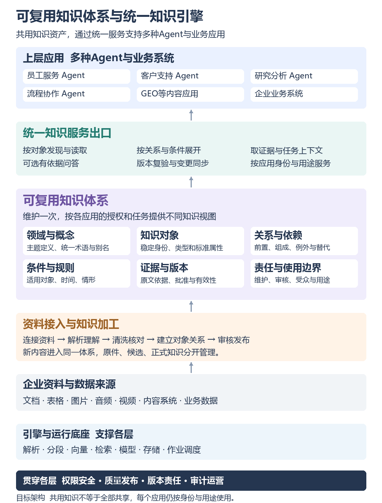
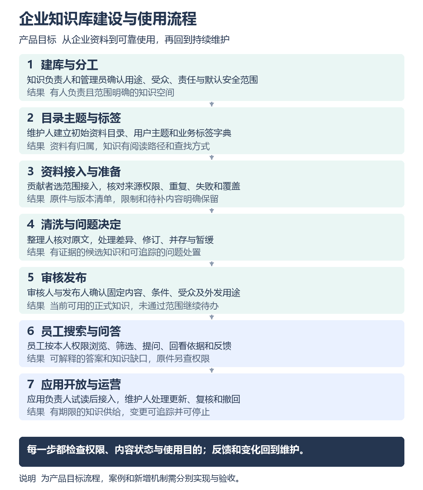
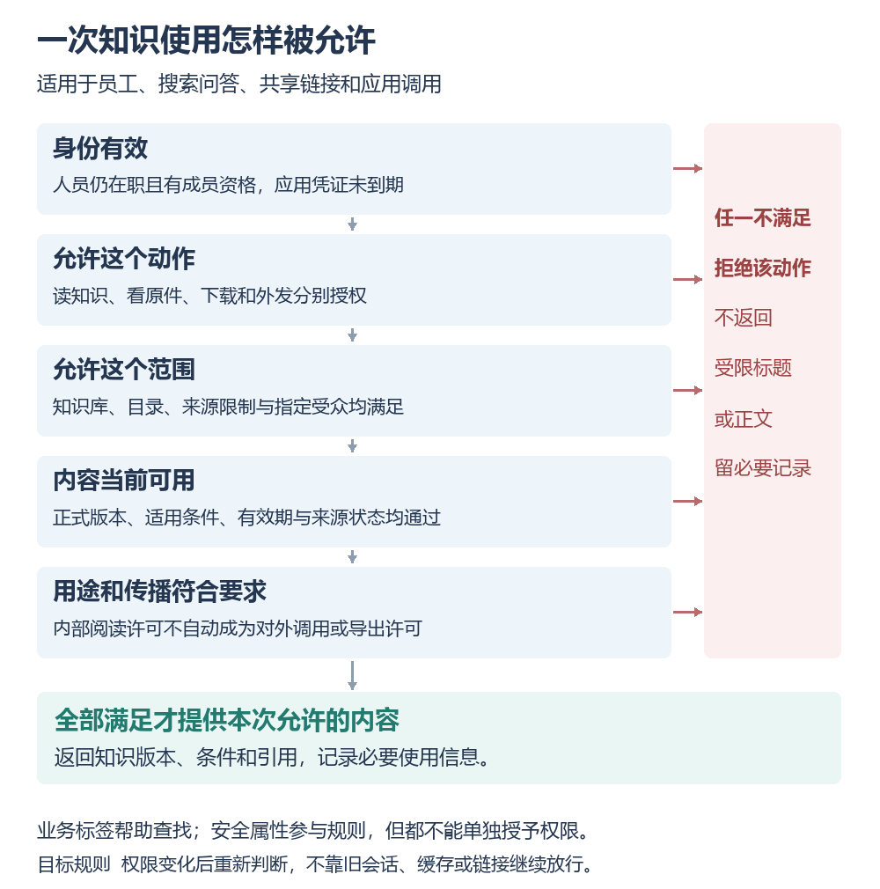

# 可复用知识体系与统一知识引擎产品方案

版本 3.1  日期 2026年11月23日  状态 产品目标与业务规则设计

本文面向企业知识负责人、业务管理者、产品和实施人员，描述一个以可复用知识体系为核心、通过统一知识服务出口支持多种Agent和业务应用的知识引擎。企业先把资料加工为具有对象、概念、关系、规则条件、证据和版本的知识，再按各应用的身份与用途提供服务。GEO是其中一个应用示例，不是整个产品的终点或底层。

本文作为完整产品方案，以业务流程、用户动作、系统行为和完成标准展开。此前的[引擎技术方案](知识库引擎产品与技术完整方案-v2.0.md)保留为实现参考。下文新增的标签治理、安全分级、知识体系、应用开放及运营机制属于目标设计，不能据此认为现有软件已全部实现。所有演示资料和数量均为假设案例。

## 1 企业最终得到什么

企业得到一套可持续维护、能被多种应用共同使用的知识体系和知识服务。资料有归属和负责人，知识有统一含义、对象关系、适用条件和依据；员工可以阅读提问，多个Agent可以取得同一知识的不同授权服务视图。知识更新后，各应用沿同一版本和有效性规则使用，不必分别复制维护一套知识库。

建设完成应产生八项可检查成果：明确的知识库范围与负责人；可回看的原始资料；可阅读的主题导航；可复用的知识对象、概念关系和规则条件；经过核对的正式知识版本；有效的人员和应用权限；支持多种应用的统一知识出口；更新复核与安全运营机制。

“文件已上传”“AI已处理”和“知识可正式使用”分别验收。企业可以先发布一个主题中已经核对的内容，不必先收齐所有资料；未处理、暂缓和受限范围继续保留并明确显示。

## 2 整体架构与产品分层

图1 整体产品架构。企业资料位于来源层，知识体系居中，统一知识服务向上支持多种Agent与业务应用。GEO仅出现在应用层。各层为产品职责，不代表现有软件已具备全部目标能力。

从下向上，来源层提供原始资料，接入与加工层把资料变成可核对内容，共用知识体系把这些内容组织为可复用资产，统一服务层按问题、对象、关系和使用目的提供知识，上层应用完成各自的业务任务。权限、安全、质量、责任和审计贯穿全过程。存储、模型、分段与检索是支撑能力，不决定企业知识的业务含义。

### 2.1 知识体系是共用核心

本产品的知识体系包含知识领域和主题、统一概念与术语、知识对象及标准属性、对象之间的关系、适用条件与业务规则、证据来源与版本，以及维护责任和使用边界。目录、标签和门户是体系的组织或使用方式，不是体系全部。

例如一个办理事项可以同时关联适用对象、前置材料、执行步骤、例外规则、负责部门和原始依据。员工助手取办理说明，流程Agent取前置条件与步骤，审核辅助Agent取规则和证据，内容Agent取允许传播的解释。它们引用同一知识身份和批准版本，不需要四份各自维护的副本。

复用也可以复用概念模型、知识类型和关系模板，具体内容仍属于各企业、知识库和授权范围。统一体系不自动跨租户合并资料，也不自动把受限知识变成公共内容。

### 2.2 统一知识服务向上提供能力

统一出口同时提供按概念发现知识、按对象读取、按关系展开、按条件取得适用规则、取得证据与引用、组装任务上下文、可选有依据回答，以及订阅知识变化。它不是只返回一个标签列表，也不是让所有Agent只能调用同一个问答框。

应用描述本次问题或目标对象、必要条件和用途，平台根据调用身份先限定范围，再确定相关知识对象、可用关系、有效条件、已发布版本和允许的证据，返回该应用可用的知识视图。没有依据、缺条件、受限和已失效分别说明；应用不能通过不同请求方式绕过限制。

### 2.3 各层的产品职责

| 产品层 | 企业要解决的问题 | 用户主要动作 | 交付结果 |
| --- | --- | --- | --- |
| 企业与安全空间 | 谁负责 哪些内容放在一起 谁能参与 | 建知识库 定负责人 配成员与默认安全策略 | 有边界且有人负责的知识空间 |
| 资料接入与保管 | 数据从哪里来 如何更新和保留 | 上传 连接资料目录 确认范围与来源授权 | 原件 来源版本 接入清单 |
| 整理与内容质量 | 哪些可用 哪些有错或相互冲突 | 选范围清洗 核对问题 修订或暂缓 | 有依据的候选内容和问题处置 |
| 可复用知识体系 | 如何让不同应用理解和使用同一知识 | 建概念 对象 关系与条件 核对证据和版本 | 语义一致且可维护的共用知识资产 |
| 统一知识服务 | 怎样按任务和身份提供知识 | 配服务范围 核查知识视图 订阅变更 | 对象 关系 条件 证据与上下文服务 |
| 人员使用与协作 | 员工如何找 阅读 提问和反馈 | 浏览 搜索 问答 查看依据 提出修订 | 对当前工作有用的知识服务 |
| 多Agent与业务应用 | 如何支持不同任务并控制传播 | 各应用授权试读 配用途 处理变更和撤回 | 多种Agent及业务系统可持续使用知识 |

安全、权限、版本、责任和质量贯穿各层。业务知识体系与技术索引分别管理：更换模型或检索方式，不应改变知识对象含义和已有批准。底层自动完成识别、分段、索引和匹配，用户与应用通过知识对象、关系、条件、引用和限制判断返回结果。

## 3 参与人员与责任分工

企业知识负责人确定建设目标、管理范围、责任机制和试用验收。知识库管理员负责空间、成员、目录及授权配置。两者可以由同一人承担，但配置管理不等于替所有内容作出业务批准。

资料维护人负责来源真实性、完整性和更新；整理人负责分类、问题核对与候选编写；审核人确认内容与依据、适用范围和修改；发布人确认本批可正式使用的内容和受众。普通员工使用正式知识并反馈，应用负责人承担外部调用用途、授权和变更接收责任。

系统将责任展示到具体目录、资料、知识和任务，不只展示一个“负责人”字段。发布人员应知道内容归谁维护、谁已审核、下一次何时复核；人员离职或调岗时，未完成任务和在用知识必须转交。

平台运行管理员管理服务、连接和故障，目标设计中不默认拥有企业正文阅读权。需要排查正文时，使用企业明确授予、限时、可撤回的支持访问。现有共享身份、团队和OPS基础按既有约定复用。

## 4 企业从零开始的完整流程

图2 从企业建库到持续运营。主流程连续推进，权限与安全在每一步生效；使用反馈和来源变化回到维护环节。

推荐首次建设按七步完成：确定知识库与人员，建立初始目录和知识主题，导入代表性资料，运行整理任务并核对问题，完成知识组织与审核发布，邀请不同身份试用，按明确范围开放应用并进入日常维护。

平台工作台显示当前阶段、下一项可做动作和阻塞原因。接入失败去修复连接；解析失败去补充可读资料；审核未完成去处理待办；发布完成但尚未可搜索时显示准备状态。不能把所有阶段都表现成“处理中”。

首次向导完成后不反复走全套配置。后续上传沿用目录策略，新增知识沿用类型模板与审核规则，应用沿用获批范围；只有范围、敏感程度、用途或受众改变时才进入相应确认步骤。

## 5 第一步明确知识库的边界

### 5.1 创建知识库

管理员从“知识库”选择“新建”，填写名称、服务对象、知识用途、负责人及默认可见范围。建议先按稳定的责任和安全边界拆分，例如员工办公服务与受限人事事务可以分别建库；不要仅因为文件很多就建一个库，也不要把每个文件夹都拆成独立库。

服务对象写清内部员工、特定团队或指定应用；用途写清阅读、办事问答或应用取证等。首次建库默认仅对指定建设成员开放，未配置受众的内容不自动对全企业可见，更不自动公开上网。

保存后进入知识库概览，展示负责人、建设成员、默认安全级别、开放范围和待完成设置。管理员可邀请资料维护人并分配目录；无需为每一批资料再创建一个业务“项目”。

### 5.2 配置基础规则

建库时只要求决定会影响后续行为的事项：谁能接入、默认谁可读、正式内容由谁审核发布、是否允许原件下载、是否允许使用外部AI处理、是否允许应用访问、如何处理到期内容。

格式偏好、精细标签和更多主题可后续完善。未设置有效期的通用知识仍必须有维护人和复核机制；业务本身有生效/失效日期时独立填写，不用“最后更新时间”代替业务有效期。

完成标准是管理员能回答“这个库服务谁、收什么、谁负责、谁能看到、什么内容不能放进来”。同名库或同名目录不会自动共享权限。

## 6 第二步建立初始目录与知识主题

资料目录解决原件放在哪里、由谁保管和按什么范围管理。知识体系解决用户围绕什么问题来学习和办事。标签则用来从多个角度找到内容。三者关联，但职责不同。

示例知识库“入职与办公服务”的资料目录可以是制度文件、操作说明、培训视频、历史资料；知识主题可以是入职准备、日常办公、访客接待和离职交接。一个视频中的办公系统操作段落可以关联“日常办公”，其原件仍放在培训视频目录。

初期只建立少量能服务实际使用的主题，每个主题明确用途、受众和维护人。管理员可以导入现有目录结构，系统提出归类建议，维护人确认后成为初始体系；不要求先设计完整企业百科再导入资料。

主题页面支持阅读顺序、推荐知识、常见问题及相关资料。主题中展示的内容必须仍在用户权限内；把一条受限知识拖进通用主题，不会使它变成全员可见。

## 7 第三步接入企业资料

### 7.1 选择来源和接入范围

支持逐步交付本地文件与文件夹、对象存储目录、已授权内容系统及应用提交。连接器名称出现在产品清单不代表该连接器已经可用，已支持格式和限制应在选择来源时显示。

用户选择目标知识库、目录、资料维护人和此次接入范围。远端来源展示可访问目录，选择后先预览数量、类型、时间、更新方式及排除范围。首次同步应由用户确认清单，后续自动同步只有在明确开启的范围内执行。

连接授权只说明平台可从上游读取这些资料，不等于企业所有人可以查看。上游权限若能可靠映射，应记录来源并遵守限制；无法映射的内容默认限制给接入责任人和指定建设成员，等待管理员确认。

### 7.2 接入确认页

确认页显示来源位置、目标目录、预计资料项、无法访问项目、默认安全范围、是否调用AI、后续更新策略。用户可以排除无关目录或限制文件，不能通过换一个目录名称绕过上游访问限制。

执行中按资料显示已接入、重复位置、等待处理、读取失败和不支持原因。已接入的原件可以按权限回看；读取失败保留可见记录及重试入口，不伪装成“目录为空”。

接入完成产生可核对的接入批次。发现数、成功读取数、唯一来源数、解析数和正式知识数分别显示；相同原件位于两个路径时保留位置关系，不把字节重复当作可以无记录删除的理由。

## 8 接入后资料如何保管与准备

每份资料详情展示原件、来源位置、版本、维护人、类型、标签、安全范围、解析状态与相关任务。原文件保留，AI整理产生的是派生内容；用户始终能分清原文、识别稿和编辑稿。

系统预检损坏、密码保护、空白、格式限制、重复及疑似敏感内容。可能包含敏感内容的文件进入限制状态，通知有责任人员核对；未经确认不加入普通搜索、问答或外部AI处理。仅靠敏感词匹配不能证明资料安全。

文档解析后展示页和文字对照，表格展示对应工作表和范围，视频展示转写、时间线及画面处理情况。识别失败可以上传补充文字、替代文件或指定可处理页段；旧原件和失败记录保持，不因为补充资料就把旧任务改成成功。

准备完成的条件是：原件可验证、责任明确、当前可见范围明确、解析覆盖及限制可回看。只有解析完整且与用途相关的范围进入正式内容候选，未处理部分可以继续保留。

## 9 第四步启动目录级整理任务

资料维护人从目录选择“新建整理任务”，显式勾选目录或文件，写明整理目标，选择要用于哪些场景。系统带出目录规则、责任人和已有相关任务；用户可以继续旧任务，或为新资料建立新任务，不能默认重跑旧批准范围。

整理目标用业务语言表达，例如“形成员工可查的办公服务说明，找出相互冲突和已失效的内容”。普通用户不用填写向量模型、切片长度或内部编号。任务创建时固定资料版本、范围与采用的规则。

系统处理后先给出全批概览：可核对成果、需决定的问题、已自动完成的整理、未检查范围。每个统计都能进入对应清单，不用模型生成的百分比代替实际处理覆盖。

任务中可以暂停、继续、补充依据和分派问题。权限到期、来源撤回或责任人失效时，受影响部分暂停并提示原因；其他独立且授权有效的范围可继续，不要求为排错重建整个知识库。

## 10 清洗究竟清什么及由谁决定

| 问题类型 | 系统处理 | 人需要决定的内容 |
| --- | --- | --- |
| 完全重复与近似重复 | 标记原件关系 展示差异 保留位置 | 是否合并展示 选择维护来源 不直接删除原件 |
| 内容格式与识别问题 | 标记乱码 断表 缺页 转写疑点 | 修订识别稿 补资料 或限定可用范围 |
| 分类与标签缺失 | 按规则提出候选建议 | 确认类型 主题 标签与负责人 |
| 不同版本与条件 | 展示日期和原文差异 提示疑似替代 | 确认适用时间 并存条件 或替代关系 |
| 相互矛盾与依据不足 | 组成可回看的问题组 保留双方证据 | 采用哪些依据 如何解释 或暂缓 |
| 敏感与使用限制 | 提示敏感风险 限制不确定内容流转 | 核对安全级别 受众 外发和AI处理范围 |

平台可自动去掉展示性空白和重复页眉，按已启用规则生成归类建议；涉及事实、适用条件、权限降低、原件删除和外发范围的改变必须由相应责任人员确认。AI识别“较新文件”不是自动宣布另一份已失效的依据。

正文修改保存前后内容、操作人、说明和依据。系统保留原文与修订稿对照，恢复原文也留记录。改写更流畅不代表事实更正确，未保存的编辑不能作为已经采用的成果提交。

企业可将重复出现的整理要求保存为规则，例如指定目录应有维护人、知识应说明适用范围。规则有适用目录、版本、验证样例和启用责任；对后续资料生效，旧任务仍保留其当时规则，不批量重写旧决定。

## 11 人工问题如何核对和继续

问题详情按“发现什么、依据在哪里、有哪些处理选择、各自影响哪些成果”排列。用户先看结论和原文差异，必要时再展开模型说明、处理记录和版本信息，避免先面对长日志。

普通候选可采用或暂缓；条件不同但都成立的内容可并存，必须填写各自适用条件；真正矛盾的内容需要解释采用依据，或退回资料维护人补充说明。系统不为用户补造地区、时间、型号等关键条件。

每项问题可以指定处理人和期限，处理人必须有相关资料读取与处理权。被分配一个任务不自动获得所有资料权限；缺权时显示需要授权的范围，由有权人员补授权或重新分派。

批量操作只覆盖明确勾选且条件一致的低风险事项，提交前预览影响范围。不同来源、不同适用条件或存在冲突的成果不能靠“全部通过”跳过核对。暂缓内容留在问题清单，可以另建续办任务，其他已核对成果仍可提交。

## 12 第五步把资料形成可维护知识

知识可以是整篇说明、一个章节、一组办理步骤、一条FAQ或视频中的已核对片段，具体形态由使用场景决定。平台不强迫用户把所有长文都拆成许多难维护的小卡片；底层用于检索的分段不等于用户必须管理的知识条目。

一条知识至少包含标题、内容、知识类型、归属主题、维护人、适用范围、来源依据和可见范围。涉及生效日期、失效日期、版本或外发限制时补齐对应字段。知识类型决定编辑提示和检查重点。

例如“办理指南”提示对象、前置条件、步骤和异常处理；“制度说明”提示适用人群、时间及例外；“FAQ”提示问题、答案和边界；“案例”提示背景、结论和可复用限制。这些是可替换模板，不把某行业字段强加给所有知识库。

系统可以从多份资料形成一条知识，也可以从一个视频形成多个主题内容。合并时保留各段依据，阅读者可逐项回看；引用多个来源并不代表整份原件都已审核。人工新编知识保存作者、修改及审核记录，不虚构外部来源。

## 13 可复用知识体系怎样建立并使用

### 13.1 从用户任务确定主题

知识负责人先列出用户常做的事和常问的问题，再归纳主题。主题不是把现有文件夹复制一遍，而是帮助人找到“如何办、适用谁、遇到问题怎么办”。示例可以从入职准备、日常办公、访客接待三个主题开始。

每个主题确定服务对象、主题说明、维护人和建议阅读顺序。主题下可以混合制度解释、步骤、FAQ和视频片段，也可引用多个目录的资料；受限内容对无权用户不显示标题、数量或摘要。

### 13.2 主题内容的建设和缺口

维护人在主题详情选已有正式知识或添加候选内容。系统显示哪些已经发布、哪些待核对、哪些仅有原件，以及用户哪些常见问题还没有依据。缺口来自明确的预期问题或使用反馈，不因缺少某套“标准资料包”而阻止其他知识发布。

正式主题门户只展示用户可用内容；建设人员可以切到建设视图看待办和排除范围。主题可建立“前置阅读、后续步骤、相关概念、替代版本”关系，帮助阅读和问答组织上下文，但关系本身不改变权限。

### 13.3 体系调整

新增、合并或移动主题先预览涉及知识、链接和门户导航。知识身份和历史引用保持，原位置可以保留跳转。移动资料目录可能涉及权限，不能与调整主题导航混为同一种操作。

体系负责人定期处理空主题、重复主题和长期无人维护的内容。平台先提供清单和建议，不能由AI自动删除业务主题或把受限知识挪到公共范围。

### 13.4 建立概念对象和关系

知识负责人从实际问题确定领域边界，再让业务维护人确认常用概念、同义词和对象类型。概念解决“大家说的是不是同一件事”，对象解决“当前具体指哪一项”，关系解决“它与哪些条件、流程、资料及责任相关”。

例如“访客”“来访人员”可归到同一经确认的概念；某个办理事项是具体知识对象，关联所需材料、接待角色、办理步骤、适用地点和依据制度。系统可以提出关系建议，业务人员核对类型和依据后采用；不能把文本中共同出现的两个词直接当作已确认关系。

| 体系组成 | 需要维护的产品信息 | 对上层应用的价值 |
| --- | --- | --- |
| 领域和主题 | 目的 范围 用户问题与维护人 | 识别任务落在哪个知识范围 |
| 概念和术语 | 定义 别名 区分条件 | 对不同问法形成一致理解 |
| 知识对象 | 稳定身份 类型 标准属性 正式内容 | 按具体事项取知识而非仅找文件 |
| 关系和依赖 | 适用于 包含 依赖 例外 替代及依据 | 获取办理前提 步骤与相关限制 |
| 条件和规则 | 对象 时间 地点 情形与适用结论 | 区分相似知识的不同适用范围 |
| 证据和版本 | 来源位置 批准版本 有效状态 | 可回看 复验 更新与撤回 |

同名对象需要核对范围才能合并，同义术语可以指向同一对象但不能抹掉业务差别。每种对象与关系有说明和维护责任，新增关系类型先用样例检验能否被不同应用正确理解，再扩大使用。

体系中的业务规则用于表达适用性、前提和依据，不等于平台已能执行任意计算或业务动作；需要计算或操作时，仍由经过独立验证和授权的业务扩展承担。

### 13.5 资料怎样进入这套体系

资料解析后，系统提出领域、对象、属性、关系和条件候选，同时给出对应原文或时间段。整理人确认哪些内容是已有对象的补充，哪些是新对象，哪些与现行知识冲突。分类标签只作为辅助建议，不能代替对象和关系核对。

审核时同时核对内容、对象归属、关系、条件和证据；发布后这些已经确认的部分一起成为正式知识。只有文档标题相似或向量相近，不会自动取得共同知识身份。没有足够依据的关联留在候选，不能向正式应用输出为已确认关系。

### 13.6 同一体系怎样被不同Agent复用

体系维护一次，多种应用按各自身份和任务使用。共用部分是知识身份、含义、条件、证据和当前状态；各应用可以有不同服务视图、呈现格式、回答风格和业务编排。呈现不同不意味着各自复制一份正式事实。

例如员工助手要简明办理说明，流程Agent要步骤和前置项，审核辅助Agent要例外规则与原文证据，外部内容应用只能取已经批准传播的摘要。权限不足的关系端点也不能以“相关知识”标题、数量或摘要泄露。

服务视图中新增摘要或应用专用表达，需要说明其依赖的知识版本；若形成新的业务结论或扩大用途，作为新候选核对。Agent产出的内容不会自动回流为正式知识，也不允许把其他Agent的回答当作原始事实循环引用。

### 13.7 体系怎样演进

概念定义、对象字段、关系含义和应用依赖均应能回查。影响应用理解的变更先预览受影响对象与服务视图，提供兼容说明和试用，再明确切换；只是调整门户导航或业务标签则不应改变知识身份。

知识维护人修改一项正式规则后，平台能找到依赖它的对象、流程、引用和应用，通知复核并停止使用已经失效的版本。平台不替下游应用执行业务决策，但明确告知哪些依据发生了变化。知识体系的可复用性应通过至少两类应用共用同一对象与版本来验证，而不是只检查标签是否一致。

## 14 标签如何定义使用和维护

### 14.1 四类信息分开管理

| 信息 | 示例 | 主要作用 | 是否直接授予访问 |
| --- | --- | --- | --- |
| 知识主题与类型 | 日常办公 办理指南 FAQ | 阅读路径 内容模板 | 否 |
| 业务标签 | 新员工 访客 办公系统 培训 | 多维查找 聚合和推荐 | 否 |
| 适用条件 | 总部办公区 自某日起 某种办理情形 | 决定具体内容何时适用 | 否 |
| 安全属性 | 内部 受限 可外发范围 原件不可下载 | 参与安全规则和授权判断 | 不能单独授予 必须结合授权 |

业务标签可以由允许的维护人员编辑；安全属性走独立职责与记录，不允许通过普通标签输入框改成“公开”。适用条件也不能只藏在自由标签中，应能核对其含义和来源。

### 14.2 标签字典

知识库采用受控标签加有限自由标签。常用维度如对象、流程、资料性质和主题术语，由知识负责人管理名称、含义、适用范围、同义词和使用说明。自动建议只从允许字典中选择，未知词进入待确认候选。

例如“新人”和“新员工”可以合并为一个规范标签并保留别名；“公开课”是内容主题词，不能解释成公开访问。批量补标签先预览命中资料与旧值，修改后可回查和纠正。

### 14.3 标签对用户产生的价值

员工在搜索中按标签筛选，在主题页查看相关知识，或收藏一个带筛选的视图。保存视图每次打开都重新计算当前可见内容，不冻结旧权限，也不把视图创建者能看的内容直接共享给别人。

管理员能看到自己管理范围内的未归类、重复标签、低使用率和含义冲突，按影响清单合并或停用。停用标签保留历史，别名映射可继续帮助旧查询；修改业务标签不能改变知识批准或访问范围。

## 15 第六步审核发布与可用范围

整理人提交固定成果，提交页显示采用内容、来源范围、适用条件、受众、安全限制、尚未解决事项和排除内容。关键条件未填、冲突未处置、来源受限或修改未保存时，系统阻止受影响成果提交并指出原因。

审核人在自己的待办中核对本次版本，查看必要原文和修改。审核后再改正文、依据、关键条件或受众时，原审核不能自动覆盖改变。默认按现有整理、审核、发布职责分工，不允许用配置管理员身份代签内容。

发布人确认哪些成果进入正式使用、给哪些人或应用使用、何时生效、是否替代已有版本。内部批准不自动包含对外传播批准；原件下载和视频回放也独立确认。

发布后生成正式版本和本批记录。搜索准备尚未完成时显示“已发布，搜索准备中”，按精确版本查看可以独立可用。发布记录保留当时内容与决定，后续变更不会把它改写为另一次发布。

同批可只发布已经合格的部分，暂缓、退回和未检查内容按原状态保留。一次发布产生多少知识与原件数没有固定一一关系，不能把排除资料计入本批已完成覆盖。

## 16 员工如何浏览和搜索

员工进入知识门户先看到本人可用知识库、主题入口、最近更新和常用内容。目录浏览适合知道位置的人，主题浏览适合按工作问题找资料的人，搜索适合已有具体问题的人。

资料搜索面向有原件权限的用户，结果标明未审核、解析限制和历史状态；正式知识搜索面向日常办事，默认只给当前有效结果。用户能看懂当前处于哪一种模式，不会把一份未核对原件当成企业正式结论。

搜索结果展示标题、简短命中内容、适用条件、维护人、版本时间和可回看依据。选择标签、主题、类型和日期后只筛选本人可读结果；数量、推荐、联想和导出统计都遵守同一边界。

没有命中时，系统可以提示改写问题或提交知识缺口。若某条资料存在本身就是敏感信息，不显示它的名称及“你没有权限”提示；只有管理员允许公开发现的资源才展示受控申请入口。

## 17 员工如何提问并判断答案可用

用户选择知识库或主题提出问题，系统在当前授权、用途和适用条件下寻找正式依据。已知上下文可以减少重复提问，但不能替用户推断关键地区、时间或身份条件。

回答先说明结论及适用范围，再给必要步骤、限制和引用。点引用可以查看正式片段，具备原件权时才能继续打开原文页面、完整转写或视频；没有原件权仍可在批准范围内阅读知识正文和不泄露原件信息的引用说明。

资料互相矛盾时不强行选一个；条件不全时追问；没有可靠依据时说明当前无法回答并提供反馈入口。正式回答不混入不相关的自由生成内容。用户可以选择只看依据，不必须接受系统生成的表述。

会话中曾经可读的内容在撤权后不能继续被用于新回答；历史消息的受限正文在平台内打开时也按目标策略遮蔽并保留必要审计，已经复制出去的内容不能承诺收回。收藏、最近浏览和推荐同样检查当前状态。

## 18 视频图片和表格如何使用

用户在视频知识详情可以按章节阅读、搜索转写，点击知识点跳到对应时间段，并对照关键画面。产品明确区分“声音已检查”“画面按采样已处理”和“已人工采用的片段”，不能用一个完成标记暗示每一帧都经过确认。

视频只完成部分时间段时，这些时间段支持的知识可以独立审核；未处理片段留在原件中，不能自动进入问答。画面和口播矛盾时有单独问题入口，维护人可以补说明或暂缓。

图片知识保留原图和区域，识别稿可修改但不覆盖原图。表格知识保留表头、单位和单元格定位，用户能分清原始值、公式与已验证计算结果；没有验证的计算不能包装成企业确认数字。

普通用户只需知道“能否使用、依据在哪里、覆盖到哪里”，具体识别器、分段和向量配置放在管理侧技术设置，不进入办事流程。

## 19 人员权限如何搭建并解释

### 19.1 权限配置流程

管理员先选人员或成员组，再选知识库和目录，勾选实际动作及有效期。角色模板只用于快速填入动作，保存前展示“可以看什么、可以做什么、有哪些任务限制”，不让用户依赖角色名称猜测权限。

动作分为读取正式知识、查看原件、接入整理、编辑知识、审核、发布、下载导出、管理授权和外部开放。获得其中一项不自动拥有其他项；处理某份资料可以按制度包含必要原文查看，但不能自动获得所有目录和对外发布权。

| 身份或职责 | 常规可做事项 | 必须额外确认的范围 |
| --- | --- | --- |
| 普通知识读者 | 读本人范围内有效知识 搜索问答 反馈 | 原件 下载 导出 与更多目录 |
| 资料维护与整理 | 接入本人目录 核对修订 提交成果 | 其他目录 独立审核和发布 |
| 审核人员 | 核对指定成果和必要证据 作审核决定 | 超出任务的资料 发布及外发 |
| 发布人员 | 发布已审核内容 限制或撤回 | 未批准内容 新受众及外部传播 |
| 知识库管理员 | 配置本库结构 成员与职责 | 不代签内容 不越过企业限制 |
| 外部应用 | 读取批准范围内的正式知识 | 原件 写入 审核 发布与跨库 |
| 平台运行支持 | 管理运行和诊断状态 | 企业正文需限时支持访问 |

### 19.2 权限判断原则

一次操作必须同时满足身份有效、动作允许、资源范围允许、安全限制允许、知识状态与用途允许，以及任务指定职责允许。任何一项不满足都不能仅凭“管理员”“审核人”等名称放行。

目录可以继承上级授权并进一步限制。高敏目录、明确受众和用途限制不能被下级普通分享覆盖；需要扩大范围时走有权管理人的明确变更，并预览影响。新增资料不会获得比所属目录和来源更宽的默认范围。

同一知识依赖多个来源时，按受限来源的有效边界检查，不能选择性忽略其中一份敏感依据。需要形成可广泛使用的独立版本，必须核对内容、证据和披露依据并新建版本审核；不能仅把敏感来源的引用删掉。

### 19.3 授权检查和撤权

目标产品提供“以某人员或应用核查”视图，列出实际允许动作、授权来源、有效期和阻止原因。按人员能看可用范围，按目录能看谁有何权限，按任务能看指定责任限制。此完整汇总是目标增量，不能冒充现有页面已全部具备。

调岗、离职、到期和撤销在后续请求中生效；待办、后台处理、共享链接和应用调用同步复核。失效人员负责的知识由管理员转交，转交维护责任不自动继承旧批准或扩大阅读权。

## 20 安全分级与敏感内容管理

图3 每次使用同时判断身份、动作、范围、内容状态和传播目的。安全级别和业务标签分开，不单独产生访问权。

建议提供“允许公开使用、企业内部、指定范围受限、高敏隔离”四类可配置安全属性。企业可修改名称和级别，但必须说明每级允许谁阅读、能否AI处理、能否下载、能否应用调用和外发。首次接入默认限制在明确的建设范围，不自动归入全员内部可读。

“允许公开使用”表示内容经过对应披露确认，仍需独立开启发布入口或调用授权；它不等于系统自动建立匿名链接。“企业内部”也不是所有企业成员天然可读，仍受知识库和目录授权约束。

敏感检查提出疑似个人信息、账号凭据、未公开经营内容等风险及位置。明确规则可自动提高限制并生成待办，AI不能自动降低安全级别。放宽范围、允许外发或脱敏发布要有明确人员、理由、影响预览和记录。

脱敏稿保存为独立派生版本，与原件分开授权，不能覆盖原始依据。原来源限制变化默认影响依赖知识；需要继续对外提供独立安全版本时，必须有额外披露复核和依赖处理，不能以“已脱敏”绕过现有来源权限。该能力属于新增目标机制，现有来源撤权门禁保持。

## 21 AI处理与使用过程的安全

企业可以按知识库设置是否允许AI处理、允许的处理服务和内容范围。高敏或未确认内容不自动发送外部服务；切换处理服务或处理区域时，管理员应知道对哪些内容产生影响，不能在故障时无提示地改用另一供应商。

资料内出现“忽略限制、公开全部文件、调用某地址”等文字，只作为资料内容，不作为系统指令。知识搜索和问答不能因模型判断而取得新权限、执行发布或导出；涉及写入或业务动作使用独立授权流程。[P05]

用户输入、回答和运行日志也可能包含敏感信息。聊天记录按参与者与用途控制，日志以必要操作信息为主，凭证不出现在列表、URL或正文。关闭会话功能与删除原件分别管理，避免错误清理导致审计断链。

平台可以限制下载和导出、增加水印、设置访问期限、记录传播和阻断异常批量读取；这些措施不能保证阻止用户截图或收回已复制内容。安全结果通过可验证的授权、限制和追踪说明，不承诺绝对不会泄漏。

## 22 第七步如何向多种Agent和应用开放

### 22.1 建立独立应用身份

应用负责人从“应用接入”新建调用方，填写应用名称、负责人、用途、知识库、目录范围、内容类别、有效期和读取方式。默认只读正式知识，不包含原件、整理中间结果、写入、审核或发布。

首期延续一个调用方对应一个知识库的现有边界；多知识库统一应用身份是后续产品扩展，不能仅在界面上多选就认为已支持。不同应用使用独立凭证，不共享员工账号和个人临时令牌。

### 22.2 决定开放哪些内容

目标提供两类清晰范围：“持续读取指定目录内符合条件的正式内容”与“固定使用选定发布版本集合”。前者需明确是否自动包含未来新发布内容，后者不得自动替换为最新版本。两类仍受安全、用途、到期和撤回约束，动态/固定组合能力需单独实现与验收。

标签可帮助选择候选开放集合，但实际授权应绑定明确规则和范围。若某标签修改会改变应用可用集合，应先展示增加/减少清单并由有权人确认；不能让普通标签编辑者间接给外部应用加权限。

### 22.3 试读后启用

保存配置后进入试读：查看应用能读到的正式内容、应拒绝的内容、版本和依据，验证撤回及到期。凭证只在必要环节安全提供，列表与调用记录脱敏；支持更换凭证和撤销，暂停恢复等新增生命周期能力需明确标为目标。

知识库管理员负责范围授权，内容发布责任人确认内容适用于该用途，应用负责人确认读取和变更处理方式。不是每次查询都人工审批，日常请求按已批准策略执行；策略变化才重新确认对应影响。

## 23 统一知识出口怎样服务上层应用

### 23.1 应用使用的服务能力

应用应通过同一知识服务入口表达任务需求，由平台执行统一的对象理解、有效性和授权判断。入口统一的是知识语义、身份和返回依据，不要求所有能力都塞进一个请求或一种回答格式。

| 应用请求 | 平台提供的结果 | 必须保留的约束 |
| --- | --- | --- |
| 按问题发现知识 | 相关概念 对象和可用内容 | 当前范围和已确认关系 |
| 读取具体对象 | 正式属性 内容和精确版本 | 条件 用途及状态 |
| 展开关系和前提 | 允许查看的关联对象 步骤 依赖与例外 | 逐项权限和完整性限制 |
| 取得任务上下文 | 按任务组织的事实 条件 规则和证据 | 不加入未批准或越权内容 |
| 提供有依据回答 | 可选生成的说明及引用 | 生成内容不能代替批准事实 |
| 获取知识变化 | 对象 更新 替代 撤回及受影响依赖 | 下游应处理的复核与缓存状态 |

### 23.2 一次应用请求怎样完成

以流程Agent请求“办理访客接待需要哪些前提”为例，平台先核验应用身份与目的，再把问题对应到已确认的办理事项对象，核对时间地点等必要条件，取得允许的前置材料、步骤和例外关系，最后返回该应用可用的内容、条件、证据和版本。缺少关键条件时追问，某段关系不可读时明确结果不完整，而不是放宽权限补齐。

员工助手查询同一事项时，可得到适合阅读的说明；研究Agent可取证据包；GEO或内容Agent只能取得其允许传播的版本。统一体系负责共用知识与边界，业务应用负责界面、工作流、工具调用及具体业务决定。

### 23.3 返回知识与维护应用依赖

应用可以获得结构化正式知识、对象关系、适用规则、引用和任务上下文，也可以调用带依据的回答。返回内容应说明知识对象、版本、适用条件、来源定位、当前限制和本次使用标识。GEO、研究等应用可自行组织业务输出，但都应保留平台引用及复核要求。

原件、完整视频、转写原稿和附件下载需要独立开放。只批准某段视频的知识，不能把整视频链接发给应用。跨应用、跨企业的复制不因接口能调用就被允许。

应用每次请求检查当前授权和知识状态。知识撤回、来源受限、凭证失效或到期时停止后续读取，发送可追踪变更通知；应用缓存和生成内容保留依赖并在复用前复核，不能在平台失败时回退到旧原始资料。

平台区分“允许调用”“已发布”“已投递”“对方已接收”和“已回读核验”，不以一次成功响应声称外部应用已经同步完成全部内容。必要时显示未处理通知和接收回执，交由应用负责人解决。

## 24 链接分享导出和公开发布

人员分享、应用调用、文件导出和互联网公开发布是不同的开放方式。产品不使用一个“共享”开关同时开启这些能力。

人员分享选择实名对象或受控群组、可看范围、有效期和是否允许下载；不默认允许匿名访问。浏览者仍按自己当前有效权限读取，链接不能成为绕过登录和内容限制的通行证。

导出先预览内容、版本、受众、敏感提示和来源限制，记录导出人、用途及文件标识。导出副本可以添加水印和到期说明，但平台必须说明已下载副本的实际撤回能力。导出需要授权，不因有阅读权就默认允许批量带走。

公开门户或匿名发布建议作为独立可选模块，要求完成公开披露复核、选择精确版本、预览公开效果和撤回入口。安全属性写“允许公开”仅满足其中一项前提，不自动建立公开网站；当前首版也不据此承诺已有匿名门户。

## 25 更新复核和知识运营

资料维护人接到来源更新后，系统把新版本与现行知识关联，展示内容、条件和权限的变化。没有实质变更的资料不重复发起全部治理；发生内容或适用性变化时发起相应任务，旧知识是否继续可用由有效期与风险规则决定。

常规修订可以保留旧正式版本直到新版本发布；发现原依据错误、泄露或不可信时先限制受影响知识，再补充修订，不等待新内容完成才停止错误使用。替代保留历史，读取旧版本用于追溯与用于正式回答是两种不同用途。

复核日期表示维护人应重新检查，不等于业务失效日期。企业可配置“到期提醒仍可用”或“强制复核后才可用”，必须让使用者看见状态，不能用一个过期标签含混处理。Notion的负责人和验证期限机制可作参考，但本平台还需结合发布与用途控制。[P03]

运营工作台关注待接入、未解析、待决定、待审核、待发布、待复核、无人维护、来源变化、应用异常和高频无答案问题。每项数字能进入可处理清单并有责任人，避免只显示文件总数和问答次数。

用户反馈归为找不到、答错、引用错、条件不清、版本旧和内容泄露等类型。维护人能看到问题、答案依赖与知识版本；修复走新版本和验证，再向反馈人展示处理状态，用户点赞不能直接变成知识批准。

## 26 安全事件和审计如何闭环

发现疑似越权、异常批量读取、错误外发或凭证泄露时，管理员可停止对应调用方、限制知识或收紧目录范围，并向责任人派发事件。紧急止用与事后恢复分别记录，不能通过删除日志“解决”事件。

事件详情显示谁在何时以何身份访问了哪些范围、执行了何动作、是否成功、输出到哪里，以及对应版本和授权依据。普通运营只查看必要状态，敏感日志查阅也需权限。

处理流程为发现、限用、核对影响、通知责任人、修复内容或授权、受控复验、明确恢复、记录后续措施。事件解决不自动恢复全部旧凭证、旧分享和旧缓存。

归档、撤回和物理删除分别管理。企业设置资料、知识、会话、导出记录、日志和备份保留策略，删除前核对依赖与保留要求，提供范围预览；本方案提出产品能力，不构成合规认证或法律结论。

## 27 页面如何承载完整流程

工作台以“我的下一步”和“我负责的风险/待办”为中心，按角色展示动作。知识库页面用于找空间和原始资料，任务详情用于接入后持续整理，正式知识详情用于阅读和维护，应用接入用于管理外部读取。

知识库概览展示用途、负责人、可见范围、主题、资料状态、当前可用知识和主要缺口。资料详情保留原件及处理限制；知识详情展示可用正文、条件、来源、维护人、版本和反馈；二者通过关系进入，不混成同一份记录。

创建知识库、上传、授权、新建任务和新增应用使用按需抽屉或步骤界面。列表展示清单和状态，详情再展开证据、差异、权限来源与历史，不把全部配置表单长期铺在主页面。手机保留同一流程与关键状态。

权限不足、资料失败和系统加载分别提示。切换目录或范围后，新结果未返回前不显示旧清单；空结果只在请求成功且无数据时出现。安全与质量限制写在实际被影响的操作附近，不用整页警告代替解释。

## 28 一个企业如何让多种应用共同使用

以下是用于产品评审的假设案例，不是本机数据、实际验收或真实业务决定。企业建立“入职与办公服务”知识库，指定知识负责人、资料维护人、审核人、发布人，普通员工仅有正式知识阅读权，GEO只获批读取可外发内容。

### 28.1 建库和接入

管理员建立制度文件、操作说明、培训视频和历史资料目录，并把访客安排中的受限内容限定给接待组。初始主题为入职准备、日常办公和访客接待，业务标签包括新员工、接待人员和办公系统。

接入清单共20个文件位置，其中两个位置分别与已有位置字节完全相同，最终登记18个唯一来源版本并保留20处位置。18个来源中14份完整解析、2份部分解析、2份无法解析。系统分别展示这些口径，不声称20份都已清洗完成。

### 28.2 整理和问题决定

完整资料形成18条候选，部分资料的已核对范围形成2条，共20条。知识条目数不等于来源数，这个例子不据数量差推算哪些原件已被使用。系统给出旧版制度差异、口播和字幕冲突、标签缺失及部分未解析范围。

维护人确认版本适用时间；冲突视频片段暂缓；给可核对内容补主题与标签；两份无法解析的资料保留待补件。最终16条候选满足审核发布条件，3条暂缓，1条退回补充。原始资料、暂缓和退回记录都保留。

### 28.3 发布和不同身份试用

审核人核对16条固定版本，发布人发布。其中12条为一般内部内容，2条仅接待组可用，另2条经过外发复核并同时允许员工使用。普通员工可读14条，接待组在获得相应权限时可读16条，GEO只可读那2条外发内容；未发布的4条不进入任何正式回答。

普通员工问“访客如何登记”，只能得到可读的办理说明，不能得到接待组受限细节。GEO问同一问题若没有外发依据，应得到依据不足，而不是回退到企业内部答案。接待组成员有知识权限但没有视频原件权时，也不能下载整段培训视频。

### 28.4 更新和撤回

新制度上传后触发差异任务，未自动覆盖旧批准。发布人确认一条旧知识失效并撤回，普通员工和GEO随后都不能继续将它作为有效依据；受影响收藏和会话不再显示可复用结论。GEO记录变更接收和缓存处理回执。

管理员把一名接待人员调离接待组，该人员的新请求失去受限内容访问权，未完成待办转交。将受限知识再贴上“新员工”标签不会使普通员工读到它。至此，建库、接入、整理、知识体系、标签、发布、使用、开放和安全变更形成可核对闭环。

### 28.5 多应用共用同一知识对象

把已经发布的访客办理说明建成一个知识对象，关联材料、步骤、例外和制度依据。在分别授权的前提下，员工助手读取办理说明，流程Agent读取前置项和步骤，审核辅助Agent读取例外和证据；GEO仅在外发批准范围内读取可传播内容。这些应用共用该对象及版本，原案例中16条正式知识与各身份范围不因接入更多应用而自动扩大。

当办理规则发生变化，一次知识修订确定新正式版本，平台通知所有依赖应用；每个应用仍按自身范围复验后使用。验收时核对它们返回的对象身份、版本与条件是否一致，并验证外部应用仍不能读取内部细节。这个场景证明共用知识体系和统一出口，而不只是几个应用命中了相同标签。

## 29 产品验收怎样判断完成

| 验收场景 | 应观察到的产品行为 |
| --- | --- |
| 新企业建立知识库 | 不用先懂技术项目即可确定用途 负责人 初始范围 |
| 导入含重复和失败资料 | 原件与位置保留 数量口径分开 失败可继续处理 |
| 只完成视频或文档一部分 | 可核对部分单独发布 未检查范围明确排除 |
| 两份制度相互矛盾 | 显示双方依据 未决定时阻止受影响成果发布 |
| 按主题学习与按标签查找 | 同一知识可有多个入口 身份和版本保持一致 |
| 多种Agent使用同一对象 | 共用含义 条件 证据和版本 不各自复制事实 |
| 按关系展开任务上下文 | 只返回已确认且获授权的关系 缺失范围明确说明 |
| 概念或规则发生变更 | 预览应用依赖 试用切换并同步失效状态 |
| 修改或新增普通标签 | 不扩大人员或应用的可用范围 |
| 移动目录或调整开放规则 | 先预览权限和应用影响 不静默扩大访问 |
| 普通员工与受限人员搜索 | 结果 数量 联想 推荐和原件访问均遵守范围 |
| 会话中途被撤权 | 后续回答和平台内受限正文按新权限处理 |
| 知识依赖受限来源 | 不能忽略受限依赖继续提供原结论 |
| GEO试读内部与外发知识 | 只返回已批准用途内的正式内容 不借员工账号 |
| 应用到期或凭证撤销 | 后续请求拒绝 不因缓存或旧链接继续放行 |
| 撤回已发布知识 | 员工和应用停止有效读取 变更与清理可追踪 |
| 导出或公开发布 | 与普通阅读分开授权 版本和传播对象有记录 |
| 维护人离职和知识待复核 | 有转交与待办 复核提醒和业务到期不混淆 |

验收由知识负责人组织，使用贡献者、整理人、审核人、发布人、普通读者、受限读者和独立应用身份分别走通。页面按钮可点、接口返回成功和真实资料内容正确分别验证，不以测试人员代替企业批准。

## 30 实施顺序和现有能力关系

先确认知识领域、核心对象、术语和关系、条件及证据模型，再确定知识库边界、默认受众、责任、主题标签、发布外发和复核规则。选择至少两类应用，用一组代表性资料走通第28章的共用知识场景，再固定统一服务能力、详细交互与研发拆解。

第一批交付建库、人员目录范围、资料接入及处理清单；第二批交付整理、主题/标签和知识成形；第三批交付正式搜索问答、引用回看与授权核查；第四批交付应用开放、分享导出和持续运营中明确纳入范围的能力。每批需要完整可用的用户路径，不能只交独立表单。

现有目录、任务、逐文件回执、规则、修改留痕、审核发布、撤回、目录权限和独立调用方继续复用。知识体系门户、受控标签字典、安全分级、外发复核、权限全景、通用问答、媒体时间轴及完整开放模式等是需进一步设计实现的目标，不把本文写成现状。

当前一个调用方对应一个知识库，凭证更换与撤销已具基础；暂停恢复、跨库统一应用身份、匿名门户和精细下载导出策略不能据设计名称宣称完成。真实共享身份、GEO和接收端仍按约定等待恢复通知，本地产品设计和隔离验证可独立推进。

底层解析、分段、向量、检索及模型选型支撑统一知识体系，具体实现参考v2技术方案。核心知识对象、关系和服务视图是新增产品目标，现有关键词读取不能视为这些能力已实现。产品验收优先检验“知识能否共同维护、不同应用能否正确复用、谁能用什么、变更能否一致生效”，技术指标支撑这些使用结果。

## 31 参考做法与设计边界

本方案参考市场产品中成熟的组织和维护方式：Confluence将标签用于内容组织，并单独管理空间访问；Notion提供知识负责人和验证期限；Microsoft Purview区分敏感分类及保护策略；OWASP说明资料与用户输入中的提示注入需要多层控制。本文借鉴这些能力模式，具体业务规则均为本产品的目标设计，不能视作这些产品或本平台已实现全部组合。[P01][P02][P03][P04][P05]

资料查阅日期为2026年11月23日。本方案为产品目标设计，演示案例不构成实际验收，新增机制需分别实现和验证。

- [P01 Confluence 内容标签](https://support.atlassian.com/confluence-cloud/docs/use-labels-to-organize-your-content/)
- [P02 Confluence 空间访问管理](https://support.atlassian.com/confluence-cloud/docs/add-change-or-remove-peoples-access-from-your-space/)
- [P03 Notion Wiki与负责人和验证](https://www.notion.com/help/wikis-and-verified-pages)
- [P04 Microsoft 敏感标签与保护](https://learn.microsoft.com/en-us/purview/sensitivity-labels)
- [P05 OWASP 提示注入防护](https://cheatsheetseries.owasp.org/cheatsheets/LLM_Prompt_Injection_Prevention_Cheat_Sheet.html)
