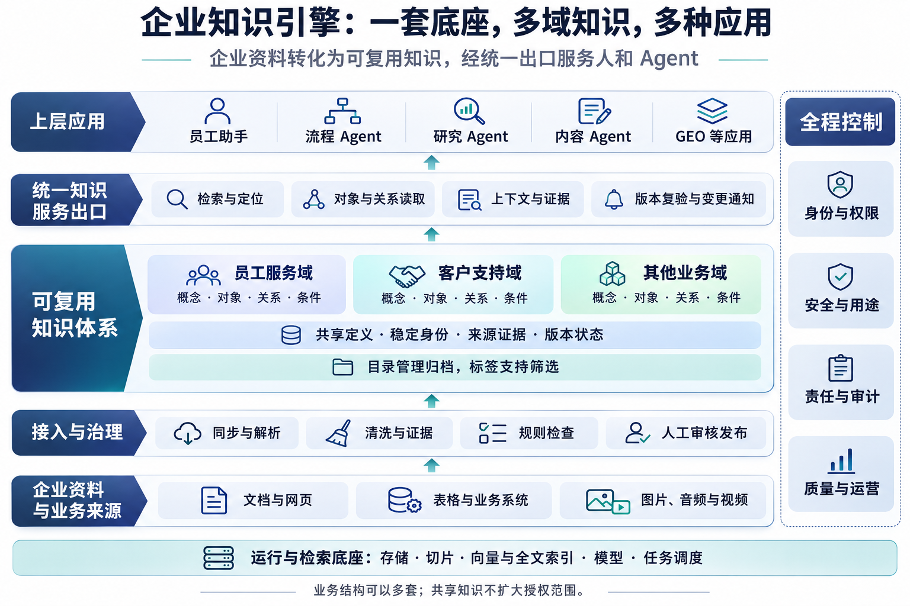
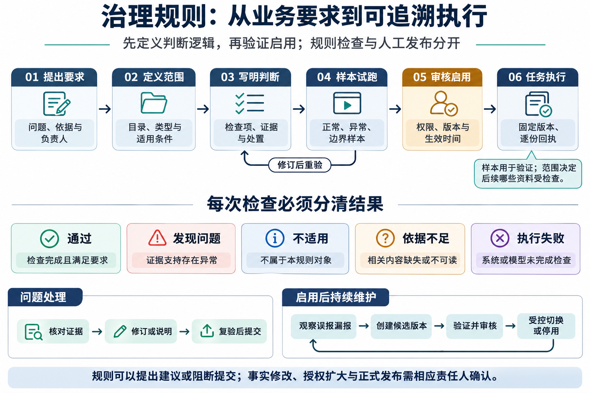
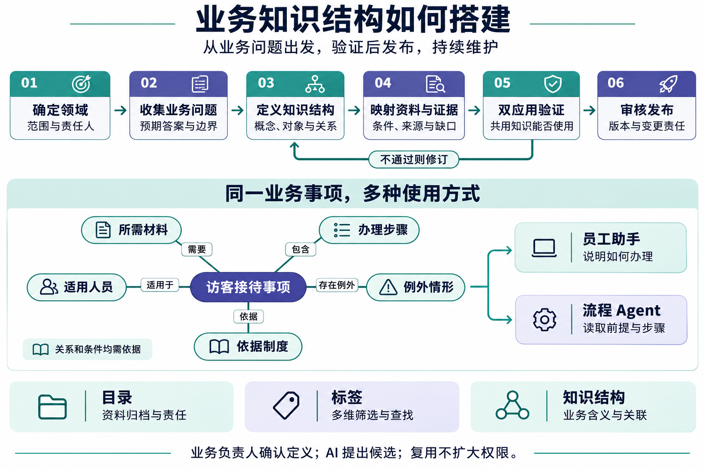
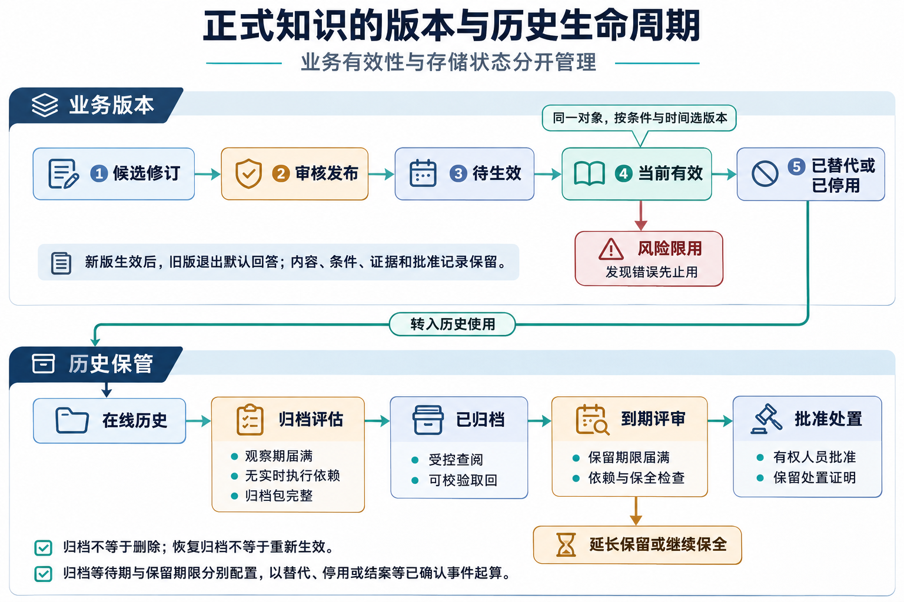

# 可复用知识体系与统一知识引擎产品方案

版本 3.4  日期 2026年11月24日  状态 产品目标与业务规则设计

本文面向企业知识负责人、业务管理者、产品和实施人员，描述一个以可复用知识体系为核心、通过统一知识服务出口支持多种Agent和业务应用的知识引擎。企业先把资料加工为具有对象、概念、关系、规则条件、证据和版本的知识，再按各应用的身份与用途提供服务。GEO是其中一个应用示例，不是整个产品的终点或底层。

本文作为完整产品方案，以业务流程、用户动作、系统行为和完成标准展开。此前的[引擎技术方案](知识库引擎产品与技术完整方案-v2.0.md)保留为实现参考。下文新增的标签治理、安全分级、知识体系、应用开放及运营机制属于目标设计，不能据此认为现有软件已全部实现。所有演示资料和数量均为假设案例。

本版进一步明确：平台采用统一底座、企业共用定义、多套业务领域知识结构和多种应用视图。统一的是知识身份、证据、版本、权限与服务合同；各领域保留业务含义、对象关系及维护责任。知识结构、知识库空间、资料目录、标签体系与应用视图分别设计，通过受控映射关联。

本轮细化业务结构从领域边界、问题清单、术语对象、关系条件到资料映射、双应用验证和版本演进的建设步骤，并完整说明治理规则的来源、创建、范围、判断、验证、启用与运营。四幅图由内置图像模型生成，文字与业务规则以本文定义为准。

本版补全正式知识随业务调整的版本生命周期、有效性选择、历史查阅、归档条件、保留计时、保全和到期处置。业务有效性与存储保管分开，归档和永久删除分别审批；第25章集中说明完整维护逻辑。

## 1 企业最终得到什么

企业得到一套可持续维护、能被多种应用共同使用的知识体系和知识服务。资料有归属和负责人，知识有统一含义、对象关系、适用条件和依据；员工可以阅读提问，多个Agent可以取得同一知识的不同授权服务视图。知识更新后，各应用沿同一版本和有效性规则使用，不必分别复制维护一套知识库。

建设完成应产生八项可检查成果：明确的知识库范围与负责人；可回看的原始资料；可阅读的主题导航；可复用的知识对象、概念关系和规则条件；经过核对的正式知识版本；有效的人员和应用权限；支持多种应用的统一知识出口；更新复核与安全运营机制。

“文件已上传”“AI已处理”和“知识可正式使用”分别验收。企业可以先发布一个主题中已经核对的内容，不必先收齐所有资料；未处理、暂缓和受限范围继续保留并明确显示。

## 2 整体架构与产品分层

图1 整体产品架构。企业资料位于来源层，知识体系居中，统一知识服务向上支持多种Agent与业务应用。GEO仅出现在应用层。各层为产品职责，不代表现有软件已具备全部目标能力。

从下向上，来源层提供原始资料，接入与加工层把资料变成可核对内容，共用知识体系把这些内容组织为可复用资产，统一服务层按问题、对象、关系和使用目的提供知识，上层应用完成各自的业务任务。权限、安全、质量、责任和审计贯穿全过程。存储、模型、分段与检索是支撑能力，不决定企业知识的业务含义。

### 2.1 知识体系是共用核心

本产品的知识体系包含知识领域和主题、统一概念与术语、知识对象及标准属性、对象之间的关系、适用条件与业务规则、证据来源与版本，以及维护责任和使用边界。目录、标签和门户是体系的组织或使用方式，不是体系全部。

例如一个办理事项可以同时关联适用对象、前置材料、执行步骤、例外规则、负责部门和原始依据。员工助手取办理说明，流程Agent取前置条件与步骤，审核辅助Agent取规则和证据，内容Agent取允许传播的解释。它们引用同一知识身份和批准版本，不需要四份各自维护的副本。

复用也可以复用概念模型、知识类型和关系模板，具体内容仍属于各企业、知识库和授权范围。统一体系不自动跨租户合并资料，也不自动把受限知识变成公共内容。

共用核心不要求全企业使用同一棵业务分类树。不同领域可以维护不同知识结构，相同事实通过稳定对象和明确映射复用。一个知识库空间可以容纳数个有明确边界的领域，一个领域也可能分布在不同安全空间；这些是目标产品能力，不改变现有按知识库隔离的权限事实。

### 2.2 统一知识服务向上提供能力

统一出口同时提供按概念发现知识、按对象读取、按关系展开、按条件取得适用规则、取得证据与引用、组装任务上下文、可选有依据回答，以及订阅知识变化。它不是只返回一个标签列表，也不是让所有Agent只能调用同一个问答框。

应用描述本次问题或目标对象、必要条件和用途，平台根据调用身份先限定范围，再确定相关知识对象、可用关系、有效条件、已发布版本和允许的证据，返回该应用可用的知识视图。没有依据、缺条件、受限和已失效分别说明；应用不能通过不同请求方式绕过限制。

### 2.3 各层的产品职责

| 产品层 | 企业要解决的问题 | 用户主要动作 | 交付结果 |
| --- | --- | --- | --- |
| 企业与安全空间 | 谁负责 哪些内容放在一起 谁能参与 | 建知识库 定负责人 配成员与默认安全策略 | 有边界且有人负责的知识空间 |
| 资料接入与保管 | 数据从哪里来 如何更新和保留 | 上传 连接资料目录 确认范围与来源授权 | 原件 来源版本 接入清单 |
| 整理与内容质量 | 哪些可用 哪些有错或相互冲突 | 选范围清洗 核对问题 修订或暂缓 | 有依据的候选内容和问题处置 |
| 可复用知识体系 | 如何让不同应用理解和使用同一知识 | 建概念 对象 关系与条件 核对证据和版本 | 语义一致且可维护的共用知识资产 |
| 统一知识服务 | 怎样按任务和身份提供知识 | 配服务范围 核查知识视图 订阅变更 | 对象 关系 条件 证据与上下文服务 |
| 人员使用与协作 | 员工如何找 阅读 提问和反馈 | 浏览 搜索 问答 查看依据 提出修订 | 对当前工作有用的知识服务 |
| 多Agent与业务应用 | 如何支持不同任务并控制传播 | 各应用授权试读 配用途 处理变更和撤回 | 多种Agent及业务系统可持续使用知识 |

安全、权限、版本、责任和质量贯穿各层。业务知识体系与技术索引分别管理：更换模型或检索方式，不应改变知识对象含义和已有批准。底层自动完成识别、分段、索引和匹配，用户与应用通过知识对象、关系、条件、引用和限制判断返回结果。

## 3 参与人员与责任分工

企业知识负责人确定建设目标、管理范围、责任机制和试用验收。知识库管理员负责空间、成员、目录及授权配置。两者可以由同一人承担，但配置管理不等于替所有内容作出业务批准。

资料维护人负责来源真实性、完整性和更新；整理人负责分类、问题核对与候选编写；审核人确认内容与依据、适用范围和修改；发布人确认本批可正式使用的内容和受众。普通员工使用正式知识并反馈，应用负责人承担外部调用用途、授权和变更接收责任。

系统将责任展示到具体目录、资料、知识和任务，不只展示一个“负责人”字段。发布人员应知道内容归谁维护、谁已审核、下一次何时复核；人员离职或调岗时，未完成任务和在用知识必须转交。

平台运行管理员管理服务、连接和故障，目标设计中不默认拥有企业正文阅读权。需要排查正文时，使用企业明确授予、限时、可撤回的支持访问。现有共享身份、团队和OPS基础按既有约定复用。

## 4 企业从零开始的完整流程

推荐首次建设按七步完成：确定知识库与人员，建立初始目录和知识主题，导入代表性资料，运行整理任务并核对问题，完成知识组织与审核发布，邀请不同身份试用，按明确范围开放应用并进入日常维护。

平台工作台显示当前阶段、下一项可做动作和阻塞原因。接入失败去修复连接；解析失败去补充可读资料；审核未完成去处理待办；发布完成但尚未可搜索时显示准备状态。不能把所有阶段都表现成“处理中”。

首次向导完成后不反复走全套配置。后续上传沿用目录策略，新增知识沿用类型模板与审核规则，应用沿用获批范围；只有范围、敏感程度、用途或受众改变时才进入相应确认步骤。

## 5 第一步明确知识库的边界

### 5.1 创建知识库

管理员从“知识库”选择“新建”，填写名称、服务对象、知识用途、负责人及默认可见范围。建议先按稳定的责任和安全边界拆分，例如员工办公服务与受限人事事务可以分别建库；不要仅因为文件很多就建一个库，也不要把每个文件夹都拆成独立库。

服务对象写清内部员工、特定团队或指定应用；用途写清阅读、办事问答或应用取证等。首次建库默认仅对指定建设成员开放，未配置受众的内容不自动对全企业可见，更不自动公开上网。

保存后进入知识库概览，展示负责人、建设成员、默认安全级别、开放范围和待完成设置。管理员可邀请资料维护人并分配目录；无需为每一批资料再创建一个业务“项目”。

### 5.2 配置基础规则

建库时只要求决定会影响后续行为的事项：谁能接入、默认谁可读、正式内容由谁审核发布、是否允许原件下载、是否允许使用外部AI处理、是否允许应用访问、如何处理到期内容。

格式偏好、精细标签和更多主题可后续完善。未设置有效期的通用知识仍必须有维护人和复核机制；业务本身有生效/失效日期时独立填写，不用“最后更新时间”代替业务有效期。

完成标准是管理员能回答“这个库服务谁、收什么、谁负责、谁能看到、什么内容不能放进来”。同名库或同名目录不会自动共享权限。

## 6 第二步建立初始目录与知识主题

资料目录解决原件放在哪里、由谁保管和按什么范围管理。知识体系解决用户围绕什么问题来学习和办事。标签则用来从多个角度找到内容。三者关联，但职责不同。

示例知识库“入职与办公服务”的资料目录可以是制度文件、操作说明、培训视频、历史资料；知识主题可以是入职准备、日常办公、访客接待和离职交接。一个视频中的办公系统操作段落可以关联“日常办公”，其原件仍放在培训视频目录。

初期只建立少量能服务实际使用的主题，每个主题明确用途、受众和维护人。管理员可以导入现有目录结构，系统提出归类建议，维护人确认后成为初始体系；不要求先设计完整企业百科再导入资料。

主题页面支持阅读顺序、推荐知识、常见问题及相关资料。主题中展示的内容必须仍在用户权限内；把一条受限知识拖进通用主题，不会使它变成全员可见。

### 6.1 分开决定业务结构和存放空间

先按业务对象、规则与责任确定知识领域，再按人员协作和安全边界安排知识库空间，最后确定资料归档目录与用户导航。不能只根据组织架构、硬盘文件夹或某个Agent名称决定业务知识结构。

例如同一员工服务领域的通用办理说明和受限人员材料可以分开保管；它们的领域概念能够关联，内容仍按不同范围授权。客服和研究两个Agent使用同一事项时，应形成各自的服务视图，而不重复新建两套事实库。

### 6.2 目录的合理使用

目录优先表达稳定的保管责任、接入范围和日常管理方式。名称由业务人员能理解的资料归属确定，层级以能管理和查找为限，不强制预设全企业统一深度。若目录同时影响授权和处理规则，调整前必须预览这两类影响。

一个资料可以保留多个真实来源位置，也可以被多个主题引用。主题引用或快捷入口不生成新的授权，不靠复制一份文件来解决跨主题使用。真实多位置资料沿既有权限核对规则处理，不能通过增加宽权限目录的位置绕过受限来源。

目录不同时承担受众、时间、地区、状态、内容类型等全部维度。把“员工服务／新员工／总部／2026／指南／已审核”塞成一条长路径，会把查询维度混成存放位置，也容易形成大量重复资料。受众等查找维度进入标签，真正影响适用性的条件进入明确字段，审核状态由流程产生。

## 7 第三步接入企业资料

### 7.1 选择来源和接入范围

支持逐步交付本地文件与文件夹、对象存储目录、已授权内容系统及应用提交。连接器名称出现在产品清单不代表该连接器已经可用，已支持格式和限制应在选择来源时显示。

用户选择目标知识库、目录、资料维护人和此次接入范围。远端来源展示可访问目录，选择后先预览数量、类型、时间、更新方式及排除范围。首次同步应由用户确认清单，后续自动同步只有在明确开启的范围内执行。

连接授权只说明平台可从上游读取这些资料，不等于企业所有人可以查看。上游权限若能可靠映射，应记录来源并遵守限制；无法映射的内容默认限制给接入责任人和指定建设成员，等待管理员确认。

### 7.2 接入确认页

确认页显示来源位置、目标目录、预计资料项、无法访问项目、默认安全范围、是否调用AI、后续更新策略。用户可以排除无关目录或限制文件，不能通过换一个目录名称绕过上游访问限制。

执行中按资料显示已接入、重复位置、等待处理、读取失败和不支持原因。已接入的原件可以按权限回看；读取失败保留可见记录及重试入口，不伪装成“目录为空”。

接入完成产生可核对的接入批次。发现数、成功读取数、唯一来源数、解析数和正式知识数分别显示；相同原件位于两个路径时保留位置关系，不把字节重复当作可以无记录删除的理由。

## 8 接入后资料如何保管与准备

每份资料详情展示原件、来源位置、版本、维护人、类型、标签、安全范围、解析状态与相关任务。原文件保留，AI整理产生的是派生内容；用户始终能分清原文、识别稿和编辑稿。

系统预检损坏、密码保护、空白、格式限制、重复及疑似敏感内容。可能包含敏感内容的文件进入限制状态，通知有责任人员核对；未经确认不加入普通搜索、问答或外部AI处理。仅靠敏感词匹配不能证明资料安全。

文档解析后展示页和文字对照，表格展示对应工作表和范围，视频展示转写、时间线及画面处理情况。识别失败可以上传补充文字、替代文件或指定可处理页段；旧原件和失败记录保持，不因为补充资料就把旧任务改成成功。

准备完成的条件是：原件可验证、责任明确、当前可见范围明确、解析覆盖及限制可回看。只有解析完整且与用途相关的范围进入正式内容候选，未处理部分可以继续保留。

## 9 第四步启动目录级整理任务

资料维护人从目录选择“新建整理任务”，显式勾选目录或文件，写明整理目标，选择要用于哪些场景。系统带出目录规则、责任人和已有相关任务；用户可以继续旧任务，或为新资料建立新任务，不能默认重跑旧批准范围。

整理目标用业务语言表达，例如“形成员工可查的办公服务说明，找出相互冲突和已失效的内容”。普通用户不用填写向量模型、切片长度或内部编号。任务创建时固定资料版本、范围与采用的规则。

系统处理后先给出全批概览：可核对成果、需决定的问题、已自动完成的整理、未检查范围。每个统计都能进入对应清单，不用模型生成的百分比代替实际处理覆盖。

任务中可以暂停、继续、补充依据和分派问题。权限到期、来源撤回或责任人失效时，受影响部分暂停并提示原因；其他独立且授权有效的范围可继续，不要求为排错重建整个知识库。

## 10 清洗究竟清什么及由谁决定

| 问题类型 | 系统处理 | 人需要决定的内容 |
| --- | --- | --- |
| 完全重复与近似重复 | 标记原件关系 展示差异 保留位置 | 是否合并展示 选择维护来源 不直接删除原件 |
| 内容格式与识别问题 | 标记乱码 断表 缺页 转写疑点 | 修订识别稿 补资料 或限定可用范围 |
| 分类与标签缺失 | 按规则提出候选建议 | 确认类型 主题 标签与负责人 |
| 不同版本与条件 | 展示日期和原文差异 提示疑似替代 | 确认适用时间 并存条件 或替代关系 |
| 相互矛盾与依据不足 | 组成可回看的问题组 保留双方证据 | 采用哪些依据 如何解释 或暂缓 |
| 敏感与使用限制 | 提示敏感风险 限制不确定内容流转 | 核对安全级别 受众 外发和AI处理范围 |

平台可自动去掉展示性空白和重复页眉，按已启用规则生成归类建议；涉及事实、适用条件、权限降低、原件删除和外发范围的改变必须由相应责任人员确认。AI识别“较新文件”不是自动宣布另一份已失效的依据。

正文修改保存前后内容、操作人、说明和依据。系统保留原文与修订稿对照，恢复原文也留记录。改写更流畅不代表事实更正确，未保存的编辑不能作为已经采用的成果提交。

企业可将重复出现的整理要求保存为规则，例如指定目录应有维护人、知识应说明适用范围。规则有适用目录、版本、验证样例和启用责任；对后续资料生效，旧任务仍保留其当时规则，不批量重写旧决定。

### 10.1 治理规则从哪里来

图2 治理规则先明确要求、范围和判断逻辑，经样本试跑与审核启用后，供任务按固定版本执行；检查结果进入核对和复验，持续维护另建版本。

治理规则把可重复的资料质量与处理要求保存成可验证的检查。来源包括企业已批准的制度和标准、领域知识结构的字段与关系要求、接入与解析合同，以及人工整理中反复出现的问题。规则创建人必须能说明要解决什么、谁确认要求、依据哪个版本，以及发现问题后希望怎样处理。

已有资料中的某句话、某次模型建议或某次人工例外决定，只能成为候选线索。把它推广成长期规则前，由有责任的业务人员确认适用边界和权威依据；未确认的经验可作为提示，不能直接变成全库阻断条件。AI可把自然语言整理成候选规则卡，但不能自行启用。

领域知识规则、治理检查和访问策略分别管理。领域规则描述业务上何时成立；治理规则检查资料是否正确表达并有依据；访问策略决定谁能做什么。涉及业务计算或实际操作时交由受控扩展执行。规则检查“通过”不自动产生内容批准、访问授权或公开发布。

### 10.2 先选择规则要检查什么

| 规则类别 | 适合检查的事项 | 可选择的执行方式 | 处理边界 |
| --- | --- | --- | --- |
| 接入与可读性 | 来源版本 可读范围 缺页或截断 | 系统确定性检查 | 未读到部分不判内容合格 |
| 格式与完整性 | 必要字段 单位 日期和维护信息 | 表单或结构校验 | 缺失先提示补全 不补造事实 |
| 分类与映射 | 对象类型 标签候选及来源映射 | 配置条件或AI建议 | 自动建议与正式采用分开 |
| 一致性与冲突 | 同对象同条件结论差异 | 确定性比对结合AI检查 | 指出矛盾 不自动选事实赢家 |
| 敏感与用途 | 疑似敏感内容和用途限制 | 检测规则结合人工复核 | 可限制流转 不自动扩大权限 |
| 业务计算与专门校验 | 通用配置无法表达的判断 | 已登记并验证的扩展 | 明确输入输出 版本与授权 |

能用字段、字典或明确比较表达的要求优先确定性配置。需要理解语义、辨别条件或定位证据时采用AI辅助检查。需要外部数据、精确算法或业务动作时走扩展，不把一段自然语言当作已经实现了任意业务执行能力。

### 10.3 一条规则需要哪些信息

规则卡先展示业务名称和一句话目的，再维护负责人、依据版本、适用范围、触发时点、检查对象、判断要求、证据要求、问题等级和处置方式、例外、验证样本及启用状态。系统标识、执行器版本等技术信息按需展开，不占用业务人员的首屏。

判断要求按“在什么情况下，对什么检查什么，依据什么，满足与不满足分别如何处理”填写。模糊描述如“资料必须专业完整”需要拆成可观察检查项。一次只放可独立解释和验证的要求；需要同时检查多项时保留逐项结果，避免一项通过掩盖另一项未完成。

重要字段分开定义：问题等级表示影响；处置方式表示提醒、必须核对或阻断某个后续动作；自动化权限表示系统可以直接做的动作。高等级问题不表示系统可以删原件，优先级也不表示有权覆盖其他安全要求。无法自动证明的事实判断可以阻断使用并要求核对，不能默认自动修成某个答案。

### 10.4 执行范围与验证样本分开

执行范围回答后续哪些资料受这条规则检查，可按已授权知识库、真实目录及子目录、来源类型、知识对象类型与明确条件配置。验证样本回答规则在已知场景是否工作。选择几份样本不应导致规则永久只对这几份资料生效，也不应自动覆盖整个企业。

配置时先展示当前命中数量和示例、排除项及原因，并说明后续新增资料的匹配方式。位置匹配使用资料登记的真实路径；任务临时别名或更改展示名称不能绕过规则。移动目录、改变来源类型或调整范围时重新预览影响并记录。

语义适用与目录命中是两次不同判断。文件在范围内但与规则对象无关，可标不适用；正文缺失、类型尚不确定或条件未识别，应标依据不足，不能把“没法看懂”当作“不适用”。宽范围规则须说明哪些内容一定要核对，语义不确定时进入人工处理。

比较多份资料时另选允许比较的对象集合、身份关联和条件范围。不能为找到矛盾绕过权限读取其他库；未能取得完整对照集时明确覆盖限制，不宣称已完成全企业一致性检查。

### 10.5 创建规则的产品流程

入口保留规则列表，显示名称、目的、范围、负责人、版本、状态和最近验证结果。用户从“新建规则”进入步骤式抽屉或工作台，完成后回到规则详情；不在列表页堆叠所有创建表单。

第一步写要求和依据，可从空白、模板、人工问题或AI建议创建候选；第二步选择检查类别和执行方式；第三步选范围并预览匹配；第四步写判断、证据、例外和处置；第五步选样本、标预期并试跑；第六步核对影响、提交审核及启用。保存草稿随时可行，启用必须达到相应验证和责任要求。

规则创建人负责编写与修订，业务负责人确认要求及例外，样本标注人确认预期，审核人核对验证结果及影响，有权管理员控制启用范围。小团队可由同一人承担多个角色，页面如实记录；需要职责分离时按企业策略执行，不把只有一个按钮点击记录写成多方审核。

候选状态、验证状态和启用状态分开展示。例如“已保存、范围验证通过、语义效果待验、未启用”比笼统“成功”更准确。缺少依据、执行器不支持或审批未完成时说明具体阻塞，并保留已填写内容。

### 10.6 判断顺序和规则冲突

一次检查先核验操作者与执行器可访问范围，再按真实位置和明确条件确定候选规则，随后确认资料可读性与语义适用，最后运行检查并核对证据。未命中范围记为未覆盖，不与命中后的不适用混为一谈。权限拒绝、执行器失败和依据不足分别记录。

多条可并行质量检查通常都执行并保留结果。分类写入同一字段等互斥动作需要明确选择策略：展示候选来源、优先依据和冲突处置；无法确定时停止该项自动写入，要求人工确认。不能只靠谁最后执行就覆盖结果。

更具体的目录规则不会天然取消上级必查要求。平台强制安全门禁不允许业务规则绕过；可覆盖的默认建议必须显式标注覆盖关系和理由。两条业务要求互相矛盾时展示双方依据，由责任人调整规则或定义有效例外，优先级数字不能作为业务事实的裁决。

### 10.7 五类检查结果和逐份回执

| 检查结果 | 判定含义 | 用户下一步 |
| --- | --- | --- |
| 通过 | 在已声明覆盖内检查完成且满足要求 | 继续后续审核 不自动批准发布 |
| 发现问题 | 有证据表明存在需核对或不符合项 | 看证据 修订 解释或暂缓 |
| 不适用 | 已确认不属于本规则的检查对象 | 保留理由与判断依据 |
| 依据不足 | 相关正文 条件 对照资料或权威依据不足 | 补资料或缩小用途后复验 |
| 执行失败 | 系统 模型或执行器未完成检查 | 修复后重试 未检查项保持待办 |

上述为目标产品状态表达，需与底层执行结果分别映射。逐份回执保存规则及版本、资料及版本、命中路径、覆盖范围、执行方式、结论、理由、原文位置和后续决定。跨文件问题还列出有关来源，不能把同批未涉事资料一并标成冲突。

“没有发现问题”仅限已实际检查的范围。AI未返回、漏了一份资料、证据不在原文、正文截断、图像或音轨未处理时不得统计为通过。流程看板同时显示应检、已检、未覆盖和失败，避免完成率掩盖缺口。

### 10.8 样本验证分两层

第一层验证范围：应命中的是否命中、不应命中的是否排除、目录边界和新增资料是否符合预期。第二层验证判断效果：正确资料是否被误报，错误资料是否漏报，不同条件能否区分，证据是否准确，不完整资料是否保持待核对。范围测试通过不能代替语义效果验收。

样本由有权人员选择并标注预期，包含正常、异常、边界、条件并存、无关内容、缺页截断、无权对照和执行失败等适用场景。开发和调试使用的样本之外保留未见样本。模型参与试跑时记录实际请求和输入版本；仅做模拟或复用旧回执时明确标识，不作为本次真实模型效果证据。

结果比较按适用场景展示误报、漏报、证据错误和未完成数量，并逐项定位。通过门槛由风险与业务容忍度确认，不预设一个通用高分就自动启用。样本本身缺权或答案尚未确认时不能强行算正确；候选结论改动后重验受影响场景。

### 10.9 启用后怎样作用于任务

启用前确认规则版本、范围、责任人、验证证据、生效方式以及对在途任务和既有知识的影响。新任务冻结创建时有效的规则和执行依据；已开始任务默认继续使用旧快照，必要时通过明确升级和复验切到新版，不静默重写旧审核决定。

目标产品支持立即生效、指定时点或限制试用范围等按需能力，必须分别实现并验证。旧资料需要追溯检查时创建独立任务，说明重检范围及后续处置；规则启用本身不自动把历史发布全部重跑或撤回。

修订新建候选版本，旧版保留回执和历史关联。停用后不再供后续任务选择；在途任务按停用原因处理，普通规则调整可明确保留原快照，安全事故或失效执行器则需限用并复核。回退也保留变更记录和有效性检查，不靠覆盖旧版本完成。

### 10.10 一条规则的完整创建示例

假设企业负责人确认要求：“已发布的办理指南应明确适用对象；仅供背景阅读的资料不受这项要求约束。”创建人将目的写为减少用户误用，绑定企业确认的知识类型定义和依据版本，执行范围选择示例知识库的指南目录及子目录，检查对象为办理指南，触发于候选提交前。

判断分两项：是否明确可识别的适用对象，以及该结论能否回到原文或经审核的作者说明。字段缺失用确定性校验；“全体人员”等表述是否真实适用由语义检查和人工依据确认。不能因填了一个标签就判范围表达正确，也不能在未确认时自动补“全部人员”。

样本一为明确写明对象且有依据的指南，预期通过；样本二缺适用说明，预期发现问题；样本三只是背景资料，预期不适用；样本四相关页面未解析，预期依据不足；样本五同目录但适用对象不同，分别保留；样本六跨出目录边界，预期未命中范围。另模拟超时，预期显示执行失败而不放行为通过。

试跑后逐项核对结论和证据，业务负责人修订例外或模糊表述，审核启用版本。后续在该目录新增资料会按真实位置匹配；与规则无关的内容可不适用，缺正文则待补充。用户核对问题、保存修订或决定暂缓，复验后提交内容审核，最后由有权人员发布。

### 10.11 例外与持续运营

例外写明适用对象、原因、依据、批准人、期限和可执行动作，关联具体规则版本。临时允许某份资料继续内部试用，不等于永久修改全库规则，也不能扩大来源权限。例外到期或来源改变时生成复核待办，历史批准继续保留。

规则负责人定期查看命中、误报、漏报、依据不足、执行失败和人工推翻情况，区分资料问题、要求不清、样本偏差、解析不足和执行器变化。低命中不自动删规则，高通过率不自动证明规则有效；必要时补样本、修订范围、换执行方式或停用。

业务结构、权威依据、模型或执行器版本变化时，识别依赖规则并复验受影响场景。批量导入规则也经过范围预览、冲突检查和逐项启用要求，不能由配置文件写入就直接对全企业生效。

### 10.12 与当前实现的衔接边界

现有代码已提供数据库规则版本、分类与有限条件检查、自然语言AI治理要求、目录范围匹配、任务快照、逐文件证据回执及人工审核门禁，可作为本方案延伸基础。登记扩展有输入输出及版本合同，不能据此声称任何业务算法已提供。

当前AI规则样本验证主要核对规则范围和指令是否命中；不能把其通过结果描述成已自动验证语义结论正确。实际AI检查有逐份结论与原文证据核对，仍需要与人工标注预期比较、未见样本复验和业务确认。本文的完整规则卡、语义试跑工作台、统一五类状态、时点生效和运营看板等属于目标增量，不据设计文字宣称已经上线。

## 11 人工问题如何核对和继续

问题详情按“发现什么、依据在哪里、有哪些处理选择、各自影响哪些成果”排列。用户先看结论和原文差异，必要时再展开模型说明、处理记录和版本信息，避免先面对长日志。

普通候选可采用或暂缓；条件不同但都成立的内容可并存，必须填写各自适用条件；真正矛盾的内容需要解释采用依据，或退回资料维护人补充说明。系统不为用户补造地区、时间、型号等关键条件。

每项问题可以指定处理人和期限，处理人必须有相关资料读取与处理权。被分配一个任务不自动获得所有资料权限；缺权时显示需要授权的范围，由有权人员补授权或重新分派。

批量操作只覆盖明确勾选且条件一致的低风险事项，提交前预览影响范围。不同来源、不同适用条件或存在冲突的成果不能靠“全部通过”跳过核对。暂缓内容留在问题清单，可以另建续办任务，其他已核对成果仍可提交。

## 12 第五步把资料形成可维护知识

知识可以是整篇说明、一个章节、一组办理步骤、一条FAQ或视频中的已核对片段，具体形态由使用场景决定。平台不强迫用户把所有长文都拆成许多难维护的小卡片；底层用于检索的分段不等于用户必须管理的知识条目。

一条知识至少包含标题、内容、知识类型、归属主题、维护人、适用范围、来源依据和可见范围。涉及生效日期、失效日期、版本或外发限制时补齐对应字段。知识类型决定编辑提示和检查重点。

例如“办理指南”提示对象、前置条件、步骤和异常处理；“制度说明”提示适用人群、时间及例外；“FAQ”提示问题、答案和边界；“案例”提示背景、结论和可复用限制。这些是可替换模板，不把某行业字段强加给所有知识库。

系统可以从多份资料形成一条知识，也可以从一个视频形成多个主题内容。合并时保留各段依据，阅读者可逐项回看；引用多个来源并不代表整份原件都已审核。人工新编知识保存作者、修改及审核记录，不虚构外部来源。

## 13 可复用知识体系怎样建立并使用

### 13.1 从用户任务确定主题

知识负责人先列出用户常做的事和常问的问题，再归纳主题。主题不是把现有文件夹复制一遍，而是帮助人找到“如何办、适用谁、遇到问题怎么办”。示例可以从入职准备、日常办公、访客接待三个主题开始。

每个主题确定服务对象、主题说明、维护人和建议阅读顺序。主题下可以混合制度解释、步骤、FAQ和视频片段，也可引用多个目录的资料；受限内容对无权用户不显示标题、数量或摘要。

### 13.2 主题内容的建设和缺口

维护人在主题详情选已有正式知识或添加候选内容。系统显示哪些已经发布、哪些待核对、哪些仅有原件，以及用户哪些常见问题还没有依据。缺口来自明确的预期问题或使用反馈，不因缺少某套“标准资料包”而阻止其他知识发布。

正式主题门户只展示用户可用内容；建设人员可以切到建设视图看待办和排除范围。主题可建立“前置阅读、后续步骤、相关概念、替代版本”关系，帮助阅读和问答组织上下文，但关系本身不改变权限。

### 13.3 体系调整

新增、合并或移动主题先预览涉及知识、链接和门户导航。知识身份和历史引用保持，原位置可以保留跳转。移动资料目录可能涉及权限，不能与调整主题导航混为同一种操作。

体系负责人定期处理空主题、重复主题和长期无人维护的内容。平台先提供清单和建议，不能由AI自动删除业务主题或把受限知识挪到公共范围。

### 13.4 建立概念对象和关系

知识负责人从实际问题确定领域边界，再让业务维护人确认常用概念、同义词和对象类型。概念解决“大家说的是不是同一件事”，对象解决“当前具体指哪一项”，关系解决“它与哪些条件、流程、资料及责任相关”。

例如“访客”“来访人员”可归到同一经确认的概念；某个办理事项是具体知识对象，关联所需材料、接待角色、办理步骤、适用地点和依据制度。系统可以提出关系建议，业务人员核对类型和依据后采用；不能把文本中共同出现的两个词直接当作已确认关系。

| 体系组成 | 需要维护的产品信息 | 对上层应用的价值 |
| --- | --- | --- |
| 领域和主题 | 目的 范围 用户问题与维护人 | 识别任务落在哪个知识范围 |
| 概念和术语 | 定义 别名 区分条件 | 对不同问法形成一致理解 |
| 知识对象 | 稳定身份 类型 标准属性 正式内容 | 按具体事项取知识而非仅找文件 |
| 关系和依赖 | 适用于 包含 依赖 例外 替代及依据 | 获取办理前提 步骤与相关限制 |
| 条件和规则 | 对象 时间 地点 情形与适用结论 | 区分相似知识的不同适用范围 |
| 证据和版本 | 来源位置 批准版本 有效状态 | 可回看 复验 更新与撤回 |

同名对象需要核对范围才能合并，同义术语可以指向同一对象但不能抹掉业务差别。每种对象与关系有说明和维护责任，新增关系类型先用样例检验能否被不同应用正确理解，再扩大使用。

体系中的业务规则用于表达适用性、前提和依据，不等于平台已能执行任意计算或业务动作；需要计算或操作时，仍由经过独立验证和授权的业务扩展承担。

### 13.5 资料怎样进入这套体系

资料解析后，系统提出领域、对象、属性、关系和条件候选，同时给出对应原文或时间段。整理人确认哪些内容是已有对象的补充，哪些是新对象，哪些与现行知识冲突。分类标签只作为辅助建议，不能代替对象和关系核对。

审核时同时核对内容、对象归属、关系、条件和证据；发布后这些已经确认的部分一起成为正式知识。只有文档标题相似或向量相近，不会自动取得共同知识身份。没有足够依据的关联留在候选，不能向正式应用输出为已确认关系。

### 13.6 同一体系怎样被不同Agent复用

体系维护一次，多种应用按各自身份和任务使用。共用部分是知识身份、含义、条件、证据和当前状态；各应用可以有不同服务视图、呈现格式、回答风格和业务编排。呈现不同不意味着各自复制一份正式事实。

例如员工助手要简明办理说明，流程Agent要步骤和前置项，审核辅助Agent要例外规则与原文证据，外部内容应用只能取已经批准传播的摘要。权限不足的关系端点也不能以“相关知识”标题、数量或摘要泄露。

服务视图中新增摘要或应用专用表达，需要说明其依赖的知识版本；若形成新的业务结论或扩大用途，作为新候选核对。Agent产出的内容不会自动回流为正式知识，也不允许把其他Agent的回答当作原始事实循环引用。

### 13.7 体系怎样演进

概念定义、对象字段、关系含义和应用依赖均应能回查。影响应用理解的变更先预览受影响对象与服务视图，提供兼容说明和试用，再明确切换；只是调整门户导航或业务标签则不应改变知识身份。

知识维护人修改一项正式规则后，平台能找到依赖它的对象、流程、引用和应用，通知复核并停止使用已经失效的版本。平台不替下游应用执行业务决策，但明确告知哪些依据发生了变化。知识体系的可复用性应通过至少两类应用共用同一对象与版本来验证，而不是只检查标签是否一致。

### 13.8 一套底座还是多套业务结构

建议采用四个层次。平台层统一知识身份、来源证据、版本、状态、授权和服务语义；企业共用层管理真正可共识的术语定义与共享对象；领域层管理各自的对象、属性、关系、规则和责任；应用层按任务组合这些知识，形成导航、搜索、问答或流程上下文。

平台不应预先规定所有行业只有一套业务结构，也不应每新增一个Agent就复制一套结构。结构可以先从一个领域开始，业务边界出现时再扩展；多套结构之间有名称空间、对象映射和责任约定，保持可理解的关联。

### 13.9 什么情况共用扩展或分开

| 业务情况 | 推荐处理 | 需要业务人员核对的事实 |
| --- | --- | --- |
| 同一对象供不同部门或Agent使用 | 共用知识对象 不按消费者复制 | 含义 依据 条件与权威维护人是否一致 |
| 同一对象只有地区或时间差异 | 同一对象下表达条件或版本 | 是适用分支还是业务概念已经不同 |
| 含义一致但少量领域属性不同 | 共用核心定义 加领域扩展 | 新属性是否改变原对象含义与规则 |
| 同名但含义 生命周期或规则不同 | 保留领域独立定义 显式映射 | 同名词是否指同一事实 能否可靠转换 |
| 仅权限或保留政策不同 | 调整空间和访问策略 | 是否只是受众不同而非业务语义不同 |
| 核心对象 关系和维护制度明显不同 | 建立独立领域结构 | 谁确认定义 谁负责变更 哪些关联可共用 |

拆分领域应综合业务对象、术语含义、规则适用、更新节奏和责任制度。部门不同只是线索，安全级别不同也不必然意味着业务模型不同。反过来，硬把不同领域的“状态”“有效”“客户”等词设成一个企业通用定义，可能让应用取得错误结论。

共用定义由受影响领域的责任人共同确认。不能因为名称一样就合并，也不能因为字段格式不同就分裂成两份事实。映射可以是同义、包含、关联或有条件对应，不只有“完全相同”一种关系。

### 13.10 如何理解知识结构目录标签和视图

| 产品对象 | 主要回答的问题 | 适合承载的内容 | 不应承担的职责 |
| --- | --- | --- | --- |
| 业务知识结构 | 业务是什么 对象如何关联和适用 | 概念 对象 属性 关系 规则与条件 | 不能只用一棵文件分类树替代 |
| 知识库空间 | 谁共同建设 谁能管理和使用 | 团队协作 授权 安全与责任边界 | 不能据空间名称推定业务含义 |
| 资料目录 | 原件归谁保管 在哪里接入和维护 | 来源位置 归档 处理与授权范围 | 不把所有查询维度塞进路径 |
| 业务标签 | 怎样从多个角度找到内容 | 受众 主题 用途 资料性质等维度 | 不表示事实关系 不直接授予权限 |
| 用户导航与应用视图 | 某种任务需要看到和取得什么 | 阅读路径 知识组合 字段呈现 | 不复制事实 不绕过来源和权限 |

例如一份办公服务制度保存在制度文件目录，关联“办理事项”和“适用对象”等领域知识，可以带新员工和办理指南等查找标签。员工门户按办事主题展示，流程Agent取前提和步骤，审核辅助Agent取规则及依据。文件归档、业务解释、筛选和应用表达各有职责。

业务标签“总部”可以帮助查找，但某条规定是否只适用于总部，必须有经确认的适用条件和证据。审核通过、已失效等流程状态不能允许用户任意贴标签替代。知识结构的关系应能说明依据和业务含义，不能把标签共现当作对象关系。

### 13.11 业务知识如何转成可用结构

建模从业务任务和真实问题开始。知识负责人组织领域专家、内容维护人和应用负责人，列出有代表性的使用问题，并写出期望答案、适用条件、所需依据与不能回答的情况。AI可整理术语和候选，但不能代替业务人员确认定义、规则与权威来源。

随后从这些问题反推核心对象、必要属性和关系。先选少量真实或合成资料试填：每一个必要字段能否找到依据，关系能否解释，两个不同问法是否指向同一对象，不同条件能否被区分。不为追求结构完整而先设计大量没有内容或用途的字段。

再决定目录归档、标签维度和应用视图，分别用资料维护者、普通读者和至少两类应用试用。找不到答案时先定位是缺资料、语义不清、关系缺失、条件未填还是查找方式不合适；不能把所有问题都归结为“再加一个标签”。

试用通过后，由领域负责人确认结构版本、维护职责和变更方式，再逐步扩大资料接入。发现领域结构不合适时创建候选调整和影响清单，保留既有对象与发布依据，不批量覆盖旧批准。

### 13.12 产品需要提供的业务建模工作台

目标工作台展示领域概览、术语与对象、关系条件、资料映射、业务问题验证、目录标签映射及应用依赖。维护人能点开一个业务问题，看它需要哪些对象、条件与证据；也能点开对象，核对资料来源、冲突、维护人及被哪些应用使用。

新建领域支持空白和模板两种起点。行业模板只提供候选对象、关系和标签维度，企业可以删改并用自己的资料验证；不能选择模板后就宣称行业知识体系已建设完成。已有字段、标签和知识类型配置也不能冒充完整领域建模已实现。

每轮确认应留下可评审成果：领域边界、术语和对象字典、属性与关系说明、权威来源约定、目录映射、标签字典、应用视图及业务问题验收记录。这些成果有版本和责任人，形成可复用的业务资产，而不只是一次性访谈纪要。

### 13.13 跨领域使用与变更责任

应用可以在授权允许的多个领域中组合知识，平台保留每项知识的所属领域、定义和版本。遇到歧义时明确选择领域或要求补条件，不通过全局同义词表强行统一不同含义。同一调用方跨知识库能力仍按既定产品范围逐步实现，不能由“统一出口”推定已经支持。

共用定义的修改要通知所有依赖领域，领域局部扩展不应无故阻断其他领域。跨域映射改变时先验证应用能否正确理解，停止使用已失效的对应关系；事实、安全和授权检查仍逐项执行。一个领域的负责人不能单方面修改另一个领域的正式定义。

图3 领域建设由业务问题驱动，定义对象、关系和条件，映射证据并经不同应用验证。示例不表示任何具体办理要求已经确认。

### 13.14 搭建从业务问题清单开始

知识负责人先选择一个可负责、可验证的领域，写清服务对象、要支持的业务任务、包含与不包含的事项、权威维护人和试用应用。领域边界可以跨部门，也可以只覆盖某个大领域的一部分；先让一个范围内的知识可用，再根据含义和责任差异决定扩展或拆分。

第一轮访谈围绕实际工作进行：用户什么时候会问、希望完成什么、回答错误会影响什么、哪些条件会改变答案、谁能确认答案。既要收集常见问法，也要收集容易混淆、存在例外和目前不能回答的问题。实施人员负责整理记录，领域专家负责确认业务含义，应用负责人确认实际需要的输出。

每个业务问题保存问题描述、目标人群、所需条件、预期答案要点、依据要求、缺条件时的追问以及负责人。预期答案由业务人员标注，不能直接把当前模型回答作为正确答案。尚无权威答案时明确记为知识缺口，不强行填成结构化事实。

例如“访客接待需要哪些材料”只是入口，还要确认地点、来访类型和适用时间是否会改变要求。预期结果既可包含已确认的材料，也可能是“需要补充地点”或“当前依据不足”。以下示例仅说明建模方法，具体办理要求由企业配置。

### 13.15 逐步建立术语对象和知识类型

先从问题与资料中提取常用术语，再写出定义、别名、易混淆概念、所属领域和维护人。相同名称先判断含义，近义表达先核对适用范围；跨领域同名词保留领域标识。只有业务负责人认可含义一致时才共用定义。

对象类型表达业务中需要持续识别和维护的东西，例如办理事项、所需材料、角色或制度。知识类型表达内容的呈现方式，例如指南、FAQ、案例或培训片段。一个办理事项可以关联多种内容形态，不能因新建一条FAQ而自动创建另一个同名业务事项。

每种对象类型配置名称和说明、稳定识别方式、必要属性、允许关系、责任角色、来源要求及版本规则。优先复用企业业务编号；没有编号时由平台分配稳定身份，标题和目录路径变化不改变身份。模型提出相似对象时展示差异和依据，人工决定关联、合并或分开，原身份和历史引用保留可追溯关系。

对象属性按使用必要性设置。字段是否必填应与对象类型、使用阶段和场景关联：候选资料可以暂缺，某应用需要的关键条件在对该应用发布前补齐或明确限制。不知道的日期、适用地区和条件保留未知，不能自动填“全部”“永久有效”或其他默认事实。

| 建模项 | 需要写明的内容 | 检验方式 |
| --- | --- | --- |
| 术语 | 定义 别名 区分条件 维护人 | 两种问法是否识别同一含义 |
| 对象类型 | 对象含义 身份方式 属性与责任 | 能否区分同名但不同的事项 |
| 属性 | 值类型 单位 单多值 允许未知及必填时机 | 能否找到依据并正确表达缺失 |
| 关系 | 起点 终点 含义 方向 条件与证据 | 应用是否会误读关系 |
| 知识类型 | 内容结构 编辑提示与发布要求 | 是否便于维护和阅读 |

### 13.16 关系与适用条件怎样表达

关系不能只写“相关”。例如“事项需要材料”“事项包含步骤”“规则适用于人群”“新版本替代旧版本”分别定义含义、起点类型和终点类型。需要时说明数量、先后顺序、适用条件、有效时间及证据；只允许有业务意义的组合，不把所有对象任意连线。

“需要材料”可以带“仅限某种来访类型”的条件；“替代”需要明确替代范围和生效时间。不同条件下的结论分别保存，在条件未明确之前保持待核对。只有共现、相似度或文件日期，不能据此确认业务依赖或新旧替代。

事实、业务规定和推导结果分别标识。例如某制度写明的前提属于有来源的规定，模型根据若干规定提出的结论属于候选推导。规则需要执行计算或调用业务系统时，转给已登记、经验证和授权的扩展，返回执行依据与结果，不在知识关系里暗藏可运行脚本。

关系本身也有维护人、证据和状态。只有关系及所需端点均满足授权和有效性检查，应用才能取得它；无权端点不能通过关系名称、数量或摘要泄露。来源撤回时，对受影响关系标记限用并复核，不把历史引用静默改成新的来源。

### 13.17 从来源映射到知识对象

资料接入后先确定可读范围和解析覆盖，再由系统提出“这段内容描述哪个对象、包含哪些属性或关系、证据在哪里”的候选。文本保留原文位置，表格保留表头、单位与单元格上下文，音视频保留时间段和对应转写；未读到的画面、音轨或附件明确排除。

整理人逐项选择补充现有对象、新建对象、形成条件分支、标记冲突或暂缓。对象匹配可以参考编号、领域、名称和属性，但相似度不直接决定同一身份。一份资料可以支持多个对象，一个对象也可以有多份证据；同一来源的部分确认不能冒充整份来源都已审核。

同一对象出现不同结论时先核对来源权威、适用范围、生效时间和例外。权威来源是经业务负责人确认的约定，不能靠“谁的文件更新”或“来自哪个文件夹”自动推断。无法确定时同时保留原文和问题，已确认且不受影响的其他对象可以继续发布。

资料维护人修订原件后，系统比较受影响的属性、关系和引用，给出复核清单。重新解析成功只代表读取成功，业务负责人仍需确认结论是否变化。正式对象及其证据、条件和关系按批准版本使用，不把未审核增量直接送给应用。

### 13.18 目录标签与结构的具体配置顺序

先决定领域对象与业务含义，再配置管理位置和查找维度。目录保持稳定、层级适量，可按来源或维护责任组织；同一资料位于多个真实位置时保留位置记录，用引用或导航复用，避免为每种查询需求复制一份原件。

标签按维度设计，每个维度说明用途、允许值、单选或多选、别名、适用对象类型、是否允许继承、谁能新增及何时复核。是否必填由实际管理或使用需求决定。自由标签先作为待整理候选，正式查询维度采用受控字典；新增标签值不得自动进入安全策略或改变业务适用条件。

目录默认值只是建议或明确配置的继承结果。某文件例外于目录默认地域或受众时，保留显式覆盖和说明，并核对已有授权限制；目录移动时预览受影响的接入规则、维护责任、继承信息和权限。知识对象身份与业务含义不随路径自动改变。

应用视图选择要解决的任务、可用对象类型、展示字段、关系展开、必要条件和证据要求。视图可以聚合多个领域，但每次返回仍保留原领域定义与版本。员工导航调整不改变事实；新生成摘要若改变业务结论，需作为候选核对后再供正式使用。

### 13.19 从试填到验收发布

先用少量代表性资料试填对象、关系和条件，记录每个字段是否找得到证据、是否有歧义，以及维护成本。没有任何业务问题使用的字段先搁置；必须回答而当前无法表达的问题，先调整结构，不能靠人工在答案末尾加一段备注长期补救。

至少用两类应用验证复用。例如员工助手能说明怎么办，流程Agent能读取前提与步骤；两者应指向同一对象和批准版本。验证普通问法、同义问法、同名异义、条件变化、资料缺失、来源冲突、无权访问和知识撤回。正确行为也包括追问、拒绝或说明无依据。

失败时按层定位：缺原始资料去补来源；解析不全去补可读内容；概念混淆去修定义；对象关系不足去改结构；知识已存在但找不到再调整导航、标签或检索。记录问题与改动的对应关系，再跑受影响问题，不能只看某次问答“听起来不错”。

试用通过后，领域负责人批准结构版本与维护责任，内容仍分别经过知识审核发布。结构批准不等于所有已映射内容都正确；内容发布也不代表整个领域已覆盖完整。建设看板分别展示结构确认、来源覆盖、内容发布和问题验收情况。

### 13.20 建模工作台和每次交付物

产品入口为领域列表和领域详情。详情先显示建设范围、负责人、代表性问题和当前缺口；术语、对象、关系、来源映射、验证和版本从具体问题或对象进入，新增与修改按需展开。用户可从问题追到知识、再追到原文，也可从某条知识查被哪些视图和应用使用。

一次建设至少交付领域说明、问题及预期结果清单、术语字典、对象与关系定义、适用条件、来源权威约定、目录和标签映射、应用视图及验证记录。每份成果有负责人和状态，企业可先发布已完成子范围；不要求先画完一张全企业巨型关系图。

模板提供对象、关系和问题清单的候选起点。导入时展示哪些定义复用、哪些需要改名或拆开，先试填再确认，不把行业模板作为全部企业通用事实。领域定义、资料映射和应用视图可分别版本化，并保留彼此依赖，支持回查和受控演进。

### 13.21 结构变更如何落地

新增可选字段、调整说明和变更业务含义分别评估。改变必填条件、枚举含义、关系方向或共享定义时，先列出受影响内容、治理规则和应用视图，说明兼容方式，创建候选版本并验证。不能只修改名称后让所有旧值被解释成新含义。

旧内容有三种明确去向：无需变更但继续绑定旧解释；经负责人确认映射到新版；依据不足留待复核并限制新版用途。应用按已批准兼容范围切换，旧引用仍可解释。新增领域优先复用确实含义一致的部分，无法可靠转换的定义保留独立，不强行归并。

业务结构建设的最终判断是维护者能解释、应用能正确使用、变更后能追溯。图形美观、标签数量或对象数量均不能替代这一结果。

## 14 标签如何定义使用和维护

### 14.1 四类信息分开管理

| 信息 | 示例 | 主要作用 | 是否直接授予访问 |
| --- | --- | --- | --- |
| 知识主题与类型 | 日常办公 办理指南 FAQ | 阅读路径 内容模板 | 否 |
| 业务标签 | 新员工 访客 办公系统 培训 | 多维查找 聚合和推荐 | 否 |
| 适用条件 | 总部办公区 自某日起 某种办理情形 | 决定具体内容何时适用 | 否 |
| 安全属性 | 内部 受限 可外发范围 原件不可下载 | 参与安全规则和授权判断 | 不能单独授予 必须结合授权 |

业务标签可以由允许的维护人员编辑；安全属性走独立职责与记录，不允许通过普通标签输入框改成“公开”。适用条件也不能只藏在自由标签中，应能核对其含义和来源。

### 14.2 标签字典

知识库采用受控标签加有限自由标签。常用维度如对象、流程、资料性质和主题术语，由知识负责人管理名称、含义、适用范围、同义词和使用说明。自动建议只从允许字典中选择，未知词进入待确认候选。

每个标签维度需要说明是单选还是多选、是否必填、允许值、由谁维护、哪些目录或对象类型适用，以及是否允许继承。企业级维度与领域扩展分别管理，同名但含义不同的标签不自动合并。标签过多、含义不清或只有一个文件使用时先看实际查找价值，再决定保留。

建议从应用真正使用的少量维度开始。例子中的“服务对象”“资料类型”“服务主题”可用于多面筛选；人物身份、地区和时间一旦决定答案是否成立，就同时需要明确的适用条件，不能只用模糊标签表达。

例如“新人”和“新员工”可以合并为一个规范标签并保留别名；“公开课”是内容主题词，不能解释成公开访问。批量补标签先预览命中资料与旧值，修改后可回查和纠正。

### 14.3 标签对用户产生的价值

员工在搜索中按标签筛选，在主题页查看相关知识，或收藏一个带筛选的视图。保存视图每次打开都重新计算当前可见内容，不冻结旧权限，也不把视图创建者能看的内容直接共享给别人。

管理员能看到自己管理范围内的未归类、重复标签、低使用率和含义冲突，按影响清单合并或停用。停用标签保留历史，别名映射可继续帮助旧查询；修改业务标签不能改变知识批准或访问范围。

标签字典变更与业务知识结构变更分别评估：改一个显示别名一般不需要重新批准事实；改变标签含义、把它用作应用开放条件或改变适用性，则需要相应责任人核对影响。标签不是越多越好，应检验用户能否理解并用于筛选、能否稳定地标到资料，以及维护成本是否可接受。

## 15 第六步审核发布与可用范围

整理人提交固定成果，提交页显示采用内容、来源范围、适用条件、受众、安全限制、尚未解决事项和排除内容。关键条件未填、冲突未处置、来源受限或修改未保存时，系统阻止受影响成果提交并指出原因。

审核人在自己的待办中核对本次版本，查看必要原文和修改。审核后再改正文、依据、关键条件或受众时，原审核不能自动覆盖改变。默认按现有整理、审核、发布职责分工，不允许用配置管理员身份代签内容。

发布人确认哪些成果进入正式使用、给哪些人或应用使用、何时生效、是否替代已有版本。内部批准不自动包含对外传播批准；原件下载和视频回放也独立确认。

发布后生成正式版本和本批记录。搜索准备尚未完成时显示“已发布，搜索准备中”，按精确版本查看可以独立可用。发布记录保留当时内容与决定，后续变更不会把它改写为另一次发布。

同批可只发布已经合格的部分，暂缓、退回和未检查内容按原状态保留。一次发布产生多少知识与原件数没有固定一一关系，不能把排除资料计入本批已完成覆盖。

## 16 员工如何浏览和搜索

员工进入知识门户先看到本人可用知识库、主题入口、最近更新和常用内容。目录浏览适合知道位置的人，主题浏览适合按工作问题找资料的人，搜索适合已有具体问题的人。

资料搜索面向有原件权限的用户，结果标明未审核、解析限制和历史状态；正式知识搜索面向日常办事，默认只给当前有效结果。用户能看懂当前处于哪一种模式，不会把一份未核对原件当成企业正式结论。

搜索结果展示标题、简短命中内容、适用条件、维护人、版本时间和可回看依据。选择标签、主题、类型和日期后只筛选本人可读结果；数量、推荐、联想和导出统计都遵守同一边界。

没有命中时，系统可以提示改写问题或提交知识缺口。若某条资料存在本身就是敏感信息，不显示它的名称及“你没有权限”提示；只有管理员允许公开发现的资源才展示受控申请入口。

## 17 员工如何提问并判断答案可用

用户选择知识库或主题提出问题，系统在当前授权、用途和适用条件下寻找正式依据。已知上下文可以减少重复提问，但不能替用户推断关键地区、时间或身份条件。

回答先说明结论及适用范围，再给必要步骤、限制和引用。点引用可以查看正式片段，具备原件权时才能继续打开原文页面、完整转写或视频；没有原件权仍可在批准范围内阅读知识正文和不泄露原件信息的引用说明。

资料互相矛盾时不强行选一个；条件不全时追问；没有可靠依据时说明当前无法回答并提供反馈入口。正式回答不混入不相关的自由生成内容。用户可以选择只看依据，不必须接受系统生成的表述。

会话中曾经可读的内容在撤权后不能继续被用于新回答；历史消息的受限正文在平台内打开时也按目标策略遮蔽并保留必要审计，已经复制出去的内容不能承诺收回。收藏、最近浏览和推荐同样检查当前状态。

## 18 视频图片和表格如何使用

用户在视频知识详情可以按章节阅读、搜索转写，点击知识点跳到对应时间段，并对照关键画面。产品明确区分“声音已检查”“画面按采样已处理”和“已人工采用的片段”，不能用一个完成标记暗示每一帧都经过确认。

视频只完成部分时间段时，这些时间段支持的知识可以独立审核；未处理片段留在原件中，不能自动进入问答。画面和口播矛盾时有单独问题入口，维护人可以补说明或暂缓。

图片知识保留原图和区域，识别稿可修改但不覆盖原图。表格知识保留表头、单位和单元格定位，用户能分清原始值、公式与已验证计算结果；没有验证的计算不能包装成企业确认数字。

普通用户只需知道“能否使用、依据在哪里、覆盖到哪里”，具体识别器、分段和向量配置放在管理侧技术设置，不进入办事流程。

## 19 人员权限如何搭建并解释

### 19.1 权限配置流程

管理员先选人员或成员组，再选知识库和目录，勾选实际动作及有效期。角色模板只用于快速填入动作，保存前展示“可以看什么、可以做什么、有哪些任务限制”，不让用户依赖角色名称猜测权限。

动作分为读取正式知识、查看原件、接入整理、编辑知识、审核、发布、下载导出、管理授权和外部开放。获得其中一项不自动拥有其他项；处理某份资料可以按制度包含必要原文查看，但不能自动获得所有目录和对外发布权。

| 身份或职责 | 常规可做事项 | 必须额外确认的范围 |
| --- | --- | --- |
| 普通知识读者 | 读本人范围内有效知识 搜索问答 反馈 | 原件 下载 导出 与更多目录 |
| 资料维护与整理 | 接入本人目录 核对修订 提交成果 | 其他目录 独立审核和发布 |
| 审核人员 | 核对指定成果和必要证据 作审核决定 | 超出任务的资料 发布及外发 |
| 发布人员 | 发布已审核内容 限制或撤回 | 未批准内容 新受众及外部传播 |
| 知识库管理员 | 配置本库结构 成员与职责 | 不代签内容 不越过企业限制 |
| 外部应用 | 读取批准范围内的正式知识 | 原件 写入 审核 发布与跨库 |
| 平台运行支持 | 管理运行和诊断状态 | 企业正文需限时支持访问 |

### 19.2 权限判断原则

一次操作必须同时满足身份有效、动作允许、资源范围允许、安全限制允许、知识状态与用途允许，以及任务指定职责允许。任何一项不满足都不能仅凭“管理员”“审核人”等名称放行。

目录可以继承上级授权并进一步限制。高敏目录、明确受众和用途限制不能被下级普通分享覆盖；需要扩大范围时走有权管理人的明确变更，并预览影响。新增资料不会获得比所属目录和来源更宽的默认范围。

同一知识依赖多个来源时，按受限来源的有效边界检查，不能选择性忽略其中一份敏感依据。需要形成可广泛使用的独立版本，必须核对内容、证据和披露依据并新建版本审核；不能仅把敏感来源的引用删掉。

### 19.3 授权检查和撤权

目标产品提供“以某人员或应用核查”视图，列出实际允许动作、授权来源、有效期和阻止原因。按人员能看可用范围，按目录能看谁有何权限，按任务能看指定责任限制。此完整汇总是目标增量，不能冒充现有页面已全部具备。

调岗、离职、到期和撤销在后续请求中生效；待办、后台处理、共享链接和应用调用同步复核。失效人员负责的知识由管理员转交，转交维护责任不自动继承旧批准或扩大阅读权。

## 20 安全分级与敏感内容管理

每次使用同时判断身份、动作、范围、内容状态和传播目的。安全级别和业务标签分开，不单独产生访问权。

建议提供“允许公开使用、企业内部、指定范围受限、高敏隔离”四类可配置安全属性。企业可修改名称和级别，但必须说明每级允许谁阅读、能否AI处理、能否下载、能否应用调用和外发。首次接入默认限制在明确的建设范围，不自动归入全员内部可读。

“允许公开使用”表示内容经过对应披露确认，仍需独立开启发布入口或调用授权；它不等于系统自动建立匿名链接。“企业内部”也不是所有企业成员天然可读，仍受知识库和目录授权约束。

敏感检查提出疑似个人信息、账号凭据、未公开经营内容等风险及位置。明确规则可自动提高限制并生成待办，AI不能自动降低安全级别。放宽范围、允许外发或脱敏发布要有明确人员、理由、影响预览和记录。

脱敏稿保存为独立派生版本，与原件分开授权，不能覆盖原始依据。原来源限制变化默认影响依赖知识；需要继续对外提供独立安全版本时，必须有额外披露复核和依赖处理，不能以“已脱敏”绕过现有来源权限。该能力属于新增目标机制，现有来源撤权门禁保持。

## 21 AI处理与使用过程的安全

企业可以按知识库设置是否允许AI处理、允许的处理服务和内容范围。高敏或未确认内容不自动发送外部服务；切换处理服务或处理区域时，管理员应知道对哪些内容产生影响，不能在故障时无提示地改用另一供应商。

资料内出现“忽略限制、公开全部文件、调用某地址”等文字，只作为资料内容，不作为系统指令。知识搜索和问答不能因模型判断而取得新权限、执行发布或导出；涉及写入或业务动作使用独立授权流程。[P05]

用户输入、回答和运行日志也可能包含敏感信息。聊天记录按参与者与用途控制，日志以必要操作信息为主，凭证不出现在列表、URL或正文。关闭会话功能与删除原件分别管理，避免错误清理导致审计断链。

平台可以限制下载和导出、增加水印、设置访问期限、记录传播和阻断异常批量读取；这些措施不能保证阻止用户截图或收回已复制内容。安全结果通过可验证的授权、限制和追踪说明，不承诺绝对不会泄漏。

## 22 第七步如何向多种Agent和应用开放

### 22.1 建立独立应用身份

应用负责人从“应用接入”新建调用方，填写应用名称、负责人、用途、知识库、目录范围、内容类别、有效期和读取方式。默认只读正式知识，不包含原件、整理中间结果、写入、审核或发布。

首期延续一个调用方对应一个知识库的现有边界；多知识库统一应用身份是后续产品扩展，不能仅在界面上多选就认为已支持。不同应用使用独立凭证，不共享员工账号和个人临时令牌。

### 22.2 决定开放哪些内容

目标提供两类清晰范围：“持续读取指定目录内符合条件的正式内容”与“固定使用选定发布版本集合”。前者需明确是否自动包含未来新发布内容，后者不得自动替换为最新版本。两类仍受安全、用途、到期和撤回约束，动态/固定组合能力需单独实现与验收。

标签可帮助选择候选开放集合，但实际授权应绑定明确规则和范围。若某标签修改会改变应用可用集合，应先展示增加/减少清单并由有权人确认；不能让普通标签编辑者间接给外部应用加权限。

### 22.3 试读后启用

保存配置后进入试读：查看应用能读到的正式内容、应拒绝的内容、版本和依据，验证撤回及到期。凭证只在必要环节安全提供，列表与调用记录脱敏；支持更换凭证和撤销，暂停恢复等新增生命周期能力需明确标为目标。

知识库管理员负责范围授权，内容发布责任人确认内容适用于该用途，应用负责人确认读取和变更处理方式。不是每次查询都人工审批，日常请求按已批准策略执行；策略变化才重新确认对应影响。

## 23 统一知识出口怎样服务上层应用

### 23.1 应用使用的服务能力

应用应通过同一知识服务入口表达任务需求，由平台执行统一的对象理解、有效性和授权判断。入口统一的是知识语义、身份和返回依据，不要求所有能力都塞进一个请求或一种回答格式。

| 应用请求 | 平台提供的结果 | 必须保留的约束 |
| --- | --- | --- |
| 按问题发现知识 | 相关概念 对象和可用内容 | 当前范围和已确认关系 |
| 读取具体对象 | 正式属性 内容和精确版本 | 条件 用途及状态 |
| 展开关系和前提 | 允许查看的关联对象 步骤 依赖与例外 | 逐项权限和完整性限制 |
| 取得任务上下文 | 按任务组织的事实 条件 规则和证据 | 不加入未批准或越权内容 |
| 提供有依据回答 | 可选生成的说明及引用 | 生成内容不能代替批准事实 |
| 获取知识变化 | 对象 更新 替代 撤回及受影响依赖 | 下游应处理的复核与缓存状态 |

### 23.2 一次应用请求怎样完成

以流程Agent请求“办理访客接待需要哪些前提”为例，平台先核验应用身份与目的，再把问题对应到已确认的办理事项对象，核对时间地点等必要条件，取得允许的前置材料、步骤和例外关系，最后返回该应用可用的内容、条件、证据和版本。缺少关键条件时追问，某段关系不可读时明确结果不完整，而不是放宽权限补齐。

员工助手查询同一事项时，可得到适合阅读的说明；研究Agent可取证据包；GEO或内容Agent只能取得其允许传播的版本。统一体系负责共用知识与边界，业务应用负责界面、工作流、工具调用及具体业务决定。

### 23.3 返回知识与维护应用依赖

应用可以获得结构化正式知识、对象关系、适用规则、引用和任务上下文，也可以调用带依据的回答。返回内容应说明知识对象、版本、适用条件、来源定位、当前限制和本次使用标识。GEO、研究等应用可自行组织业务输出，但都应保留平台引用及复核要求。

原件、完整视频、转写原稿和附件下载需要独立开放。只批准某段视频的知识，不能把整视频链接发给应用。跨应用、跨企业的复制不因接口能调用就被允许。

应用每次请求检查当前授权和知识状态。知识撤回、来源受限、凭证失效或到期时停止后续读取，发送可追踪变更通知；应用缓存和生成内容保留依赖并在复用前复核，不能在平台失败时回退到旧原始资料。

平台区分“允许调用”“已发布”“已投递”“对方已接收”和“已回读核验”，不以一次成功响应声称外部应用已经同步完成全部内容。必要时显示未处理通知和接收回执，交由应用负责人解决。

## 24 链接分享导出和公开发布

人员分享、应用调用、文件导出和互联网公开发布是不同的开放方式。产品不使用一个“共享”开关同时开启这些能力。

人员分享选择实名对象或受控群组、可看范围、有效期和是否允许下载；不默认允许匿名访问。浏览者仍按自己当前有效权限读取，链接不能成为绕过登录和内容限制的通行证。

导出先预览内容、版本、受众、敏感提示和来源限制，记录导出人、用途及文件标识。导出副本可以添加水印和到期说明，但平台必须说明已下载副本的实际撤回能力。导出需要授权，不因有阅读权就默认允许批量带走。

公开门户或匿名发布建议作为独立可选模块，要求完成公开披露复核、选择精确版本、预览公开效果和撤回入口。安全属性写“允许公开”仅满足其中一项前提，不自动建立公开网站；当前首版也不据此承诺已有匿名门户。

## 25 正式版本生命周期与历史数据维护

正式知识会随业务变化持续修订。产品需同时管理业务上的可用性、历史上的可解释性和存储上的保管状态。新版本发布、旧版本退出日常使用、历史归档和到期处置是不同动作，分别有条件、责任和记录。

图4 业务版本与历史保管分别管理。图中转入历史指对应适用范围已退出正式使用；部分范围仍有效的版本不能整体归档。归档保留受控追溯能力，到期是否删除另行评审。

### 25.1 版本究竟管理哪些内容

知识对象保持稳定身份，内容修订创建新版本，发布记录冻结一次批准及其适用范围，业务应用可以引用明确的发布集合。资料、结构、治理规则和技术索引也各有版本，不能用一个“版本号”混合表示所有变化。

| 管理对象 | 需要冻结和追溯的内容 | 发生变化后的处理 |
| --- | --- | --- |
| 来源版本 | 原件 可读范围 位置与完整性摘要 | 新来源保留旧件 复核受影响知识 |
| 知识内容版本 | 正文 属性 关系 条件与证据引用 | 创建候选修订 不覆盖批准内容 |
| 正式发布记录 | 批准内容 适用范围 生效安排及审核依据 | 新建发布或状态事件 历史决定不改写 |
| 发布基线 | 一组精确知识版本和发布记录 | 生成新基线 旧集合继续可解释 |
| 结构与治理规则 | 定义 判断方式 范围和执行依据 | 新建版本 验证依赖及兼容性 |
| 切片与检索索引 | 对应内容 模型和索引代次 | 可重建但不产生新的业务批准 |

正式版本的内容快照和当时批准记录保持不变，后续撤回、替代、纠错和授权变化以新事件体现。重新切片、更换向量模型或重建索引，不应改变知识身份、业务生效时间或原批准含义。

### 25.2 业务状态与保管状态分开

业务视角包括候选修订、待审核、已批准待生效、当前有效、部分范围被替代、已替代、已到期、已停用及风险限用等状态。状态要同时说明适用范围和原因；一项知识在甲地区已被替代，在乙地区仍有效时，不能给整个对象只贴一个“历史”标签。

保管视角包括在线保管、归档准备、已归档、待到期处置和已完成处置。在线历史可快速查阅，归档历史可以受控检索和取回；归档可使用低频或冷存储，但不是必须迁往某一云存储层。业务失效也不代表存储系统已经完成归档。

平台应能展示“已停用、在线保管”“已替代、已归档”这类组合。风险限用表示本次不能继续作为正式依据，不能靠归档后重新取回绕过限制。对仍需实时执行的有效知识，通常保持在线；需要长期保全的历史可以归档，只要完整性、访问和取回能力符合要求。

### 25.3 明确不同时间的含义

至少区分内容创建时间、审核批准时间、平台发布时间、业务生效与失效时间、下一次复核时间、退出正式使用时间、归档资格时间，以及保留计时起点与处置评审日期。页面以业务需要展示关键时间，其他时间在历史记录展开，不用单个“更新时间”代替。

复核到期只表示需要重新确认，不天然表示业务失效。企业可选择提醒仍可用，或某用途必须复核后使用；明确业务失效日期则按该日期限制使用。保留期限的计时可以基于替代、停用、事项结案等已确认事件，不能一律从上传时间起算；事件尚未发生时显示待起算。[P07]

业务生效时间与系统何时知道并记录该内容分别保存。事后发现旧制度解释错误时，可以登记纠正针对的业务时间和范围，但纠正的审核与记录时间必须真实保留，不能把新批准伪装成当时已经存在。普通历史查阅不自动延长保留期限；只有明确策略或事件才能改变计时。

### 25.4 业务调整如何发起变更

来源更新、制度调整、服务流程变化、适用对象变化、用户纠错和定期复核均可触发变更。维护人创建变更单，写明原因、依据、影响对象、变化内容、拟生效时间和旧版处理方式。平台据来源、关系和应用依赖列出影响清单，包含受影响的知识、领域结构、治理规则、视图、发布基线和应用。

普通标签、导航或维护人交接等管理调整，保留操作历史，不应无故生成新的业务结论。正文、数值、适用条件、关系、依据或对外表达发生实质变化时，形成内容候选并重新审核。权限收紧立即沿权限链生效；权限扩大走对应授权与披露确认，不能等同于修改内容版本。

资料维护人接到来源更新后，系统比较内容、条件和权限。没有实质变化可由有权人员记录“复核无变化”；如果引用定位或证据绑定发生变化，仍需明确新来源如何证明旧结论，不能只更新引用地址。原件变更或删除后，既有证据快照按保管策略与现行权限保留，不因连接器同步静默覆盖。

### 25.5 从现行版本到新正式版本

维护人从指定正式版本创建候选，修改过程中旧版是否继续使用由业务有效性和风险决定。系统展示正文、字段、条件、关系及证据差异；整理人核对变更，按规则验证受影响场景，审核人确认依据和适用性，发布人确认受众、生效安排及替代范围。

提交审核时固定本次内容及依赖版本；审核后再改关键内容需重新确认。发布前重新检查候选基于的正式版本是否已经被其他变更替代。两名维护人并行修订时，提示基线变化，合并差异并重验，不能由后提交者覆盖先提交者的决定。

常规调整在新版生效前保留仍安全有效的旧版。发现依据错误、敏感泄露或明确不可信时，先限用对应范围，再补修订；不能为了保持“有答案”继续返回已知错误内容。变更单被取消不影响原有正式状态，已限用内容的恢复需要独立确认。

### 25.6 新旧版本如何生效和并存

可以批准立即生效，也可以批准未来生效。未来版本在生效前进入待生效区，普通搜索和当前问答仍选择当时有效版本；有权预览者能看未来版本并看到待生效标识。审批时间早于生效时间，不代表提前替代旧版本。

生效判断围绕知识对象、业务条件和使用时间进行。相同对象、相同条件、相同时间若出现互相冲突的正式版本，必须消除冲突或明确定义选择规则；不以最大版本号、最新文件日期或检索分数决定哪个结论成立。不同地区、业务类型或有效区间可并存，并保留各自的批准版本。

切换时验证新内容、证据、权限和必要检索投影已经可用，再按批准范围更新当前视图、关系和变更记录。定时切换未执行成功时展示阻塞；旧版已失效则不能继续当现行依据，宁可说明当前暂无可用知识。查询端每次检查有效性，不依赖后台索引及时删除才能避免返回过期内容。

部分替代要明确哪些范围结束、哪些继续。一个旧版本仍支撑任何有效范围，就不能整个移出在线执行；可以在产品上分离仍有效与已退出的分支，历史证明仍指向原批准快照。所有范围退出后，才计算该版本整体归档资格。

### 25.7 应用和在途业务怎样跟随变更

日常问答默认按当前身份、业务条件和时间取有效知识。已经进行中的事项可以在创建时固定知识版本及发布基线，由业务策略决定继续沿用、补充提示或必须迁移。引用旧版本的技术能力不等于获准继续执行旧业务规则；安全限用、来源撤权和强制失效仍要重新判断。

平台对替代、失效和撤回发出可追踪通知，列出受影响应用、缓存、生成内容和在途事项。应用负责人确认已刷新、已迁移、已停止或需人工处理；失败通知可重试并进入待办。平台自身立即限制失效读取，不把第三方“已收到通知”当成已经完成更新，也不承诺外部副本瞬时收回。

引用记录至少保存对象身份、精确内容与发布版本、业务使用时间、必要条件以及当前可保留的证据或完整性摘要。历史输出中的受限正文仍按当前权限处理。业务已经结束的引用通常作为追溯依赖保存，不必因存在历史引用就让所有原件永远留在高频在线存储。

### 25.8 历史版本如何查阅和解释

普通入口只显示当前可用内容；历史入口需明确目的和权限，展示版本时间轴、适用范围、变更原因、差异、证据、审核记录、替代关系、限用和归档状态。默认搜索、推荐及Agent当前回答排除历史版本，避免把过时内容再次当成现行事实。

目标产品区分两种回查：“按现在已经确认的资料，某业务日期适用什么”与“当时系统已经知道并批准了什么”。前者可包含后续补录的纠正，后者固定当时记录和输出依据，两者不可混淆。需要原样复现历史输出时，还应保留当时使用的基线和必要执行信息，不能只靠今天重新生成一次答案。

历史身份不会恢复过去的访问权。查阅时重新核验当前人员、目的、来源及证据权限；无权内容不通过旧链接、旧附件、归档取回或管理员身份自动放行。确需审计保全查阅时走独立授权并留痕，不改变员工或应用日常权限。Confluence将归档移出日常内容入口并保留访问限制，可作为组织方式参考，本平台还需补齐正式业务有效性控制。[P06]

### 25.9 回退与纠错怎样处理

新版存在问题时先决定限用范围，再从旧版或修正稿创建纠正候选，核对当前来源、适用条件和权限后形成新的发布决定。采用旧内容也保存新的变更和批准记录，不擦除曾发布过的错误版本，不将旧批准日期当成此次恢复日期。

紧急恢复可以使用经预先确认的快速审核路径，但仍记录责任人、依据、影响和后续复核。旧版的来源已经撤销、敏感范围不再允许或业务已失效时，不能一键恢复正式使用。只恢复归档文件用于查看，也不改变其已停用或已替代状态。

### 25.10 历史数据什么时候可以归档

先确认它在所有范围内已退出正式使用，再判断在线保留观察期是否届满、是否仍有必须实时读取的在途业务或应用、归档材料是否完整，以及取回能力是否满足需要。满足条件后进入归档清单，按已批准策略自动执行或由责任人确认；未满足时展示具体阻塞与下次检查时间。

“长时间没人打开”可以触发维护提醒，但不能单独证明已无业务用途。仍有效的少用制度不因访问少就自动归档。存在历史审计引用并不必然阻止归档，只要引用可定位、材料受控可取回；在途业务仍依赖快速读取时则保留在线，或先完成经验证的取回适配。

归档资格时间可按“所有适用范围的退出时间加观察期”与“必须在线依赖解除时间”两者中较晚者确定，且归档包校验必须通过。归档策略单独配置对象范围、触发事件、观察期、依赖检查、责任人、取回要求及例外。保全要求通常限制删除，不必禁止满足要求的归档迁移。

产品可提供“替代或停用后在线历史观察90天”的普通内部知识示例模板，供企业根据实际业务确认，不作为系统强制默认、保留期限或法律期限。如果业务还未退出、仍有在线依赖或归档包不完整，即使90天已过也不应直接转冷存储。

### 25.11 归档需要保存什么及如何恢复

归档按依赖组成材料包，包含正式正文与结构化内容、适用条件及关系、精确来源与证据位置、审核发布与替代记录、必要的规则和结构版本、引用基线、权限与保管策略记录、完整性摘要和目录索引。敏感正文与一般索引分级授权，按目的保留必要内容，不要求所有中间模型日志无期限一起保存。

执行前列清单、依赖和预计影响，复制或转储后核对数量与摘要，验证可读性、来源定位、取回权限和试取回结果，再按批准策略清理原高频副本。失败时保留已验证的可用副本，显示归档失败并重试，不出现“已归档”但材料无法打开的完成状态。

历史目录保留最少必要的身份、日期、状态和受控取回定位。归档数据可以具有独立历史检索索引，但不得混入当前问答检索。切片、向量和缓存等可重建副本按依赖清理；用于准确复现的材料需明确保存，不能假设未来用新模型重新处理即可重现当时结果。

恢复归档分为临时查阅和重新启用。临时取回核验权限、完整性和查阅期限，读后按策略回收临时副本；重新启用需要重新验证业务含义、来源、条件和授权，并走新的发布决定。对象身份和历史引用保留，不通过导入归档包复制出另一个事实源。

### 25.12 保留期限和到期处置

归档回答材料在哪里保管，保留期限回答至少或至多保留到何时，处置评审回答届时究竟如何处理。企业按资料类别、用途、业务责任及适用的保留和删除要求确认策略，平台不为所有企业设统一若干年期限。各类原件、正式知识、证据、审计、草稿和技术缓存可以有不同保管周期。

到期前生成评审清单，核对计时事件与期限、在线和历史依赖、必要保全、已批准删除要求及当前策略。结论可以是批准删除、延长保留、改变保管方式或继续保全；到期本身不等于后台自动物理删除。Microsoft Purview提供事件起算与到期处置评审的模式，可作为产品机制参考，具体期限由企业确认。[P07][P08]

未决争议、审计或调查所需材料可以设范围明确的保全，记录负责人、原因、起止和复核，阻止相应处置。保全解除后重新评估，不直接补跑已过期删除任务。保留要求与删除要求发生冲突时进入责任人评审，不能机械选最长保留或永久保留来代替判断。

批准删除前列明主存储、归档副本、附件、历史索引、缓存、可控导出和备份的处理方式，检查是否误删仍由其他有效知识共用的来源；有共享依赖时只处置获批范围。备份按已确认周期到期清理，恢复时重新应用删除和撤回记录，防止已处置内容被恢复成可用知识。

处置完成保存最少必要的证明，包括对象和版本标识、范围、依据、批准与执行人、时间、执行结果及失败项；证明本身也有权限和保留策略，不把已删敏感正文复制进日志。未成功删除的副本继续受限并追踪，不能将部分成功标成全部完成。

### 25.13 不同数据分别怎样维护

| 数据类别 | 退出日常使用后的维护 | 归档或清理前重点检查 |
| --- | --- | --- |
| 已替代正式版本 | 在线历史后按策略归档 | 所有范围退出 精确引用和可取回性 |
| 来源与证据 | 随知识依赖保存精确版本 | 有效知识共用 证据完整及当前权限 |
| 草稿与退回候选 | 提醒处理或按草稿策略清理 | 未完成任务 责任确认与必要审计 |
| 结构和规则历史 | 保留当时解释与执行依据 | 哪些发布或任务仍需解释 |
| 审核发布和审计 | 独立保管周期与查阅授权 | 追溯需求 保全和最少必要内容 |
| 索引缓存和临时文件 | 失效移出使用 可重建副本可回收 | 精确复现需求 删除传播与恢复行为 |

来源仍被当前知识引用时，不因某个旧版本已归档就一起删除。重复资料合并展示也不自动删除原件。草稿过期清理与正式历史处置使用不同清单、权限和策略，避免同一个“清理历史”按钮混合处理。

### 25.14 用一次业务调整串起时间线

以下为假设例子。V1在一月一日对总部生效；二月二十日业务负责人提出调整，创建V2候选；二月二十五日审核发布，指定三月一日生效。二月二十八日当前问答仍取V1，有权预览者能看V2。三月一日V2按批准范围生效，V1在相同范围退出默认回答并进入在线历史。

如果V1仍适用于另一个地区，该范围继续有效，不能整个归档。假设本例只覆盖总部，且企业明确旧事项在四月十五日前可继续按V1办结，那么V1的在线依赖持续到最后一项相关业务结束；安全与撤权限制仍逐次复核。

若企业为本类知识采用退出后90天观察期，且所有实时依赖已在四月十五日解除，五月三十日可进入归档评估；若届时还有在途依赖或归档材料缺失，则顺延并说明原因。只有保留策略明确从事项结案起算时，才以该结案事件计算保留期限，不能把五月三十日归档日重新当作起算日。

归档后审计人员可以经授权取回V1及其当时依据；员工问今天怎么办仍取V2。等到适用保留期限届满，系统发起处置评审；存在保全则继续保管，满足处置条件并经有权人员批准后才执行清理。该时间线不代表任何真实资料的归档或删除决定。

### 25.15 页面责任与运营闭环

正式知识详情显示当前适用范围、批准版本、生效时间、维护人和下次复核，提供发起变更、看差异和版本时间轴。版本详情展开来源、批准、替代、引用、限用及保管信息；历史取回与重新启用入口明确分开，不用“恢复”同时代表两种操作。

生命周期工作台按待生效、待复核、待替代确认、在线历史、可归档、归档失败、取回中、待处置和保全分类显示可处理清单。每项列明触发依据、阻塞、负责人和下一步；归档与删除分别预览和确认。维护人交接不改变历史责任，管理员管理策略也不自动获得所有正文查阅权。

业务维护人负责变化与适用性，审核发布人员确认新正式版本，应用负责人处理迁移及回执，保管责任人维护归档和取回，处置责任人审核清理范围。可按企业要求分工，同一人兼任时记录实际身份。规则引擎负责按已批准策略生成待办和受控动作，不以任务分配替代授权。

定期复核覆盖业务仍有效但少用、复核已到期、来源改变、无人维护及无答案等情况。用户反馈区分答错、引用错、条件不清、版本旧和泄露，修复走新版本与验证；点赞或低访问量不直接决定批准或归档。运营同时看变更及时性、旧版误用、依赖迁移、归档完整性和取回成功，避免只统计存储节省。

### 25.16 与当前实现的边界及验收

现有内容版本、固定审核发布证明、修订与替代记录、撤回门禁、版本阅读、发布基线和变更事件可继续复用。版本阅读当前依据发布门禁区分当前与历史，并重新核对来源权限；这不等于已经实现上述业务时间选择、多范围并存、归档存储或保留处置。

目标增量包括统一生命周期状态与时间、待生效切换、条件化版本选择、在途业务策略、两类历史回查、归档包与依赖清单、受控取回、保留策略、保全及处置评审。需要分别设计实现和隔离验收，本方案不运行真实归档、启用或删除。

验收覆盖：未来版本不提前出现；相同条件无歧义切换；部分替代保留其他有效范围；错版先限用；并行修订不覆盖；旧引用保持可解释且不能越权；实时依赖未结束不错误转冷；归档包损坏不报成功；恢复不自动生效；期限到达未获批准不删除；保全解除先重评；共享来源不误删；备份恢复不复活已处置内容。

## 26 安全事件和审计如何闭环

发现疑似越权、异常批量读取、错误外发或凭证泄露时，管理员可停止对应调用方、限制知识或收紧目录范围，并向责任人派发事件。紧急止用与事后恢复分别记录，不能通过删除日志“解决”事件。

事件详情显示谁在何时以何身份访问了哪些范围、执行了何动作、是否成功、输出到哪里，以及对应版本和授权依据。普通运营只查看必要状态，敏感日志查阅也需权限。

处理流程为发现、限用、核对影响、通知责任人、修复内容或授权、受控复验、明确恢复、记录后续措施。事件解决不自动恢复全部旧凭证、旧分享和旧缓存。

归档、撤回和物理删除分别管理。企业设置资料、知识、会话、导出记录、日志和备份保留策略，删除前核对依赖与保留要求，提供范围预览；本方案提出产品能力，不构成合规认证或法律结论。

## 27 页面如何承载完整流程

工作台以“我的下一步”和“我负责的风险/待办”为中心，按角色展示动作。知识库页面用于找空间和原始资料，任务详情用于接入后持续整理，正式知识详情用于阅读和维护，应用接入用于管理外部读取。

知识库概览展示用途、负责人、可见范围、主题、资料状态、当前可用知识和主要缺口。资料详情保留原件及处理限制；知识详情展示可用正文、条件、来源、维护人、版本和反馈；二者通过关系进入，不混成同一份记录。

创建知识库、上传、授权、新建任务和新增应用使用按需抽屉或步骤界面。列表展示清单和状态，详情再展开证据、差异、权限来源与历史，不把全部配置表单长期铺在主页面。手机保留同一流程与关键状态。

权限不足、资料失败和系统加载分别提示。切换目录或范围后，新结果未返回前不显示旧清单；空结果只在请求成功且无数据时出现。安全与质量限制写在实际被影响的操作附近，不用整页警告代替解释。

## 28 一个企业如何让多种应用共同使用

以下是用于产品评审的假设案例，不是本机数据、实际验收或真实业务决定。企业建立“入职与办公服务”知识库，指定知识负责人、资料维护人、审核人、发布人，普通员工仅有正式知识阅读权，GEO只获批读取可外发内容。

### 28.1 建库和接入

管理员建立制度文件、操作说明、培训视频和历史资料目录，并把访客安排中的受限内容限定给接待组。初始主题为入职准备、日常办公和访客接待，业务标签包括新员工、接待人员和办公系统。

接入清单共20个文件位置，其中两个位置分别与已有位置字节完全相同，最终登记18个唯一来源版本并保留20处位置。18个来源中14份完整解析、2份部分解析、2份无法解析。系统分别展示这些口径，不声称20份都已清洗完成。

### 28.2 整理和问题决定

完整资料形成18条候选，部分资料的已核对范围形成2条，共20条。知识条目数不等于来源数，这个例子不据数量差推算哪些原件已被使用。系统给出旧版制度差异、口播和字幕冲突、标签缺失及部分未解析范围。

维护人确认版本适用时间；冲突视频片段暂缓；给可核对内容补主题与标签；两份无法解析的资料保留待补件。最终16条候选满足审核发布条件，3条暂缓，1条退回补充。原始资料、暂缓和退回记录都保留。

### 28.3 发布和不同身份试用

审核人核对16条固定版本，发布人发布。其中12条为一般内部内容，2条仅接待组可用，另2条经过外发复核并同时允许员工使用。普通员工可读14条，接待组在获得相应权限时可读16条，GEO只可读那2条外发内容；未发布的4条不进入任何正式回答。

普通员工问“访客如何登记”，只能得到可读的办理说明，不能得到接待组受限细节。GEO问同一问题若没有外发依据，应得到依据不足，而不是回退到企业内部答案。接待组成员有知识权限但没有视频原件权时，也不能下载整段培训视频。

### 28.4 更新和撤回

新制度上传后触发差异任务，未自动覆盖旧批准。发布人确认一条旧知识失效并撤回，普通员工和GEO随后都不能继续将它作为有效依据；受影响收藏和会话不再显示可复用结论。GEO记录变更接收和缓存处理回执。

管理员把一名接待人员调离接待组，该人员的新请求失去受限内容访问权，未完成待办转交。将受限知识再贴上“新员工”标签不会使普通员工读到它。至此，建库、接入、整理、知识体系、标签、发布、使用、开放和安全变更形成可核对闭环。

### 28.5 多应用共用同一知识对象

把已经发布的访客办理说明建成一个知识对象，关联材料、步骤、例外和制度依据。在分别授权的前提下，员工助手读取办理说明，流程Agent读取前置项和步骤，审核辅助Agent读取例外和证据；GEO仅在外发批准范围内读取可传播内容。这些应用共用该对象及版本，原案例中16条正式知识与各身份范围不因接入更多应用而自动扩大。

当办理规则发生变化，一次知识修订确定新正式版本，平台通知所有依赖应用；每个应用仍按自身范围复验后使用。验收时核对它们返回的对象身份、版本与条件是否一致，并验证外部应用仍不能读取内部细节。这个场景证明共用知识体系和统一出口，而不只是几个应用命中了相同标签。

## 29 产品验收怎样判断完成

| 验收场景 | 应观察到的产品行为 |
| --- | --- |
| 新企业建立知识库 | 不用先懂技术项目即可确定用途 负责人 初始范围 |
| 导入含重复和失败资料 | 原件与位置保留 数量口径分开 失败可继续处理 |
| 只完成视频或文档一部分 | 可核对部分单独发布 未检查范围明确排除 |
| 两份制度相互矛盾 | 显示双方依据 未决定时阻止受影响成果发布 |
| 按主题学习与按标签查找 | 同一知识可有多个入口 身份和版本保持一致 |
| 多种Agent使用同一对象 | 共用含义 条件 证据和版本 不各自复制事实 |
| 两个领域出现同名术语 | 按领域定义解释 不以同名自动合并 |
| 不同权限空间使用相同业务模型 | 可复用模型 内容仍按各自授权隔离 |
| 从不同目录和标签进入同一知识 | 对象身份 适用条件和正式依据一致 |
| 结构模板和实际资料不匹配 | 允许修订候选结构 不强行填充或编造字段 |
| 按关系展开任务上下文 | 只返回已确认且获授权的关系 缺失范围明确说明 |
| 概念或规则发生变更 | 预览应用依赖 试用切换并同步失效状态 |
| 修改或新增普通标签 | 不扩大人员或应用的可用范围 |
| 移动目录或调整开放规则 | 先预览权限和应用影响 不静默扩大访问 |
| 普通员工与受限人员搜索 | 结果 数量 联想 推荐和原件访问均遵守范围 |
| 会话中途被撤权 | 后续回答和平台内受限正文按新权限处理 |
| 知识依赖受限来源 | 不能忽略受限依赖继续提供原结论 |
| GEO试读内部与外发知识 | 只返回已批准用途内的正式内容 不借员工账号 |
| 应用到期或凭证撤销 | 后续请求拒绝 不因缓存或旧链接继续放行 |
| 撤回已发布知识 | 员工和应用停止有效读取 变更与清理可追踪 |
| 导出或公开发布 | 与普通阅读分开授权 版本和传播对象有记录 |
| 维护人离职和知识待复核 | 有转交与待办 复核提醒和业务到期不混淆 |

验收由知识负责人组织，使用贡献者、整理人、审核人、发布人、普通读者、受限读者和独立应用身份分别走通。页面按钮可点、接口返回成功和真实资料内容正确分别验证，不以测试人员代替企业批准。

补充验收应覆盖：同名异义不误合并、字段未知不补造默认事实、关系有证据、两类应用共用同一对象版本；规则范围测试与语义效果分别通过，未见样本不漏报，目录内无关资料不适用，截断正文依据不足，执行失败不放行，规则升级不改旧任务，冲突规则和例外有明确责任决定。

生命周期验收还需验证未来生效、条件并存、历史回查、在途依赖、归档校验、受控取回和处置闭环，具体场景见25.16。归档等待期和保留期限均为企业确认的业务配置，本文不替真实资料作处置决定。

## 30 实施顺序和现有能力关系

先用真实业务问题和代表性资料确认领域边界，再决定哪些定义共用、哪些结构独立、目录如何归档、标签如何查找、应用怎样组合。选择至少两个有交集的领域和两类应用作隔离试用，形成可评审的业务建模成果，再固定统一服务、详细交互与研发拆解。泛化平台交付建模方法、工作台和版本机制，具体行业定义由业务责任人确认，不作为平台自动代办的事实判断。

第一批交付建库、人员目录范围、资料接入及处理清单；第二批交付整理、主题/标签和知识成形；第三批交付正式搜索问答、引用回看与授权核查；第四批交付应用开放、分享导出和持续运营中明确纳入范围的能力。每批需要完整可用的用户路径，不能只交独立表单。

现有目录、任务、逐文件回执、规则、修改留痕、审核发布、撤回、目录权限和独立调用方继续复用。知识体系门户、受控标签字典、安全分级、外发复核、权限全景、通用问答、媒体时间轴及完整开放模式等是需进一步设计实现的目标，不把本文写成现状。

当前一个调用方对应一个知识库，凭证更换与撤销已具基础；暂停恢复、跨库统一应用身份、匿名门户和精细下载导出策略不能据设计名称宣称完成。真实共享身份、GEO和接收端仍按约定等待恢复通知，本地产品设计和隔离验证可独立推进。

底层解析、分段、向量、检索及模型选型支撑统一知识体系，具体实现参考v2技术方案。核心知识对象、关系和服务视图是新增产品目标，现有关键词读取不能视为这些能力已实现。产品验收优先检验“知识能否共同维护、不同应用能否正确复用、谁能用什么、变更能否一致生效”，技术指标支撑这些使用结果。

## 31 参考做法与设计边界

本方案参考市场产品中成熟的组织和维护方式：Confluence将标签用于内容组织，并单独管理空间访问；Notion提供知识负责人和验证期限；Microsoft Purview区分敏感分类及保护策略；OWASP说明资料与用户输入中的提示注入需要多层控制。本文借鉴这些能力模式，具体业务规则均为本产品的目标设计，不能视作这些产品或本平台已实现全部组合。[P01][P02][P03][P04][P05]

原参考资料查阅日期为2026年11月23日，新增归档、事件保留和处置参考于2026年11月24日核对。本方案为产品目标设计，演示案例不构成实际验收，新增机制需分别实现和验证。

- [P01 Confluence 内容标签](https://support.atlassian.com/confluence-cloud/docs/use-labels-to-organize-your-content/)
- [P02 Confluence 空间访问管理](https://support.atlassian.com/confluence-cloud/docs/add-change-or-remove-peoples-access-from-your-space/)
- [P03 Notion Wiki与负责人和验证](https://www.notion.com/help/wikis-and-verified-pages)
- [P04 Microsoft 敏感标签与保护](https://learn.microsoft.com/en-us/purview/sensitivity-labels)
- [P05 OWASP 提示注入防护](https://cheatsheetseries.owasp.org/cheatsheets/LLM_Prompt_Injection_Prevention_Cheat_Sheet.html)

- [P06 Confluence 归档与访问限制](https://support.atlassian.com/confluence-cloud/docs/archive-pages/)
- [P07 Microsoft Purview 事件起算保留](https://learn.microsoft.com/en-us/purview/event-driven-retention)
- [P08 Microsoft Purview 到期处置评审](https://learn.microsoft.com/en-us/purview/disposition)
