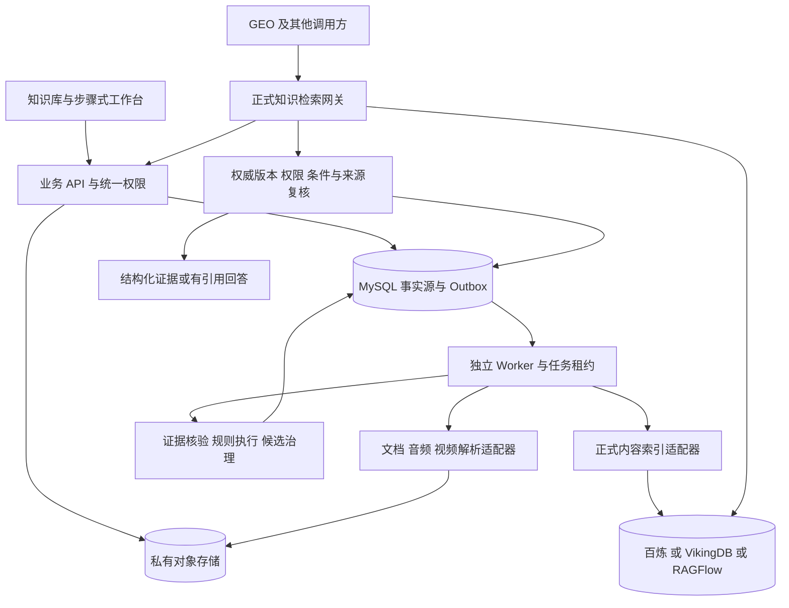

# 多模态知识治理产品化方案 v1.0

日期：2026-11-23（Asia/Shanghai）。状态：产品与技术设计建议，尚未实施、采购或完成供应商实测。

范围更新：用户进一步明确需要整个知识库引擎及从底层到上层应用的完整产品描述，现以[知识库产品全景与引擎架构](知识库产品全景与引擎架构-v1.0.md)作为产品总纲。本文保留为其中的多模态处理、治理发布与数据演进专项；后续整体建设顺序以总纲为准。

## 1. 推荐决策

沿用当前目录级资料治理产品，建设统一的多模态知识底座。平台持有原件版本、证据、治理规则、人工决定、正式知识、发布状态与调用授权；云厂商和开源引擎负责可替换的解析、模型推理和候选检索。

首期建议采用“现有 Python 服务与独立 Worker + MySQL + 对象存储 + 阿里云解析/检索适配器”。理由是已有百炼配置、模型调用及 GEO 检索经验，迁移路径短；这是基于现有资产的工程判断，不是三家效果或价格排名。火山全模态知识库进入视频对照验证；RAGFlow 进入私有化及解析可控性的对照验证。首期只交付一个通过验证的生产后端，不同时运营三套底座。

能力不足时允许单独替换视频解析器，不要求把数据库、业务审核和检索服务一起迁移。只有数据处理授权、部署区域和运维条件允许时才使用跨云组合，不能默认把客户资料发往多个供应商。

产品化的交付单元是“某个已审核知识版本及其可验证证据与使用范围”，文件上传成功、生成摘要和建立向量索引分别是处理中间结果。

## 2. 继承的产品与代码事实

### 2.1 当前依据

- 主流程依据：[资料治理主流程与步骤式工作台](资料治理主流程与步骤式工作台-v0.3.md)、[前端原型演进](frontend-prototype-v0.7.md)及其后续修正，尤其是 [Agent 调用方与权限 v0.22](Agent接入与知识库权限业务修正-v0.22.md)。外部 Agent 使用独立调用方，不要求安装内部治理 Agent。
- 实现状态依据：[implementation-status.md](implementation-status.md)、[通用能力盘点](通用知识管理能力盘点-2026-11-03.md)。历史段落里的待办要结合后续完成记录读取。
- 数据设计参考：[v0.11 实体契约](data-model/governance-catalog-v0.11.json)、[查询契约](data-model/governance-query-v0.11.schema.json)；两者是历史设计，不能覆盖当前 ORM 与实际迁移。
- 当前实体代码：`src/knowledge_governance/models.py`；外部调用方代码：`knowledge_consumers.py`；GEO 参考：[历史接入映射](migration/GeoGrowth-配置参考与消费者接入映射-v0.1.md)及 `geogrowth_consumer.py`。

### 2.2 可复用与需要升级的边界

| 范围 | 已有基础 | 本方案增加的产品化能力 |
| --- | --- | --- |
| 资料管理 | 目录、来源摘要、来源版本、远端显式导入 | 大文件对象存储、逻辑资料与多个文件版本、多模态附件 |
| 整理任务 | 固定范围、规则冻结、独立 Worker、恢复、逐文件检查回执 | 文档/音频/视频处理子任务、分模态覆盖、供应商任务映射 |
| 证据 | 文本片段编号、原文核验、来源追溯 | 页码/区域/表格/时间段定位，识别稿与原生文本的类型区分 |
| 人工治理 | 冲突、并存、暂缓、提交、审核、发布 | 对时间段或页面授权采用，按证据类型回看原件 |
| 正式知识 | 知识版本、发布、撤回、基线、审计 | 结构化证据关联、检索投影、索引就绪状态 |
| Agent 使用 | 独立凭证、目录范围、正式读取及撤权 | 混合检索、证据重排、视频引用、GEO 统一 EvidencePack 适配 |

当前 `LocalSourceVersion.original_bytes` 非空，MySQL 使用 MEDIUMBLOB，另有可空 `oss_key`；当前结构不能直接作为大视频存储方案。`CatalogAsset.source_version_id` 唯一，现有资料卡与单个来源版本绑定，需要兼容扩展逻辑资料的版本链。

当前 `knowledge_consumers.query` 提供知识 ID、关键词及游标查询；`general_agent_knowledge.py` 也主要按授权 ID、分类和关键词读取。二者不等于已具备全库向量召回。`evidence_units.py`、`source_analysis_contract.py` 的文本证据协议也不能直接宣称支持视频时间段。

以上为本次代码静态核对。现有文档记录了本机与隔离验收，本次没有重跑服务或证明生产数据库状态。真实共享服务、GeoGrowth 与接收端仍按既有约定等待恢复通知。

## 3. 产品对象与用户流程

产品界面继续使用“团队 → 知识库 → 目录 → 资料”，技术隔离字段仍沿用 `organization_id/project_id`，本次不更名或合并数据库。知识类型、文件格式、资料目录、适用条件分别管理：视频是格式，培训是知识类型，地区/版本等是业务条件。

保留原始资料库和正式版本库两个主要内容入口，审核成果放在具体任务内。解析引擎、索引参数和云存储位置放在管理员配置中，普通用户只看到支持范围、处理进度和明确限制。

| 步骤 | 用户动作 | 系统结果与门禁 |
| --- | --- | --- |
| 1. 选择资料 | 选择目录或明确文件，设置整理目标、知识类型、用途和责任人 | 冻结文件版本、目录位置、规则与处理配置；上传后未入本批的新增文件另建任务 |
| 2. AI 整理 | 查看进度、暂停、续办 | 逐页/逐时间段解析，生成候选、冲突和覆盖报告；失败内容保持可见 |
| 3. 确认成果 | 核对文字、页面或视频片段，采用/按条件并存/暂缓 | 每项决定绑定证据和条件；修订留痕，不能覆盖原件 |
| 4. 审核发布 | 整理人提交、审核人确认、发布人发布 | 固定审核版本，事务写发布与事件，后台建立正式检索投影 |
| 5. 使用核对 | 在知识库内检索，授权 GEO 等调用方并试读 | 只返回当前授权、已发布、条件相符的成果；引用可回看 |
| 6. 更新/撤回 | 新资料发起新任务，或撤回已发布成果 | 旧发布保留历史；实时停止新请求使用，异步清理索引/通知调用方 |

状态至少拆成四个维度，避免“处理完成”混淆含义：

- 解析作业：排队、处理中、部分成功、成功、失败、取消。
- 治理成果：待核对、已采用、暂缓、已提交、已审核。
- 发布：未发布、已发布、被替代、已撤回、来源受限。
- 使用准备：索引排队、构建中、就绪、失败、清理中。

已发布但索引未就绪时，允许按 ID 精确读取；语义搜索显示“准备中”，不展示已经可搜索的假状态。发布不依赖外部索引事务成功，索引失败可独立重试。

部分采用必须明确到证据范围。例如 60 分钟视频只有 0–18 分钟完成语音核对、画面尚未检查，可以发布这一范围支持的文字成果，但不能显示整段视频已检查。剩余范围可续办，新任务不继承旧批准。

## 4. 多模态统一处理

### 4.1 统一处理合同

输入为来源版本、访问范围、目标用途、处理配置版本；输出统一为 `artifacts + evidence_units + coverage + limitations + execution_receipt`。每个产物绑定原件摘要、处理器/模型版本、参数摘要、运行 ID 和输出摘要。

| 资料 | 提取产物 | 原始定位 | 不能混淆的边界 |
| --- | --- | --- | --- |
| PDF/Word/PPT | 文本、版面、表格、图片 | 页/幻灯片、段落、区域 | OCR 稿不是原生文本；Office 渲染保留软件版本和页码映射 |
| Excel/CSV | 表头、单元格、合并范围、表格片段 | 工作表名、单元格范围 | 缓存值、公式、计算结果分别标识；公式计算由受控扩展承担 |
| 图片 | OCR 稿、区域和视觉描述 | 原图尺寸、区域坐标 | 视觉描述是模型解释；OCR 内容需回看图片核对 |
| 音频 | 分句转写、说话人片段、章节 | 原音频时间段 | 无语音、识别失败、未处理是不同状态 |
| 视频 | 转写、字幕、关键帧、OCR、镜头、章节、事件候选 | 原视频时间段及帧/区域 | 音轨与画面分别记录覆盖，不能用转写代替视觉理解 |

全文摘要用于导航和粗召回；正式结论需要细粒度证据。模型根据平台分配的证据 ID 选择依据，时间与坐标由解析器产生并由服务端校验，不能让模型凭空编写定位。

### 4.2 视频流水线

1. **接入预检**：实际 MIME/容器、编码、时长、音轨、分辨率、大小和损坏检查；断点上传到私有对象存储，完成后校验 SHA-256。后缀相同不代表编码兼容。
2. **生成派生物**：必要时转封装/转码；原文件保留。记录派生文件到原视频时间轴的映射，不能丢失剪切偏移或变速关系。
3. **并行解析**：音轨执行 ASR 和分句；画面按镜头变化与定时策略抽帧，执行 OCR/VLM；嵌入字幕和烧录字幕分别记录来源。
4. **时间对齐**：转写、字幕、关键帧、画面文字合并到同一时间轴；保留冲突，例如口播“先断电”而画面字幕写“保持通电”。
5. **语义组织**：按章节/主题生成片段，操作动作保留前后步骤与必要上下文，章节下挂细粒度证据。切片长度作为可验证配置，避免把任意固定秒数当通用业务规则。
6. **候选与审核**：可提出步骤、要点、注意事项和跨文档冲突，但需人工确认；重要视觉动作未覆盖时，该用途标为依据不足。
7. **检索与回放**：返回知识正文和支持它的时间段；审核人员可从播放器定位到片段，并展开转写、帧图和相关文档。

第一版可公布的媒体配置建议为“电子文档及图片 + 普通话音频 + MP4 培训/录屏视频”，编码、语言、时长和大小上限必须由最终选定接口实测后配置。其他容器可经转码适配，但不能因云模型能接收视频就承诺平台已支持所有视频。

覆盖记录按 `source_version + channel + interval/page` 保存。ASR 的无语音段可标已处理无语音；抽帧策略只证明执行了既定采样，不能证明每帧细节均已理解。分别记录处理覆盖、证据置信与人工采用范围，不计算一个掩盖差异的总完成百分比。

### 4.3 证据结构示意

以下是目标合同，不是现有 API 响应：

```json
{
  "schema": "evidence-unit-v1",
  "evidence_id": "ev_01",
  "source_version_id": "source-version-uuid",
  "artifact_id": "transcript-artifact-uuid",
  "kind": "asr_transcript",
  "locator": {"type": "time_range", "start_ms": 125000, "end_ms": 148000},
  "content": "此处为识别稿内容，须结合原音视频核对。",
  "content_hash": "sha256-of-artifact-segment",
  "derivation": {"run_id": "parse-run-uuid", "processor_version": "frozen-version"}
}
```

`locator` 使用按类型校验的结构：`text_span/page_region/table_range/time_range/frame_region`。文本偏移相对于指定不可变文本产物，视频时间以原件时间轴为准，区域坐标明确单位与原图尺寸。帧图和转写各有证据 ID，再通过关系关联，避免用一个字段混写全部依据。

服务端检查来源归属、产物摘要、时间在时长内、区域合法、证据类型与用途一致、引用范围确实已处理。ASR/OCR 稿内的字面匹配只证明引用了识别稿，不证明录音或画面中的事实真实。

## 5. 数据库演进

### 5.1 保留事实源

MySQL 继续保存业务事实、事务状态和审计；对象存储保存原件/转写/关键帧/渲染页；检索引擎保存可重建投影。保留现有 `general_knowledge_items/versions/confirmations/publications/withdrawals`、目录任务、规则、调用方与 Outbox 等表，不建立第二套平行发布系统。

### 5.2 目标增量实体

以下为逻辑表设计，命名与迁移编号在实施时对齐；不是已执行 DDL。

| 表/实体 | 关键字段 | 约束与用途 |
| --- | --- | --- |
| `source_assets` | id、organization_id、project_id、owner、type | 跨多个来源版本的稳定逻辑资料身份 |
| `source_asset_versions` | asset_id、source_version_id、sequence、parent_id | 唯一(asset_id, sequence)，关联现有来源版本；不能按文件名自动串版本 |
| `storage_objects` | scope、object_key、object_version、sha256、bytes、mime、state | 桶与 key 是内部定位；不保存长期公开下载地址 |
| `source_version_objects` | source_version_id、object_id、role | 原件/派生物关联；同一版本原件不可静默替换 |
| `processing_runs` | source_version_id、pipeline_version、provider、external_job_id、attempt、lease、status | 幂等提交、超时核对、重试与失联恢复 |
| `source_artifacts` | run_id、source_version_id、kind、storage_object_id、hash、schema_version | 不可变转写、帧图、渲染和结构化产物 |
| `evidence_units` | source_version_id、artifact_id、kind、locator_json、content_hash | 稳定证据 ID；常用 start_ms/end_ms/page 单独索引 |
| `evidence_relations` | from_id、to_id、relation_type | 对齐转写/帧图、上下文、字幕与口播差异等关系 |
| `source_coverage_units` | run_id、channel、范围、status、reason | 声音、画面、OCR、页与表格的覆盖/排除证据 |
| `knowledge_version_evidence` | knowledge_version_id、evidence_id、role、adopted_scope | 正式版本与依据的多对多关系，记录支持/限制关系 |
| `retrieval_indexes` | scope、provider、profile_version、generation、status、active | 一套发布内容对应可重建索引代次，支持影子重建 |
| `retrieval_bindings` | index_id、publication_id、knowledge_version_id、evidence_id、provider_doc/chunk_id、hash | 云定位映射到平台稳定 ID；缺映射的候选拒绝使用 |
| `index_sync_jobs` | outbox_event_id、projection_key、desired_revision、state、attempt | 发布/撤回索引投影作业，重复事件不产生重复成果 |
| `consumer_external_mappings` | consumer_id、external_tenant_id、external_scope_id、local_scope_id | GEO 外部业务 ID 显式映射，唯一(consumer_id, external_tenant_id, external_scope_id) |
| `retrieval_requests` | consumer_id、scope、policy_revision、profile、结果 ID/摘要、耗时、request_id | 使用追踪和效果评估；默认不复制整段敏感正文到日志 |

所有关系必须能沿不可变外键验证同租户/知识库。高风险关联使用复合唯一键/外键 `(organization_id, project_id, id)` 约束归属；派生表可以继承归属，但写入和查询都要验证，不能只靠前端传入 project_id。

常用索引包括：任务 `(project_id,status,next_run_at)`，证据 `(source_version_id,kind,start_ms)`，绑定 `(index_id,knowledge_version_id)`，对象 `(project_id,sha256)`。JSON 保存版本化定位结构，不把全部实体与可查询状态塞进一个任务 JSON。现有任务 JSON 快照继续保留，规范化记录用于后续运行与查询，不反写改变旧快照。

### 5.3 兼容迁移

1. 新建增量表与对象引用，现有来源 ID、知识 ID、发布证明、审核决定和旧读取保持。
2. 增加存储模式：旧记录沿 `inline_bytes` 读取，新媒体沿 `object_ref` 读取。调整 `original_bytes` 非空合同前，先完成所有读取路径和 schema 检查的兼容改造；约束要求至少一种可验证原件存在。
3. 旧原件复制到对象存储，逐项核对摘要与大小，记录迁移回执；复制期间旧读取仍可使用。禁止大文件继续双写进 BLOB。
4. 按审核确认的对应关系建立逻辑资料版本链；哈希用于识别同字节，不把相同内容或同名文件自动当成同一业务资料，也不暴露跨租户去重结果。
5. 旧文本引用保持原合同；新证据用新 schema。可精确映射的旧引用建立桥接，无法映射的保留旧定位能力，不能批量伪造视频/页级证据。
6. 在独立副本演练当前迁移头到目标版本、数据摘要、外键、回退与恢复。旧 BLOB 的回收另有保留策略，备份审计不随迁移删除。

## 6. 技术架构与服务职责



采用模块化单体业务 API + 独立后台 Worker。解析是长时作业，GPU/转码 Worker 可独立部署；首期不为了模块数量拆成大量微服务。队列可沿现有调度机制演进，Redis 负责派发与限流，数据库任务记录负责恢复，队列丢失不能丢掉事实状态。

按能力拆分 `StorageProvider`、`DocumentParser`、`MediaParser`、`EmbeddingProvider`、`RetrievalProvider`，不要要求每家实现一个万能适配器。处理配置冻结供应商、模型、解析器、采样策略和版本。Embedding 变化创建新索引代次，不把不同模型/维度向量混存到原索引。

对云异步任务先登记本地请求与幂等键，再提交；结果未知时查询外部作业，无法核对则保留未知并显式重试，不直接假定失败后无限重复提交。回调验证身份且只更新对应运行代次；Worker 提交结果前核对租约围栏和当前授权。

业务规则扩展复用候选、验证、审核、启用、版本冻结。平台提供输入/输出 schema、范围、资源限制、执行隔离与追溯；具体计算公式或行业算法作为可选扩展注册，不写成每个用户都要走的主流程。有限规则包不承诺任意业务程序可直接运行。

## 7. 检索、发布一致性与实时失效

### 7.1 正式检索顺序

1. 认证调用方，获得其知识库、目录、用途和当前授权版本；请求中的范围只能缩小授权。
2. 选择**正式内容索引**，按租户/知识库、发布版本、条件与用途预过滤；后台治理使用的原始资料索引单独隔离。
3. 关键词与语义混合召回；视频可增加视觉候选通道。具体 TopK 和权重由冻结检索配置及离线评估决定。
4. 仅用返回 ID/映射核对权威状态，过滤未发布、已撤回、受限或条件不符的候选，再把合格正文交给外部重排模型或回答模型。未经核验的正文不能先送外部模型再过滤。
5. 去重并保留多条互补证据；版本或条件冲突无法消除时返回“需要补充条件”，不以相似度最高替用户决定。
6. 组装结构化知识和引用；生成回答时要求断言对应有效引用，无支持的断言删除或明确依据不足。
7. 返回前复核涉及范围的权限/发布修订号；若中途发生撤回，重新过滤或拒绝本次结果。首期采用完整生成后再返回，减少流式输出途中撤权的暴露窗口。

正式索引存审核后的知识正文与允许的证据投影。不得把同一原视频未审核的其他时间段作为相邻上下文补入正式回答；只有该上下文本身也在采用范围内才允许展开。具有原件权限的审核人员可另走原件查看接口。

模型答案是消费层产物，不能自动回写成为已发布事实。GEO 可以只取结构化证据，自行生成业务内容。

### 7.2 原始索引与云全模态索引的使用边界

云全模态解析可能要求先把整段视频建入供应商索引。此索引只供受控解析/治理服务使用，不能直接作为外部调用方正式问答入口。原始索引与正式索引分凭据、分集合和分调用路径。

如供应商能支持经过审核的片段独立入库并稳定映射 ID，可将采用片段投影到正式媒体索引；否则采用“审核知识文本 + 平台时间段证据 + 受控回看”，视觉检索保留为内部候选能力。不能为了原生视频问答，把未审核整段视频直接挂给客户 Agent。

### 7.3 发布与索引事务

发布事务写知识版本、审核证明、发布状态与 Outbox。Worker 消费事件，幂等更新索引；写入回执记录索引代次、内容摘要和映射。平台维护所需发布修订号，旧作业晚到时不得恢复已撤回版本。

撤回事务先使数据库中的版本不可读，再记录索引删除和调用方通知。索引即使暂未清理，新请求也会因权威复核拒绝。已返回给下游的副本不能远程保证抹除，只能记录通知、清理回执与下游处理责任。

默认不跨请求缓存最终回答。候选 ID 缓存必须带隔离范围、检索配置与索引代次，每次使用重新查权；不得因缓存命中跳过正式版本和源权限检查。失效保证以平台授权检查的事务时点为界，已经传出的字节无法撤回。

## 8. GEO 接入与旧知识库迁移

### 8.1 已知旧基线

本仓库保存的固定版本审计指出，GeoGrowth 曾通过 `aliyun_kb_client.py` 直接访问百炼，`evidence_retriever.py` 聚合研究证据，定位使用 kb/doc/chunk ID；个别缺失片段 ID 使用摘要派生。该结论来自历史固定提交，不代表本次重新核验了 GEO 线上流量。

本仓库已有 `geogrowth_consumer.py` 的治理知识 EvidencePack 投影，显式校验外部租户/项目映射，实时查询，异常不回退旧百炼证据；为避免旧 EvidencePack 丢失审计字段而复用缓存，还设置了不可作为可复用完成检索的标记。这些机制值得复用，但其中旧 AgentRun 认证路径应逐步适配 v0.22 独立调用方合同，不能再要求 GEO 安装内部治理 Agent。

### 8.2 目标接入

GEO 的研究、策划等入口统一调用平台正式检索 API。租户与业务项目 ID 通过显式映射关联本地知识库，不能把整数项目 ID 转成治理 UUID，也不能让百炼 pipeline ID 充当业务隔离 ID。

建议在现有调用方 API 上新增版本化检索与证据能力，下面是目标语义路径，实施时确定具体路由；不是现有已上线接口：

| 操作 | 目标路径 | 结果 |
| --- | --- | --- |
| 混合搜索 | `POST /api/v1/consumers/{id}/search` | 正式知识版本、发布 ID、得分与引用；明确检索就绪/降级状态 |
| 精确读取 | `GET /api/v1/consumers/{id}/knowledge/{knowledge_id}/versions/{version_id}` | 指定版本当前是否仍可用于正式用途 |
| 引用复验 | `POST /api/v1/consumers/{id}/citations/verify` | 版本、来源及用途当前有效性，不自动替换旧引用 |
| 证据查看 | `GET /api/v1/consumers/{id}/evidence/{evidence_id}` | 按证据查看权限返回摘录或短时访问会话 |
| 变更同步 | `GET /api/v1/consumers/{id}/changes?cursor=...` | 发布、替代、撤回、来源限制事件及游标 |

搜索请求包含 query、允许的目录子集、可选业务日期/条件、分页参数；租户身份由凭证确定。没有结果、需要补条件、索引未就绪、检索故障分别返回明确语义，不能把供应商故障伪装成“无相关知识”。

EvidencePack 保留 `knowledge_id/version_id/publication_id/content_hash`、来源版本、证据 ID、定位、适用条件和实时复验要求。旧 `KB-001` 只作当次展示序号，稳定 evidence_id 必须来自平台。云 chunk_id 留作内部定位，不能成为批准证明。

调用方默认只可读取正式正文及不含原始摘录的引用元数据。视频回放、转写原稿、关键帧和 PDF 原页需要独立证据/原件权限；未授权时返回引用描述，不下发能打开整段视频的 URL。受限片段采用裁剪/访问代理，不能用整文件签名地址冒充时间段授权。普通签名 URL 有效期内可能继续可用，需要强制逐次撤权时使用鉴权播放代理或受控分片会话。

### 8.3 迁移步骤

1. 冻结旧来源清单与租户/知识库归属、权限、哈希、云 ID；无法核对的先列待核验。
2. 原文件、旧文本切片及摘要分层导入；旧切片和旧回答只能成为候选输入，不自动变成已发布知识。
3. 能找到原件的重新生成平台证据并走治理；只有旧切片时明确“来源不完整”，不伪造原件引用。
4. 每个知识库独立建新索引并影子查询，对照原路径的召回、引用和权限；影子结果不混入生产回答。
5. 核验 GEO 缓存、引用复验、目录权限、撤回和故障拒绝，再按调用方/知识库切流。平台故障时可切回此前通过同一发布与授权核验的检索后端，不能回退到未治理原始百炼证据。
6. 原资料、映射、旧审计保留。真实切流和联合验收等待既有恢复通知，本次只完成设计。

## 9. 阿里云、火山引擎与 RAGFlow 选型

以下“已确认”仅指官方文档列出能力，未代表账号、区域、产品版本、数据规模和本项目合同已实测通过。模型能理解视频、知识库能解析视频、平台能审核后发布是三个不同层次。

| 方案 | 官方资料核对 | 对本项目的判断 | 实施前必须验证 |
| --- | --- | --- | --- |
| 阿里云百炼 + OSS + RDS | 已列音视频搜索类型，提供音视频解析和时间定位 [S1]；创建 API 含 multimedia 类型 [S2] | 现有配置与 GEO 经验可复用，建议作为第一生产后端候选 | 原接口/新版 API 兼容、片段导出、稳定映射、过滤、撤回与区域可用性 |
| 火山知识库/VikingDB + TOS + RDS | 官方有全模态音视频问答流程，页面注明旗舰版，视频导入列 MP4 [S5] | 原生视频候选链路值得与阿里同题对照；不因模型能力直接决定迁移 | 片段定位、原始切片回读、数据隔离、长视频限制、审核片段独立投影 |
| RAGFlow + 自管对象存储/数据库 | v0.21.0 已加入视频解析，v0.21.1 修复相关问题 [S7]；Parser 文档列出视频类别 [S8] | 可作为解析/检索底座，适合私有化评估；产品治理继续由本平台负责 | 固定发布版本与模型依赖、音轨/画面处理、时间戳保留、API 能否导出定位、运维恢复 |

需要纠正旧印象：不能再笼统说“RAGFlow 不支持视频”。若已有部署不支持，应核对版本、所用 Parser/模型及输出合同；也不能据新增解析功能就认定具有本平台要求的全过程证据与权限能力。[S7][S8]

一个直接影响产品设计的阿里接口限制：`AddChunk` 文档注明不支持对 multimedia 知识库新增切片 [S3]。因此“把审核后的任意视频切片直接 AddChunk 进原音视频库”不是已确认可行的实现。应验证片段文件独立导入，或选文本正式索引加平台视频证据的路线。`Retrieve` 文档列出音视频资源元数据及有效期，但云资源链接不能替代本平台权限与长期引用身份。[S4]

火山全模态知识库文档的导入格式与不同视频理解服务的格式/大小限制不能混用；尤其不能把独立大模型或视频理解算子的上限写成知识库导入上限。[S5][S6]

决策顺序：先检查证据导出、隔离、发布投影和删除等硬合同，再比较效果与性能。若三家托管知识库均无法满足片段发布与精确映射，则保留云解析，正式检索改用可控搜索/向量引擎适配器，业务与证据模型无需重做。

不把 RAGFlow 默认管理界面直接作为本产品工作台；也不为同时兼容三家增加用户必须理解的供应商流程。

## 10. 验证与产品交付门槛

### 10.1 同题验证集

建议第一轮使用约 30 份经授权或合成的测试资料：电子 PDF/扫描件、含图片 PPT、结构化表格、图片、音频、培训/录屏/无声视频和异常文件。配置约 60 个带人工标准证据的查询，覆盖别名、跨资料问题、条件并存、版本冲突、视觉独有信息、无依据问题。数量是验证建议，不是实际已运行结果。

视频样本至少有：只有口播、只有画面动作、字幕与口播冲突、长静默、术语识别错误、步骤跨切片、抽帧间短暂事件。分别检查能否发现和是否明确漏检，不以生成流畅摘要判定通过。

### 10.2 验收指标

| 范围 | 记录方法 | 验收要求 |
| --- | --- | --- |
| 来源完整性 | 对象大小、摘要、版本与回读 | 已接入原件可验证，失败项不伪装成功 |
| 证据定位 | 标注证据对比页/区域/时间段 | 正式引用均有合法定位；ASR 时间误差与字幕错字单独测量，容忍值按用途确定 |
| 检索效果 | Recall@K、排序、不同模态分项、无依据拒答 | 预先冻结同一测试集与目标，再出三家对照结果；不预填准确率 |
| 权限与状态 | 多租户、目录外、未发布、撤回、来源撤权、旧缓存攻击集 | 测试集中越权及失效内容进入最终响应为零；不据有限样本声称绝对无缺陷 |
| 部分处理 | 中途失败、只处理声音、跳过页面/时间段 | 完整展示排除范围，已通过范围可独立审核发布 |
| 作业一致性 | 重复回调、消息乱序、租约过期、模型超时 | 不重复批准、不恢复撤回内容、不覆盖旧产物；可核对重试 |
| 运行性能 | 固定并发/语料下的检索 P50/P95、首批索引时间、视频处理实时率 | PoC 后确定产品配额和 SLO，目标不当成已达指标 |
| 恢复与迁移 | 数据副本迁移、备份恢复、索引重建、回切 | 目标部署环境必须演练，文档设计或本地通过不代替生产证据 |

### 10.3 产品化运行配置

每个知识库配置启用格式、单文件大小/时长、解析并发、调用频率、允许处理区域、日志保留期和对象保留策略。观测包含队列积压、处理时长、失败原因、覆盖、索引延迟、拒绝原因及 Token 用量；本轮不增加费用估算、账单或金额预算产品模块。

基础部署建议为私有对象存储、托管 MySQL、业务 API、独立 Worker 和单一检索后端；容量由验证集再扩到实际样本压测后确定。企业独立部署可以替换存储/检索适配器，继续遵循同一租户、审核和证据合同。

## 11. 实施批次与完成定义

| 批次 | 实际交付 | 完成证据 |
| --- | --- | --- |
| A. 冻结合同与技术验证 | 统一证据/定位 schema、能力清单、三家小样对照、确定一个后端 | 固定版本和配置、原始响应、映射验证、效果报告；不进入真实业务批准 |
| B. 存储与来源演进 | 大文件上传、对象引用、原件回读、逻辑版本链、旧记录兼容 | 独立副本迁移/恢复、摘要核对、目录与原件权限拒绝测试 |
| C. 多模态治理闭环 | 音视频解析、时间轴回看、覆盖、片段采用、原审核发布复用 | 从上传到发布再撤回的独立人员/调用方链路；失败范围保持 |
| D. 正式混合检索与 GEO 适配 | 正式投影、稳定引用、独立凭证、EvidencePack、失效同步 | 独立 HTTP 调用、未发布/越权/撤回/故障场景及缓存验证 |
| E. 生产就绪 | 目标库迁移、运行恢复、容量与监控、指定知识库切流 | 实际部署环境演练报告、回切记录；外部联合验收按恢复约定开展 |

当前已有通用任务、审核、发布和调用方能力无需重建。新工作按批次补足媒体存储、证据和检索；具体业务规则、真实资料批准和等待恢复的外部接入分别列账，不把等待期转化为扩建业务专项。

首个产品版本承诺范围应在 A 批验证后明确到格式、语言、时长、大小、覆盖策略和调用能力。第一生产后端交付后，再按真实私有化或视频效果需求决定是否实现第二后端，不先建设无业务用途的多云调度。

## 12. 本轮边界与下一步

本轮完成：结合当前产品修正、历史数据库设计、当前来源/知识/调用方代码与 GEO 固定版本审计，形成多模态产品、数据演进、供应商适配、正式检索、视频证据、迁移和分批验收方案；查阅下列官方资料核对能力边界。

本轮未执行：代码改造、数据库迁移、云账号调用、真实视频处理、供应商效果/性能测试、真实 GEO 接入或服务切换。推荐后端属于待 PoC 验证的工程选择，不标为已完成能力。

下一步是 A 批：先固定 `evidence-unit`、覆盖及正式检索投影合同，再以同一组文档/视频样本验证候选后端；其结果决定 B/C 批具体适配代码，不需要重做已有审核与发布主流程。

## 官方核对来源

查阅日期：2026-11-23。以下为能力核对链接，供应商版本、地域和账号可用性以实施时检查为准。

- [S1 阿里云：创建知识库](https://help.aliyun.com/zh/model-studio/rag-knowledge-base)
- [S2 阿里云：创建知识库并导入 API](https://help.aliyun.com/zh/model-studio/rag-api-create-index)
- [S3 阿里云：AddChunk 新增切片](https://help.aliyun.com/zh/model-studio/api-bailian-2023-12-29-addchunk)
- [S4 阿里云：Retrieve 检索知识库](https://help.aliyun.com/zh/model-studio/api-bailian-2023-12-29-retrieve)
- [S5 火山引擎：音视频知识问答核心流程](https://docs.volcengine.com/docs/vector-database-vikingdb/audio-video-knowledge-q-a-core-process?lang=zh)
- [S6 火山引擎：知识库视频问答样例](https://docs.volcengine.com/docs/vector_database_vikingdb/KnowledgeBaseVideoQASample?lang=zh)
- [S7 RAGFlow：官方发布记录，含 v0.21.0/v0.21.1](https://github.com/infiniflow/ragflow/blob/main/docs/release_notes.md)
- [S8 RAGFlow：Parser 组件官方文档](https://github.com/infiniflow/ragflow/blob/main/docs/guides/agent/ingestion_pipeline/configure_parser_component.md)
