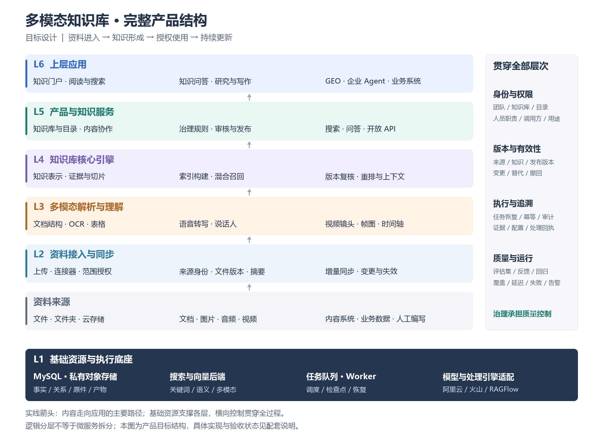
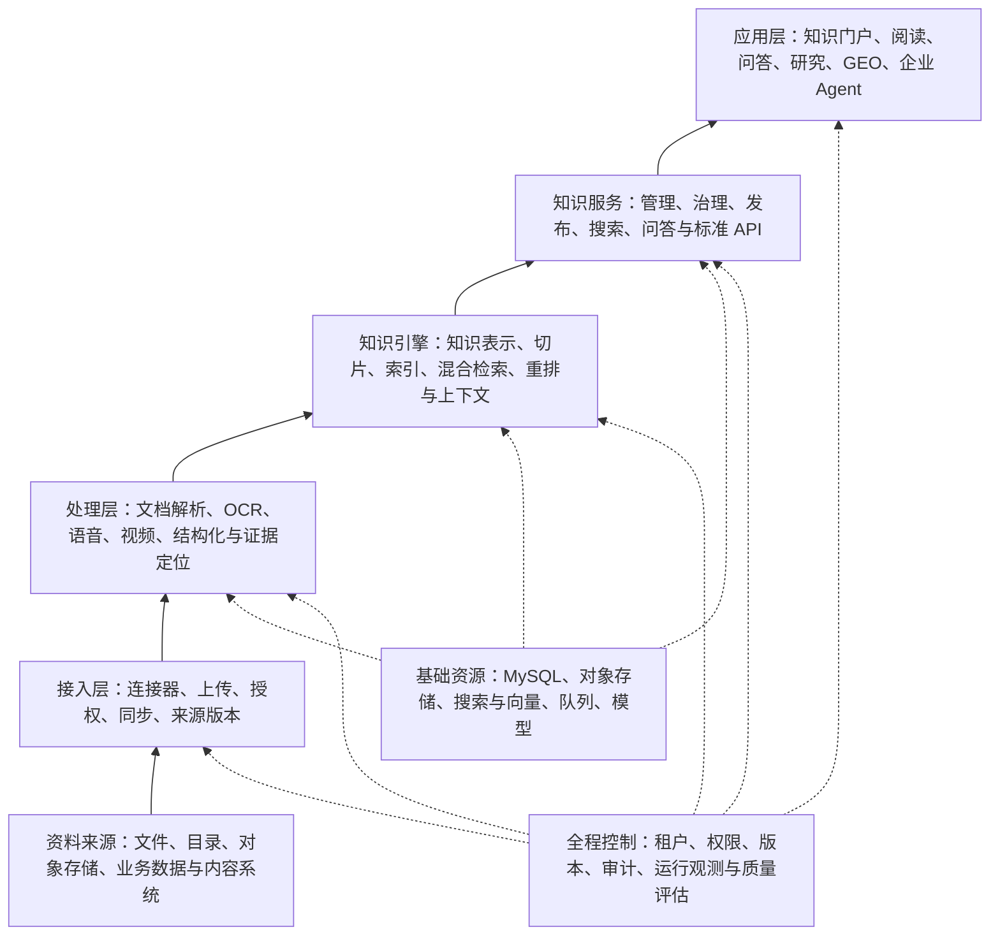

# 知识库产品全景与引擎架构 v1.0

当前产品主方案为[可复用知识体系与统一知识引擎产品方案 v3.4](可复用知识体系与统一知识引擎产品方案-v3.4.md)，在完整产品、业务结构搭建和治理规则基础上，补全正式版本的变更、生效、替代、历史回查、归档与到期处置；配四幅内置图像模型生成的图形。GEO仅为其中一个应用示例。v2作为技术参考，下文旧主次安排由本条更新。

后续深化：现已新增[知识库引擎产品与技术完整方案 v2.0](知识库引擎产品与技术完整方案-v2.0.md)，结合市场平台、框架和检索底座，展开切片、Embedding、向量索引、混合检索、重排、问答、容量、接口及验收。完整产品与引擎评审以 v2.0 为主，本文保留全景与逻辑分层参考。

日期：2026-11-23（Asia/Shanghai）。状态：完整产品目标设计；现有能力与新增目标分别标注，不代表已实施全部模块。

本文是整个产品的总纲：覆盖底层资源、知识库引擎、平台管理、知识应用及外部集成。[多模态知识治理方案](多模态知识治理产品化方案-v1.0.md)作为其中“多模态处理、治理与发布”的专项设计继续使用。本文关于优先级和系统边界的说明优先于只从治理角度安排后续建设的旧表述。

## 1. 产品定义

这是一个面向企业和团队的多模态知识库平台：将分散在文件、目录、对象存储和业务系统中的内容接入，转化成有结构、有来源、可检索、可更新、可授权使用的知识，再通过知识门户、搜索、问答和标准接口服务人及应用。

完整能力由四部分组成：

1. **知识资产管理**：让资料和知识可以组织、查找、维护、协作和追溯。
2. **知识库引擎**：完成解析、证据定位、切片、索引、混合检索、上下文组装和有引用生成。
3. **知识生命周期管理**：控制质量、版本、适用范围、审核发布、更新和撤回。
4. **知识应用与开放平台**：为搜索、问答、阅读、研究、GEO、企业 Agent 和业务系统提供统一知识能力。

治理承担质量与可用性控制，贯穿资料进入到知识使用的全过程。资料浏览、查找和授权使用也都是独立的用户价值，不能要求每次阅读资料都先创建整理任务。

产品价值的检验是：用户能找到需要的内容，能判断依据和适用范围，应用能稳定调用，更新后能使用正确版本，越权或失效内容不会继续作为有效依据。

## 2. 用户、场景与产品边界

| 用户 | 核心任务 | 主要入口 |
| --- | --- | --- |
| 资料贡献者 | 上传、接入、补充说明、维护资料版本 | 知识库目录、上传与连接器 |
| 知识维护人员 | 分类、编辑知识、整理资料、处理差异与更新 | 知识详情、整理任务 |
| 审核与发布人员 | 核对依据、条件、变更影响和发布范围 | 待办、任务审核、发布记录 |
| 普通知识使用者 | 浏览、搜索、问答、回看引用、反馈错误 | 知识门户、统一搜索、问答 |
| 应用接入人员 | 创建调用方、配置读取范围、验证接口和失效行为 | 应用接入与 API |
| 管理员与运营人员 | 团队、职责、目录权限、连接器、运行与质量 | 设置、权限、运行与评估 |

通用产品提供连接器、规则和应用的接入机制。报价算法、特定产品选型、行业决策等作为业务扩展与应用实现，沿用平台的输入输出合同、权限、版本和追溯；不把每一种算法和 Agent 固化到平台主流程。

GEO 是一个重要消费应用，也可通过受控接口贡献候选资料；它不拥有平台全部知识，也不决定平台权限。知识库可独立服务其他应用。

## 3. 完整产品分层

[可缩放 SVG](assets/knowledge-platform-overview-v1.svg)。图中各层是逻辑职责，不要求逐层拆成微服务；整图为目标结构，不表示全部能力现已完成。

接入、处理、知识组织与检索是从资料走向应用的主要数据路径；存储、模型和队列支撑多个层次，权限和质量贯穿全部路径。治理与发布决定哪些知识可以成为正式应用依据。

配套[运行架构 Mermaid 源码](assets/knowledge-platform-runtime-v1.mmd)进一步描述工作台/业务应用、API、后台 Worker、数据库/对象存储及外部引擎的调用关系。图中的管理 API 和检索 API 可先部署在同一模块化应用内，Worker 独立运行；只有扩容或隔离需要时才拆分部署。

## 4. 底层资源与数据底座

| 基础能力 | 保存或执行的内容 | 产品约束 |
| --- | --- | --- |
| 关系数据库 | 团队、知识库、目录、资料身份、版本、证据关系、规则、发布、授权、审计 | 权限、正式状态与版本的事实源；保持事务与归属约束 |
| 对象存储 | 原文件、转写、关键帧、渲染页面、派生片段和导出包 | 私有访问、摘要校验、生命周期与可恢复版本；与业务删除分开 |
| 搜索与向量后端 | 倒排索引、语义向量、多模态向量及检索元数据 | 可从已保存内容重建；不拥有最终发布权和授权决定权 |
| 任务调度与队列 | 解析、索引、同步、重试和通知的派发 | 数据库保存任务状态，队列故障不丢失作业事实 |
| 模型服务 | OCR、ASR、视觉理解、Embedding、Rerank、语言生成 | 按任务和知识库选择允许的提供商，冻结配置和版本 |
| 运行基础设施 | 日志、指标、追踪、凭据管理、备份恢复 | 管理员可诊断失败与重建；日志默认不复制客户正文 |

建议生产目标为托管 MySQL、私有对象存储、一个通过验证的检索后端及独立 Worker。当前仓库本地服务是 WSGI 入口，依赖中已有 SQLAlchemy、Alembic 与 PyMySQL；不能把历史架构提到的 FastAPI 或 Redis/ARQ 写成当前已部署事实。Web 框架和队列实现可按生产需要演进，业务合同保持稳定。

## 5. 接入与同步引擎

接入对象包括本地文件/文件夹、对象存储目录、经过授权的网页/内容系统、结构化数据源和应用提交内容。文件、云文档、网页和业务记录分别识别来源身份，使用同一来源版本合同。

连接器职责：验证连接授权 → 枚举允许范围 → 获取内容与上游版本 → 校验并登记来源版本 → 派发处理 → 记录同步结果与游标。首次全量与后续增量共用幂等合同。

连接器至少记录实例、凭据引用、允许目录/对象范围、同步策略、游标、上游资源 ID、ETag/更新时间和内容摘要。展示“已发现、已导入、已变更、失败、被删除、待核对”等结果，不用一个“同步成功”掩盖部分失败。

增量接入规则：

- 新内容产生新资料/来源版本；修改产生新版本，不覆盖旧审核证据。
- 路径改变和内容改变分别处理，不能按文件名猜测资料身份。
- 上游失联不同于删除；删除事件先标记并影响依赖内容的可用性，不自动物理清理审计和备份。
- 权限变化优先更新当前访问控制；历史发布不能绕过当前来源限制。
- 应用抓取的网页或生成内容先进入候选范围，保留抓取时间、地址、摘要和权限，不因来源是 GEO 就自动发布。

全自动增量属于目标能力。现有远端显式浏览/冻结/导入可以复用，但不能宣称全部连接器和持续增量已经实现。

## 6. 多模态解析与内容理解引擎

统一输入为不可变来源版本与处理配置，输出为产物、证据、覆盖范围、限制和执行回执。

| 模态 | 内容提取 | 结构保留与定位 |
| --- | --- | --- |
| 文档 | 原生文本、OCR、标题、列表、表格、图片 | 页码、段落、区域、标题层级及原文偏移 |
| 表格 | 表头、行列、单元格、公式、缓存值 | 工作表与单元格范围；计算结果由单独受控扩展证明 |
| 图片 | OCR、图表、区域、视觉描述 | 原图尺寸与区域；模型描述标明派生性质 |
| 音频 | 分句转写、说话人、章节 | 原音频时间段及转写版本 |
| 视频 | 音轨、字幕、镜头、关键帧、动作和章节 | 原视频时间轴、帧图区域、声音与画面关联 |
| 结构化记录 | 字段、类型、主键、记录快照 | 数据源与记录版本；实时值查询与快照知识分开 |

视频不能仅做“转成一段文字”：音轨、字幕和画面分别解析、对齐、记录覆盖；视觉独有动作应保留可回看的帧/时间证据。解析结果经过结构验证与范围检查，不能让模型任意编造页码、时间或来源 ID。

解析允许插件化，也允许不同模态采用不同提供商。原始产物与摘要都保留处理版本，模型升级后重建新产物，不静默改变旧发布所依赖的依据。

具体视频时间轴、部分处理、证据合同及大文件兼容见[多模态专项方案](多模态知识治理产品化方案-v1.0.md)。

## 7. 知识表示与组织引擎

引擎需要同时组织资料结构和可复用知识。统一链路为：

**资料身份 → 来源版本 → 解析产物 → 证据单元 → 知识条目/版本 → 发布快照 → 检索投影 → 应用引用。**

关键概念分别建模：

- **目录**提供人的组织与范围选择，**分类/标签**提供多个维度的归类；都不代替权限判断。
- **证据单元**定位原文、页、单元格或时间段；**检索切片**为召回优化，可以重建，切片 ID 不能代替稳定证据身份。
- **知识条目**承载可维护的正文、结构化字段与条件；一个条目可由多份资料支持，一份资料也可形成多个知识条目。
- **关系**表达引用、版本替代、条件并存、冲突、派生和同主题。先以关系表满足产品需求，大规模图检索有明确收益时再引入图数据库。
- **用户编写内容**作为一类合法知识来源，保存作者、编辑版本与审核记录；不伪造外部来源。AI 起草内容属于候选，依据不足时不能自动成为事实。

切片策略按内容结构选择：文档以章节/段落，表格以表头与行上下文，视频以语义章节与时间段。采用父子切片、上下文窗口与去重时，只能展开调用方有权读取且适用于本次用途的内容。

## 8. 索引与检索引擎

### 8.1 索引构建

索引包括关键词索引、文本语义向量、按需启用的图片/视频多模态向量，以及元数据过滤字段。结构化数据优先采用受控字段查询；需要实时数据库查询时使用只读连接、允许表/字段与执行限制，不把自由 SQL 生成作为默认能力。

资料索引支持内部浏览、发现与治理；正式知识索引面向正式应用。两者按索引、凭据和调用路径分开。原始资料可以在授权内部搜索中出现，但必须标明未审核/解析限制，不能自动进入正式问答上下文。

每个索引记录知识库归属、用途、Embedding 模型与维度、切片策略、代次、数据水位及状态。模型或切片配置变化后建立影子代次，验证后切换；禁止混用不兼容向量，旧代次按回退和保留策略处理。

### 8.2 查询执行

标准查询流程为：

**身份与范围 → 查询理解 → 条件过滤 → 多路召回 → 权威复核 → 重排与去重 → 上下文组装 → 证据结果。**

查询理解可识别别名、型号、主题、时间与业务条件，但只允许扩大查询表达，不能扩大授权或替用户补造关键条件。不同召回渠道的分数先统一融合或重排，不能直接比较三家后端原始分数。

支持三类查询产品：

| 查询 | 返回内容 | 典型使用者 |
| --- | --- | --- |
| 资料搜索 | 有权限的资料、页/片段、处理状态 | 内部资料查找和维护 |
| 正式知识搜索 | 当前有效知识版本、条件、证据引用 | 普通用户、GEO、业务应用 |
| 精确引用读取 | 指定版本/发布/证据当前是否有效及允许内容 | 下游引用复验与历史追溯 |

跨知识库搜索仅合并调用方分别获得授权的知识库，逐库判断并记录来源；不自动建立全租户公共检索范围。无命中、缺条件、权限受限、索引未就绪和后端不可用分别处理，错误不能伪装成无结果。

正式搜索返回前逐条检查数据库中的发布、来源、用途、条件与当前权限。外部重排或生成模型只接收已经核验的正文，不能先将未授权候选发给模型再过滤。

## 9. 问答与知识服务引擎

问答在检索结果上进行上下文编排：识别问题 → 必要澄清 → 授权检索 → 证据组装 → 模型回答 → 引用核对 → 返回结果。多轮会话保存问题上下文，但不能把旧轮次可读内容当成持续有效授权；后续轮次重新检查依赖版本。

平台同时提供两类服务输出：

- **证据服务**：返回结构化片段、知识版本、条件、来源和引用。GEO 等应用可使用自己的提示词和业务流程。
- **回答服务**：返回正文、逐项引用、适用范围、依据不足提示和必要追问，用于平台知识问答或应用嵌入。

摘要、比较、研究与辅助写作沿用同一证据服务。生成内容标为应用结果，反馈或人工修订后可以另建候选知识，不能自动循环写回正式索引造成自我引用。

首期正式问答建议完整生成并复核后返回；引入流式响应时单独明确部分响应和中途失效语义。原件下载、视频回放和转写原稿是独立授权动作，读取正式知识不默认获得整份原件权限。

工具与业务计算通过受控扩展调用：明确输入输出、用途、版本、超时和结果依据。纯文本检索问答、实时数据查询和计算结果需要区分类型，用户应能看出答案来自哪种依据。

## 10. 知识管理、治理与生命周期

管理能力包括知识库空间、目录、资料、知识编辑、标签分类、版本比较、来源回看、成员协作和访问授权。治理从这些资产中选择范围，按已有步骤式任务处理质量问题。

生命周期为：**接入/编写 → 解析与组织 → 候选知识 → 校验和人工确认 → 审核发布 → 使用 → 更新/替代/撤回 → 保留或依法定策略清理。**

不要求所有资料都提炼成短知识卡片：长文档可作为带明确版本、覆盖和授权的内容来源；正式应用使用哪些页面/章节/片段，由审核范围和内容策略决定。资料搜索与正式知识检索的信任等级清晰展示。

质量控制包括确定性校验、重复检测、跨资料差异、条件并存、版本冲突、证据不足、引用完整性及逐文件规则回执。规则来自配置库并有版本、样例验证、审核启用和执行范围，不能用写死提示词替代规则管理。

发布事务冻结知识版本、采用证据和适用条件，写审计与 Outbox。索引异步构建，界面分开显示“已发布”和“搜索就绪”；索引失败可以重建，不把外部搜索引擎当发布事务的一部分。

更新只创建新版本；旧知识在新版本正式替代前是否仍有效，依来源限制、有效期和明确策略决定。发现原依据已不可信时可以立即限制旧发布，不必等新内容审核完成。

撤回先改变权威状态，阻止后续正式读取，再异步清理索引和通知应用；外部副本记录通知与清理回执，不承诺远程抹除已经传出的字节。历史审计访问与当前正式使用分别授权。

## 11. 上层产品与应用矩阵

| 产品模块 | 用户获得的能力 | 与引擎的关系 | 交付定位 |
| --- | --- | --- | --- |
| 知识门户与目录 | 浏览空间、目录、资料和正式知识，查看更新与详情 | 资产 API、权限、版本 | 核心产品 |
| 统一搜索 | 关键词/语义/条件检索，查看页面或时间段命中 | 检索与证据 API | 核心目标，现有关键词读取可复用 |
| 知识问答 | 带引用问答、多轮澄清、回看依据 | 回答服务 | 核心目标，需要补检索与生成闭环 |
| 多模态阅读 | PDF 页/表格/图片/音视频与证据联动 | 产物与定位服务 | 已有部分预览基础，媒体目标待实现 |
| 整理工作台 | 目录任务、差异、采用/并存/暂缓、审核发布 | 生命周期与规则引擎 | 现有核心资产，继续复用 |
| 内容编写与协作 | 编写知识、修订、提出反馈和维护建议 | 版本与审核服务 | 按已有编辑能力增量完善 |
| GEO/研究/内容应用 | 获取可信证据，支撑研究、策划和内容生成 | 独立调用方、EvidencePack | 接入适配；不把 GEO 业务搬进引擎 |
| 客服/员工助手/企业 Agent | 在自己的业务入口消费已授权知识 | 搜索/回答 SDK 与 API | 应用模板或外部接入，按需求扩展 |
| 管理与运行控制台 | 权限、连接器、解析任务、索引、质量、运行情况 | 平台控制与观测 | 核心配置与运维能力 |

主导航可收敛为工作台、知识库、搜索与问答、整理任务、正式版本/发布、应用接入；规则、权限和运行配置按职责进入设置。搜索与问答是新增目标入口，不把全部能力堆到一个整理任务页面。

## 12. 开放平台与 GEO 的完整关系

开放平台提供检索、回答、精确版本读取、证据复验、变更同步、受控资料提交、任务查询和调用审计。管理接口与消费接口分开；调用方凭证只授予明确用途、知识库和目录范围。

GEO 的目标链路：

**GEO 用户问题/研究任务 → 平台调用方认证 → 授权正式检索 → 证据包 → GEO 研究/生成 → 保存平台引用 → 展示或复用前核验当前有效性。**

历史固定版本审计指出 GEO 曾直接使用百炼的 kb/doc/chunk 定位；本次未重新验证其线上流量。本仓库已有 `geogrowth_consumer.py` 的 EvidencePack 投影及异常不回退机制，可复用映射与失效语义，认证路径按最新独立调用方设计对齐。

GEO 外部租户与业务项目 ID 显式映射到平台团队/知识库，云 pipeline ID 只作提供商定位。平台稳定知识/版本/发布/证据 ID 才是长期引用身份，临时展示编号或供应商 chunk_id 不作为批准证明。

如 GEO 贡献网页或研究材料，走资料提交权限并生成新候选；读取权限不附带写入和发布权限。GEO 自己的内容计划、渠道策略和增长算法留在应用中。

## 13. 控制、运行与质量闭环

### 13.1 权限与数据隔离

租户/团队、知识库、目录、来源、知识、用途和具体动作共同决定有效权限，后台任务、索引、对象访问和缓存均执行同一隔离原则。人员职责、应用读取授权与内部处理 Agent 的执行身份分别管理；共享身份与权限按既有 KnowledgeHub/OPS 约定复用。

原件权限与知识读取权限分开，视频片段权限不能通过整文件签名地址实现；需要强制及时撤权时使用鉴权播放代理或受控分片会话。供应商解析和模型服务也必须符合该知识库允许的数据处理范围。

### 13.2 可靠性与运行管理

长任务保留检查点、尝试、租约围栏、错误分类和人工重试入口；重复事件、乱序回调和失联结果不重复发布、不复活撤回内容。索引与原件状态可对账，支持单项重建、影子重建、回切和迁移恢复。

运行观测包含处理成功/部分失败、覆盖、队列积压、索引水位、检索时延、拒绝原因、模型调用及 Token；本轮不扩展金额预算、费用估算或账单产品。

### 13.3 质量运营

建立问题与标准证据组成的评估集，分开测解析质量、证据定位、检索召回、回答支持度、无依据拒答、权限及版本失效。每次变更模型、切片、索引或提示词记录版本并回归。

用户的有用/无用反馈、漏检、错引、旧版本与权限投诉形成维护工单，关联原问题、检索配置、知识版本和运行轨迹。反馈不直接变成正式事实，不自动训练或外发客户正文。

## 14. 数据架构全景

| 数据域 | 主要对象 | 当前与目标关系 |
| --- | --- | --- |
| 身份与空间 | 团队、知识库、成员、职责、目录 ACL、调用方 | 复用现有组织/技术 project 映射及共享权限约定 |
| 接入与来源 | 连接器、同步游标、逻辑资料、来源版本、位置、对象引用 | 现有来源与目录基础，补连接器与大文件版本链 |
| 处理与证据 | 处理运行、产物、证据单元、定位、覆盖、关系 | 复用文本证据合同，补多模态规范化实体 |
| 知识与治理 | 条目、版本、分类、条件、规则、问题、决定、审核 | 复用当前通用实体；手工编写和新模态沿同一合同 |
| 发布与交付 | 发布、替代、撤回、基线、Outbox、交付回执 | 复用已有生命周期，补索引投影回执 |
| 检索与模型 | 模型/处理配置、切片、索引代次、绑定、构建水位 | 新增完整检索配置与可重建投影管理 |
| 应用与质量 | 应用配置、外部映射、请求轨迹、会话、引用、反馈、评估集和运行 | 已有调用方/审计基础，其余按阶段补充 |

详细增量实体见[多模态专项方案](多模态知识治理产品化方案-v1.0.md)。现有 `CatalogAsset` 与单个来源版本关联，`LocalSourceVersion.original_bytes` 非空且 MySQL 为 MEDIUMBLOB；逻辑资料版本链和对象引用必须增量兼容，不直接换库或覆盖旧 ID。

会话、生成结果和用户反馈是应用数据，不放入来源原文表；索引切片、模型摘要和正式知识版本也分别保存。事实状态、派生投影和应用结果三类数据必须能独立恢复与清理。

## 15. 供应商在整体架构中的位置

自研范围是产品语义、知识身份、证据合同、生命周期、授权、应用 API、适配编排和质量运营。复用范围是对象存储、数据库、成熟解析器、模型和检索执行；首期不重复开发通用 OCR、ASR、向量数据库或大模型。

| 选型 | 可承担的层次 | 平台仍需持有的能力 |
| --- | --- | --- |
| 阿里云 | OSS/RDS、文档与音视频解析、模型、知识库检索 | 统一版本、审核证据、正式投影、权限、应用合同和迁移 |
| 火山引擎 | TOS/RDS、语音/视频/模型、全模态知识库检索 | 同上，并核验媒体切片与稳定证据导出 |
| RAGFlow | 可自管的解析、切片、索引/检索与问答编排候选 | 产品工作台、共享权限、知识生命周期及标准接口 |

官方资料已列出阿里音视频知识库、火山全模态音视频流程，RAGFlow Parser 也列出视频；“支持该输入类型”仅是候选资格，不等同于本产品的时间定位、发布与撤权合同已通过。查阅日期为 2026-11-23。[阿里文档](https://help.aliyun.com/zh/model-studio/rag-knowledge-base)、[火山文档](https://docs.volcengine.com/docs/vector-database-vikingdb/audio-video-knowledge-q-a-core-process?lang=zh)、[RAGFlow 文档](https://github.com/infiniflow/ragflow/blob/main/docs/guides/agent/ingestion_pipeline/configure_parser_component.md)。

建议先验证“阿里云优先复用现有资产”的路线，同时用同一视频/文档集合对照火山与 RAGFlow，再确定第一生产后端。该建议是工程迁移判断，尚无本项目三家效果、性能或成本排名。供应商不能导出稳定证据或不能限制正式投影时，可保留其解析能力，替换检索后端。

优先按知识库配置一个主后端；多提供商适配是可迁移能力，不要求每次查询同时调用三家。切换后端、模型和索引需有验证、回切与数据处理授权。

## 16. 建设顺序与现有产品的关系

本全景描述完整目标，不把全部目标重新列为既有通用首版的阻塞条件，也不重做已经具备隔离证据的流程。

| 阶段 | 建设目标 | 完成后的产品形态 |
| --- | --- | --- |
| 1. 引擎合同与技术验证 | 稳定证据/切片/索引/检索接口、供应商对照、正式与资料搜索边界 | 明确整个引擎的输入输出与后端选择 |
| 2. 核心检索产品 | 大文件兼容、结构化证据、混合检索、版本复核、搜索 UI | 用户可找资料和正式知识，应用可取可信证据 |
| 3. 多模态与问答 | 音视频时间轴、部分覆盖、媒体审核、上下文与引用回答 | 同一知识库可阅读、检索并回答多模态问题 |
| 4. 应用与持续运营 | GEO/业务应用适配、连接器增量、反馈和离线评估 | 知识持续更新并支撑多个上层应用 |
| 5. 生产与部署扩展 | 目标库迁移、容量配额、恢复演练、运行告警、按需私有化 | 经目标环境验证的可运营产品 |

每阶段分别保留工程验证、模型效果、用户/业务验收和真实环境联合验收。共享服务、GeoGrowth 与真实接收端继续按恢复通知约定推进；本地和隔离工程可以独立开展。

现有治理任务、逐文件 AI 规则、审核发布、目录权限、独立调用方和变更通知构成生命周期基础。主要新增能力集中在连接器持续同步、多模态统一表示、真正的语义/混合检索、问答产品、评估反馈及目标生产运行，不能用当前关键词读取冒充这些目标已完成。

## 17. 本轮交付与验证边界

本轮交付完整产品总纲、逻辑分层结构图、可编辑 Mermaid 和本地 SVG/PNG，覆盖从资源底座到上层应用的职责、数据与运行逻辑。图形生成脚本与源数据保留在 `scripts/design/generate_knowledge_platform_overview.py`。

Figma 图表调用因未选择团队/组织而未生成文件；本轮交付以仓库内结构图为准。后续需要 FigJam 版本时可在选择目标团队后生成同一结构，不影响本地成果使用。

验证为现行文档与相关代码静态核对、官方能力文档查阅、本地链接/结构图文本边界和差异格式检查、PNG 视觉复核。没有变更业务代码、迁移数据库、调用真实模型、处理真实视频、切换服务或完成生产联合验收。
