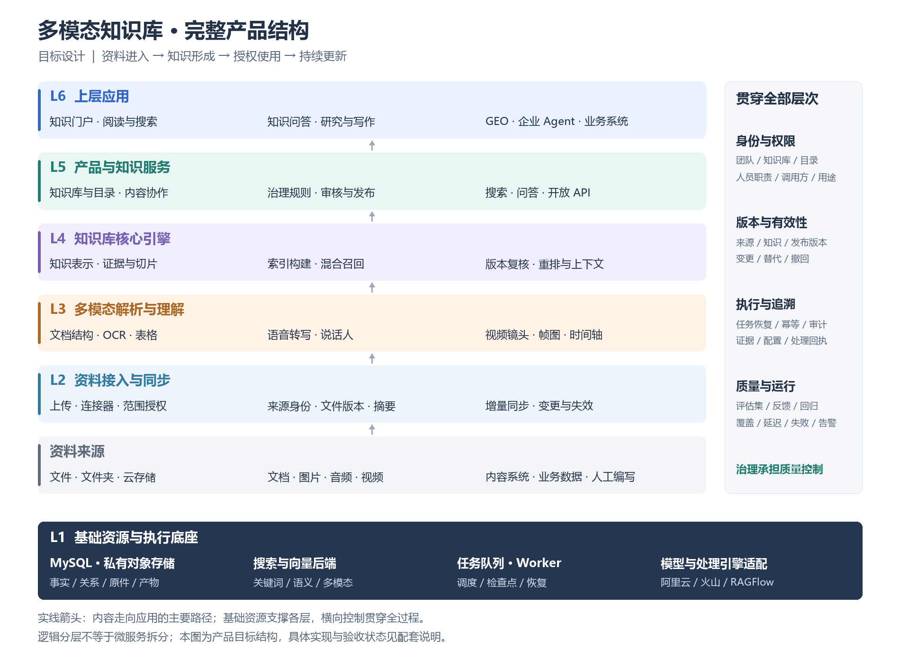
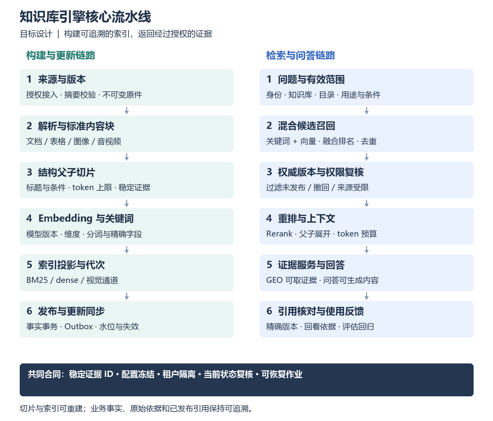

# 多模态知识库引擎产品与技术完整方案

版本 2.0  日期 2026年11月23日  状态 目标设计与技术选型建议

面向产品负责人、架构与研发团队、实施运维人员。本文将市场已有知识引擎能力与当前产品、数据模型及 GEO 接入经验结合，形成可用于产品评审、技术验证和研发拆解的完整方案。供应商事实以官方资料为依据；参数、容量和性能目标均明确标注为建议值，尚未完成本项目实测。

## 1 产品结论与总体路线

建议建设自有知识库产品与引擎控制层，复用成熟的解析器、Embedding 模型、搜索与向量后端。平台统一管理资料、证据、切片、模型配置、索引代次、检索策略、知识版本、发布和应用接口。用户可独立进行资料浏览、知识搜索和问答，治理流程控制知识质量及正式使用范围。

推荐生产目标路线为：**现有 Python 业务服务与独立 Worker，配合 MySQL、私有对象存储、可控的切片与向量化流水线，以及一个同时支持关键词和向量检索的后端。** 首个验证候选采用 Elasticsearch；模型和媒体解析优先复用阿里云现有资产。火山全模态能力与 RAGFlow 进入对照验证。最终部署版本、托管产品和模型须通过同一批资料与查询验证，不能把上游 Elasticsearch 的功能直接当成任意云托管版本均已支持。

选择该路线的工程理由是：本产品需要长期维护精确证据、条件版本、目录授权、媒体片段和 GEO 引用，可控切片及检索投影能减少供应商黑盒对这些合同的限制。检索后端不影响业务数据库与审核身份。若验证表明托管百炼或 VikingDB 已满足合同且能减少维护，也可作为首发后端接入同一标准接口。

实施顺序是：先统一资料与索引合同，再做可测量的检索引擎和搜索产品，随后接入问答、媒体和上层应用，持续验证增量更新与生产运行。现有治理、审核发布和独立调用方继续复用。

## 2 产品范围与用户使用方式

产品范围包含知识资产管理、接入同步、内容解析、切片与向量化、索引与检索、问答与证据服务、知识生命周期、应用开放以及质量运行管理。

用户面对的主入口为工作台、知识库、搜索、问答、整理任务、发布记录和应用接入。管理员设置连接器、引擎配置、模型、权限与运行策略；普通用户不需要知道向量维度、索引算法或云 pipeline ID。

支持三种使用方式：一是在知识库中阅读和搜索有权查看的原始资料；二是使用已发布知识搜索与问答，得到当前有效版本及引用；三是 GEO 等应用通过独立凭证调用检索或回答服务。三者共享知识身份和权限，但读取范围与信任等级不同。

通用平台提供扩展输入输出合同、版本、验证、执行范围与审计。行业算法、报价公式、内容策划等由业务扩展或应用承担。本方案没有将具体业务批准、任意计算引擎或费用账单列为通用产品前置条件。

## 3 市场知识引擎的分类与比较

### 3.1 比较方法

“知识引擎”应按层次拆解比较：平台负责完整工作流，框架负责组件编排，搜索或向量数据库负责检索执行，模型负责内容表征或排序。它们可以组合，不能用“选 RAGFlow 还是选 Milvus”替代整套架构决策。

能力核对日期为2026年11月23日。下面只记录官方资料可支持的事实和本项目的工程判断，不给未经实测的准确率、性价比或综合评分。

| 类别与候选 | 官方可核对能力 | 本项目建议位置 | 需要验证的合同 |
| --- | --- | --- | --- |
| 托管平台 阿里云百炼 | 文档、表格、图片和音视频知识库类型 [S01] | 快速接入候选、模型与媒体服务 | 切片导出、稳定映射、过滤、片段发布及删除 |
| 托管平台 火山全模态知识库 | 音视频切片、转写和画面总结等流程 [S03] | 视频对照与托管后端候选 | 当前版本规格、证据时间轴、索引投影与授权 |
| RAG 平台 RAGFlow | Parser、Chunker、Indexer、检索和重排配置 [S04][S05] | 可自管的解析与检索适配候选 | 固定版本 API、切片/定位导出、资源和更新行为 |
| 应用平台 Dify | 知识流水线、父子切片、向量/全文/混合检索及应用连接 [S07] | 业务应用编排或对照平台 | 不形成另一套事实权限；商业部署条款与版本 |
| 开发框架 LlamaIndex | 摄取转换、节点、父子关系、句子窗口与检索组件 [S08][S09] | 可选组件实现与快速验证 | 对象映射、依赖版本、不可变快照与错误处理 |
| 开发框架 LangChain | 文本切分等组件集成 [S10] | 可选适配器与应用工具编排 | 不将框架自带内存状态当业务事务状态 |

RAGFlow 需要特别核验版本：历史发布记录称 v0.21.0 引入视频解析 [S06]，而本次查看的 1.0.0 Parser 页面写明当前面板没有独立 Video 类别 [S04]。这说明“历史功能声明”“当前面板”和“本项目具体部署”不能相互替代。视频在本方案中具有独立处理合同，不能仅凭历史记录宣称 RAGFlow 已满足全部视频需求。

阿里云 AddChunk 文档明确其不支持 multimedia 知识库切片新增 [S02]。因此审核后的任意视频片段不能预设可通过该接口直接写入；需要验证片段文件导入，或采用自有正式文本索引并关联平台媒体证据。

### 3.2 检索底座比较

| 底座 | 可核对能力 | 适用判断 | 本项目的代价或限制 |
| --- | --- | --- | --- |
| Elasticsearch | 全文与向量混合检索、RRF、kNN 过滤 [S11][S12] | 首个验证候选；适合同时做资料搜索、条件筛选和语义搜索 | 验证云版本、功能许可、中文分析器与向量索引内存 |
| Milvus | 多类向量索引，文档列出原生 BM25 全文搜索 [S13][S14] | 向量负载或检索规模提升时的候选 | 运维拓扑、标量过滤、全文分析与备份按版本验证 |
| Qdrant | 混合多阶段查询及多租户组织方式 [S15][S16] | 自管向量服务与按租户隔离的候选 | 原生文本能力、稀疏生成方式和字段索引需逐版确认 |
| PostgreSQL 加 pgvector | 关系查询加向量近邻，HNSW 和 IVFFlat 及迭代扫描 [S17] | 已有 PostgreSQL 团队的小规模整合选择 | 当前事实库是 MySQL，引入它不是零新增数据库；过滤后召回数量需实测 |
| 百炼或 VikingDB 托管检索 | 提供知识库检索与媒体链路 [S01][S03] | 通过合同验证后可减少底层维护 | 切片和模型控制程度、数据导出及供应商映射 |

市场能力在变化。不能继续沿用“Milvus 只支持向量、不支持全文”或“只要有向量数据库就无需关键词检索”的简单判断。选型以目标版本中的完整查询执行计划为准。

### 3.3 三种集成深度

完全托管模式将解析、切片、向量和检索交给供应商，平台保留身份、证据映射与正式使用门禁；只有能导出所需定位和稳定 ID 时才适用。

推荐的组合模式由平台管理规范化内容、证据、切片、模型与索引配置，复用云模型及成熟检索引擎。平台可以独立切换解析器、模型或检索后端，也能做逐阶段质量分析。

完整私有化模式使用自管解析器、Embedding、Reranker 与搜索服务，适用于明确的数据驻留和运行要求；其容量、GPU、升级与恢复由部署团队承担。先交付一个通过验证的组合，避免首期维护三套并行事实系统。

## 4 完整架构与边界



图1 产品结构。底层资源支撑接入、解析、知识引擎及应用服务；权限、版本、审计与质量贯穿所有层。此图描述目标职责，不表示全部能力已实现。



图2 引擎核心链路。构建链路产生可追溯索引，查询链路把问题转成经过授权的证据和回答。

平台分为业务控制、引擎执行和应用消费三个部分。业务控制负责空间、资料身份、版本、授权和正式生命周期；引擎执行负责解析、切片、Embedding、索引、召回和证据上下文；应用消费负责门户、搜索、问答、研究和 GEO 等。

首期采用模块化业务服务加独立 Worker。可将查询执行与业务 API 部署在同一应用，转码、模型推理和索引作业按资源需要独立运行。职责分层不要求拆成大量微服务。

## 5 数据对象与统一内容模型

资料、文本、证据、切片和向量分别保存。稳定链路为资料身份、来源版本、解析产物、规范化内容块、证据单元、检索切片、向量记录、索引代次、知识版本、发布和应用引用。

规范化内容块包含类型、标题路径、阅读顺序、文本、语言、页码或时间、表格结构、图片引用、原始定位及处理版本。内容块 ID 在特定解析产物内稳定；换解析器生成新产物，通过关系映射旧定位，不修改旧证据。

证据单元是可核对依据，检索切片是召回优化视图，向量是某个模型对特定文本或媒体的表示。重切片可以产生新 chunk_id，但 evidence_id 和已经发布的引用保持原语义。一个切片可以关联多个证据范围，一条正式知识也可以关联多份资料。

平台同时容纳文件来源和人工编写知识。人工内容保存作者、版本、修改和审核记录；AI 起草标明派生性质，不能虚构外部出处。摘要用于导航或召回，不自动替代原文证据。

## 6 数据接入与增量同步

连接器统一输出上游资源身份、可读范围、版本标识、内容摘要与游标。支持文件/文件夹上传、对象存储、经授权网页或内容系统、结构化记录及应用提交。具体连接器按需求交付，不把枚举名称当现成集成。

导入步骤为范围授权、发现资源、下载或读取、摘要验证、登记来源版本、写对象存储、触发流水线并回写结果。新数据、内容变更、路径变更、上游删除和授权变化分别处理。临时失联不能当删除，文件同名不能当同一版本。

任务冻结来源、目录、用途及 pipeline_version。后台每个单元检查当前授权和租约，记录尝试、检查点与外部 job_id。外部提交结果未知时先核对状态，无法核对则记录未知并显式重试，不能无限重复消耗模型或生成重复资料。

增量以内容块和切片摘要判断可复用计算，复用边界包含租户、模型和处理配置。仅路径改变一般不需重新 Embedding，但授权或索引元数据可能需更新；内容改变只对受影响块重建，父摘要和正式依赖仍需复核。

## 7 解析与多模态内容处理

电子文档优先原生文本和结构提取，扫描页或复杂版面调用 OCR/视觉解析。输出保留页、段、表格、图片和阅读顺序，过滤重复页眉页脚时保留删除规则和原始对应关系。不能在“清洗”中删除否定词、型号、单位或适用条件。

Office 文件的原生结构和渲染页互相映射，原文件不改写。表格保留表头、单元格坐标、合并关系、公式及缓存值；计算作为独立扩展验证。图表需要同时保留图像、标题、坐标说明与机器提取结果。

解析质量门禁包括页数/时长一致、空页与无语音识别、文本覆盖、乱码、阅读顺序、表格断裂、坐标越界与产物摘要。失败、部分处理、无文本与不支持格式分别记录。用户可采用已核对范围，不要求失败资料被隐藏或整批停用。

解析适配器统一输出 blocks、artifacts、evidence、coverage、limitations 和 receipt。供应商原始响应保留受控副本，标准结果按 schema 校验，不能把任意模型 JSON 直接作为数据库事实。

## 8 切片策略与配置

### 8.1 推荐切片方法

采用结构优先的父子切片。先建立标题、章节、页、表格与时间段结构，再产生适合检索的子片段；召回命中子片段后，按授权、采用范围和上下文预算回取父级或邻接证据。LlamaIndex 的父子检索与句子窗口提供了可参考实现，但平台保持自己的 ID 与版本合同 [S08][S09]。

第一套建议配置中，普通中文文档子片段目标384 tokens，硬上限640 tokens，重叠48 tokens；父片段目标1536 tokens。它们是验证起点，不是行业最优值。Token 用所选模型的 tokenizer 计数，不能把一个汉字固定视为一个 token；Embedding 与生成 tokenizer 不同时分别检查上限。

| 内容类型 | 默认切分原则 | 保留的上下文与定位 |
| --- | --- | --- |
| 制度与说明文档 | 按标题段落，再按句子和 token 上限细分 | 标题路径、条件段、否定与例外、原文区间 |
| FAQ 与问答条目 | 一组问题和答案为基本单元 | 原问题、答案、分类与条件；不凭空生成批准答案 |
| 表格 | 表头加相关行，必要时按列组组织 | 单位、表头层级、脚注、单元格范围 |
| PPT | 一页或同一主题中的内容块 | 幻灯片号、图表和备注处理状态 |
| 图片 | 区域 OCR 与图像描述分别索引 | 图片/区域、识别稿和描述类型 |
| 音频与培训视频 | 先按语义句段或主题，必要时以时长限制细分 | 原时间轴、说话人、帧图和前后步骤 |
| 结构化记录 | 按业务记录或稳定字段组合 | 主键、字段类型、记录版本；聚合查询另走结构化工具 |

### 8.2 切片执行细节

切片不能只按字符截断。先把原文映射成结构块，保护数字单位、表头、型号、链接和步骤；再合并短块，分解超长块，生成父子和相邻关系。重叠来自同一不可变内容区间，不创建伪造的新证据。

对于表格，每个检索子片段携带必要表头和单位，但重复表头标为上下文，引用仍指向原单元格。对于流程说明，禁止把“仅在条件甲下执行”与后续动作分离；超过上限则建立上下文依赖关系，在回答前一并核对。

语义切片需要额外模型或相似度计算，作为复杂长文对照方案；普通文档先验证结构切片。固定长度切片保留作最低基线；句子窗口、标题层次和语义切片分别比较召回与定位效果，不默认所有文档叠加全部方法。

### 8.3 切片版本与可视化调试

每个 chunk 记录 chunk_profile_id、pipeline_version、parent_id、token_count、evidence_refs、normalized_text_hash 和 embedding_text_hash。用于 Embedding 的标题前缀与原文展示分开保存，不能把补充标题当原文摘录。

管理员可在样例文档上预览切片边界、父子关系、token 数及定位，再保存候选配置、评估、审核启用。新配置创建新索引代次，旧正式引用不变。运行中任务冻结旧配置，升级须显式发起。

## 9 Embedding 模型与向量化

### 9.1 模型候选与选型

首个云端文本候选为 text-embedding-v4，建议先用1024维，另测512/2048维的召回与容量；官方文档列出其维度范围及默认维度 [S18]。私有化文本候选 BGE-M3 的模型卡列出1024维及 dense、sparse、multi-vector 能力 [S19]。同为1024维的不同模型也不能混用一个查询向量空间。

图像和视频可以有独立多模态向量。文本摘要向量表达描述语义，视觉向量表达画面，不将两者简单拼接或求平均。只有模型声明处于同一对齐空间时才进行文本到图像/视频近邻检索；否则分路召回并在排序阶段融合。

模型比较关注中文、术语型号、短问题、长段落、中英混合、否定与条件、视觉独有信息和语言覆盖。公开榜单只能筛选候选，最终采用本项目已标注证据集，不把模型卡的提升百分比当平台效果。

### 9.2 向量记录与计算

向量配置冻结 provider、model_id、model_revision、dimensions、input_type、tokenizer、normalization、distance_metric 与文本模板。服务若不提供精确模型修订号，则记录部署标识、调用时间和测试指纹，标明可复现限制。

批量向量化按模型 token/条数和接口限制拆包，带租户级并发、重试退避和幂等键。记录每条成功/失败而非只记批次结果；成功向量与文本摘要必须核对，不能错位写入。缓存键包含租户范围、模型完整配置和输入摘要，禁止跨租户用摘要命中透露资料存在。

Embedding 模型只编码，不负责确定事实正确、版本有效或用户有权访问。过长输入先按结构重切，不能静默截断后宣称全片段向量化。用户查询按匹配的模型与 query 模板编码，按文档模型合同决定是否需要 query instruction。

### 9.3 度量与量化

Cosine 比较方向，内积同时受向量范数影响，L2 比较欧氏距离。归一化后的度量转换必须符合模型建议和后端实现；平台不能临时改变度量而继续复用旧索引。

首轮建立 float32 基线，再验证 float16、int8 或后端量化对召回、内存和时延的影响。量化降低占用但可能损失近邻精度，不能在无评估时默认启用；保留原始表征或可重算输入以支持重排与重建。

## 10 向量存储与索引设计

### 10.1 索引组织

MySQL 保存索引定义、版本关系、任务和权威状态；向量及倒排记录放入检索后端。按用途和模型空间分别管理资料索引、正式知识索引、文本向量索引和视觉向量索引。是否在一个后端物理索引中共存由其 schema 能力决定，业务合同不变。

建议物理命名模式为 tenant_scope、purpose、model_profile 与 generation 的受控组合，通过别名或平台路由指向 active generation。不要为每个文件建立独立索引；大租户或敏感空间可独立分区/索引，小空间共用时所有查询强制 scope filter，并验证绕过路径。

索引记录至少包含组织/知识库、chunk_id、parent_id、source_version_id、knowledge_version_id、publication_id、evidence_refs、目录 ID、用途、语言、知识类型、条件摘要、有效期、文本摘要和模型配置。权限元数据只是预过滤副本，最终状态仍由业务数据库复核。

### 10.2 近邻算法

小规模或高选择性范围先建立精确搜索基线，用它测 ANN 的召回损失。HNSW 作为首个 ANN 候选；M 与 ef_construction 影响构建及内存，ef_search 或对应候选扫描参数影响查询召回/时延。不同引擎参数名与实现不同，不直接复制配置。

候选验证网格可以从 M 为16/32、构建参数128/256、查询候选64/128/256开始，全部属于试验点，实际合法值以目标引擎版本为准。IVF/PQ 等方案在向量量级或内存压力明确时再比较；不把“支持算法更多”当采用理由。[S14]

严格目录/标签过滤会改变查询执行和召回数量。pgvector 的官方说明特别涉及过滤与迭代扫描 [S17]；其他后端也要测过滤选择性为1%、10%和50%时的数量、Recall 与 P95，不能只测无过滤相似度。

### 10.3 容量计算示例

容量以实际切片数和向量数量计算。假设100万条文本子片段、每条一个1024维 float32 向量，则原始向量为4.096 GB，约3.81 GiB；这不包含 HNSW 图、文本、元数据、倒排索引、副本、缓存与重建空间。两副本仅原始向量就约8.192 GB，实际资源须通过后端测量。

100小时视频若语义分段平均30秒，约产生12000个片段；若另以每秒一帧生成独立视觉向量，将有36万帧。二者是算例而非推荐全量帧向量化，说明媒体策略会显著改变容量。优先镜头/事件关键帧，样本验证后确定采样和片段表征。

上线规划还需计算原件、转码、帧图、转写、索引双代次重建、备份与保留期。容量指标不等于金额预算，本方案不扩展费用账单功能。

## 11 关键词与混合检索

关键词检索承担型号、编码、专有名词、数字和精准短语，向量检索承担改写、同义和语义关联。中文文档需验证分词器、领域词典、停用词、大小写、连字符和单位；型号原值建立 keyword 字段，不能仅依赖中文分词。

首版采用 BM25 加 dense 双路召回，标题、正文、关键词和结构字段设置可验证权重。BGE-M3 sparse 或其他稀疏模型作为额外对照，不把 learned sparse 与 BM25 当完全相同算法。Elastic 官方混合检索与 Milvus BM25 文档支持这一组合方向，但效果需本地验证 [S11][S13]。

融合优先采用 RRF，按各路排名贡献累加，避免直接相加不同量纲的 BM25 与 cosine 分数。RRF 平滑常量可先取60做基线；其值、路由权重和候选深度进入 retrieval_profile。若目标托管后端不支持所需原生融合，可在平台按候选 ID 排名融合，避免绑定特定付费算子。

建议初始 dense Top60、BM25 Top60，合并去重后最多120个候选；先复核权限与版本，再取最多40条进入外部重排，最后按预算选择6至10条互补证据。候选数量是试验起点，不保证命中；有权限过滤损失时可在请求预算内有界补召回，并返回检索完整性状态。

## 12 查询编排与重排

查询入口先确定调用方、知识库、用途、日期与目录范围，再执行文本归一化、别名展开和必要问题分解。改写不能把否定句改成肯定，也不能把缺少的地区、型号或时间当作默认业务事实。

简单事实问题使用一次混合检索；需要比较的多对象问题可拆成有限子查询，分别保留证据覆盖；复杂研究问题允许多轮，但设置最大轮数、总候选和超时。跨知识库只合并分别授权的范围，不能建立隐式公共库回退。

重排候选可使用云端 Rerank 或私有 BGE reranker，模型卡提供后者的 cross-encoder 用法 [S20]。重排模型判断问题与片段相关性，不判断最终授权和事实真伪。候选在送出重排服务前已经完成敏感范围检查。

相关性阈值按模型、问题类型和评估集校准，不设全平台统一0.7等阈值。去重同时考虑重叠证据和相同正文，不把同主题但适用条件不同的版本合并丢掉。父片段展开时再次检查是否整个范围都被采用和授权。

检索轨迹记录每一路候选 ID、过滤原因、融合排名、重排结果、最终上下文、模型配置、索引代次和耗时，默认不把全部敏感正文写入运行日志。

## 13 上下文与问答生成

上下文组装优先覆盖问题所需事实、条件和限制，然后控制重复与长度。资料标题、时间和条件用结构化包封装，资料中的指令视为不可信内容，不允许修改系统规则、调用工具或扩大授权。

建议首套16K上下文模型的测试配置为：系统与工具说明最多2000 tokens、历史最多2000、证据最多6000、输出保留2000，其余作为问题和长度安全余量。实际总预算以模型 tokenizer 和接口上限计算，不将上下文窗口填满当质量目标。

回答按声明或段落关联 evidence_id 和精确知识版本，支持出处跳转、适用条件及未覆盖范围。冲突未解决、关键条件缺失或没有足够证据时返回澄清或依据不足。不能用回答模型自由知识补成“来源已证实”的结论。

引用核对检查 ID 存在、版本有效、文字是否来自允许的证据和断言是否受到支持。纯字符串匹配只能发现错引，不能证明语义支持；重要场景需要独立标注样例与人工抽查。首期完整生成后再复核返回，流式输出另定义失效和部分响应语义。

会话保存当前问题和引用依赖，后续轮次重新核对权限与版本；会话摘要和生成答案不自动回写正式知识。允许用户提出修订和反馈，形成带来源的候选维护任务。

## 14 视频与跨模态检索专项

视频引擎输入原件和媒体配置，依次执行容器/编码预检、必要转码、音轨 ASR、字幕提取、镜头检测、关键帧/OCR/视觉理解、时间对齐、语义片段与证据索引。变速、剪切与转码保留到原时间轴的映射。

声音、画面、字幕分别记录处理覆盖。无语音不同于识别失败，低帧率采样完成也不能证明没有遗漏短暂动作。视觉独有内容的测试必须包含短时动作、无声画面和字幕/口播冲突，不能只用口播型课程验证视频能力。

第一组试验配置可使用15至45秒语义片段与镜头变化关键帧，在抽样对照中测试不同帧率；动作步骤不能为了时长截断。语音密集视频优先语义转写召回，画面密集视频启用视觉分路。真实上限由解析 API、模型和平台配额共同决定。

视频结果分为文本证据片段、关键帧视觉证据和可播放时间段。文搜视频可以依赖转写/描述，也可以使用对齐的多模态模型；图片搜片段只有在相应模型与索引启用并验收后开放。多帧向量与多向量交互是可选增强，不作为首版默认。

正式问答只展开已经采用的时间段和图像，不因片段命中而把整段视频送给模型。回放原件另查权限；受限片段采用裁剪或受控流媒体，不能给整文件 URL 再依赖前端播放器限制时间。签名链接的残留有效期与强制撤权需求分别设计。

## 15 高级检索能力的采用条件

GraphRAG、层级摘要、问题生成索引、长上下文检索、Agentic RAG 和结构化数据查询作为可选能力。只有标注问题集表明基础混合检索无法满足且增强有稳定收益时启用。

GraphRAG 适合实体关系或全库主题聚合问题。Microsoft 的项目文档描述实体关系、社区与报告等构建过程，项目自身也说明是研究性质实现 [S21]。在本平台，图中的实体、关系、摘要必须回到可授权证据，不能让社区摘要跨租户或把模型推断当批准事实。

结构化查询走只读连接、允许字段、参数化查询与执行限制，结果带查询时间和数据来源；快照知识与实时结果分开标识。业务计算通过登记扩展执行，其结果不因接入问答就省略独立验证。

默认先验证结构父子切片、BM25加dense、Rerank 和证据上下文。高级机制应有关闭开关、独立评估、执行轨迹和回退方案，避免算法叠加后无法解释结果变化。

## 16 元数据模型与存储演进

| 数据域 | 主要实体 | 保留或新增 |
| --- | --- | --- |
| 空间与授权 | 团队、知识库、目录、职责、ACL、调用方 | 保留现有技术 organization/project 映射 |
| 来源与对象 | source_asset、source_version、location、storage_object、connector、cursor | 兼容旧版本，新增大文件与连接器关系 |
| 内容与证据 | processing_run、artifact、content_block、evidence_unit、coverage | 文本证据沿用，新模态与标准块新增 |
| 切片与表征 | chunk_profile、chunk、chunk_evidence、embedding_profile、embedding_record | 引擎增量实体，明确模型空间与文本摘要 |
| 索引与同步 | index_definition、generation、binding、projection_job、watermark | 新增投影生命周期与代次管理 |
| 知识与发布 | general_knowledge_version、审核、publication、withdrawal、baseline、Outbox | 保留原发布与审计事实 |
| 应用与质量 | retrieval_profile、retrieval_request、answer、citation、feedback、evaluation_case/run | 已有调用方基础，补完整引擎与问答记录 |

所有跨实体引用验证同租户/知识库归属，关键关联使用复合外键或等价约束。目录 ID 与可变路径分开，旧发布保留冻结目录依据，当前权限仍可限制历史内容。

Embedding 表的逻辑唯一键包含 tenant、chunk_id、embedding_profile 和 input_hash；索引绑定唯一键包含 generation、projection_key。模型维度是 profile 的不可变字段，新维度生成新字段/索引代次，禁止直接修改旧字段。

当前 `LocalSourceVersion.original_bytes` 非空，MySQL 映射为 MEDIUMBLOB，且 `CatalogAsset` 与单个来源版本绑定。本次演进先加 object_ref 存储模式和逻辑资料版本链，再迁移原件引用；保留旧 ID、字节和发布证明，不能把大视频继续双写入 BLOB。

MySQL 保存业务元数据、关系和状态，较大的规范化文本、原始响应与向量可重建输入放对象存储并保留摘要。会话、生成答案和评估样例不塞进原始资料正文列。旧任务 JSON 快照保持不变，新规范化实体服务查询与执行。

## 17 引擎接口与配置合同

### 17.1 服务能力

| 接口能力 | 输入核心字段 | 输出核心字段 |
| --- | --- | --- |
| 接入与处理 | 来源版本、范围、pipeline_profile、幂等键 | run_id、逐项状态、产物与覆盖 |
| 切片预览 | 样本、chunk_profile、tokenizer | 父子片段、token 数、证据定位 |
| 索引构建 | 已授权投影、generation、profile | job_id、水位、成功/失败与映射 |
| 检索 | query、knowledge_base_ids、scope、purpose、conditions、profile | hits、版本、证据、状态、trace_id |
| 问答 | 问题、会话、检索范围、answer_profile | answer、citations、clarification、依赖与限制 |
| 精确复验 | knowledge_version、publication、evidence_refs | 当前有效性、允许内容或拒绝原因 |
| 变更同步 | consumer_id、cursor | 发布/替代/撤回事件与下一游标 |

以上是目标能力合同，具体路由在实施时与现有 API 版本对齐。现有关键词读取不是目标混合检索接口的实现证明。

### 17.2 检索结果示例

以下仅为结构示意，ID 均为占位值：

```json
{
  "request_id": "request-uuid",
  "status": "ok",
  "index_generation": "formal-text-g12",
  "retrieval_profile": "hybrid-parent-v1",
  "hits": [{
    "chunk_id": "chunk-uuid",
    "knowledge_version_id": "knowledge-version-uuid",
    "publication_id": "publication-uuid",
    "evidence_ids": ["evidence-uuid"],
    "locator": {"type": "time_range", "start_ms": 125000, "end_ms": 148000},
    "text": "当前允许返回的正式片段",
    "content_hash": "sha256-value",
    "requires_live_revalidation": true
  }],
  "trace_id": "trace-uuid"
}
```

对外不暴露未授权原文和云凭据；供应商分数用于诊断，不能解释成“事实置信度”。错误语义至少区分 unauthenticated、scope_denied、clarification_required、index_not_ready、retrieval_unavailable、partial_result 和 citation_not_effective；不把服务失败降级为无相关知识。

### 17.3 首套配置示例

下面配置为 PoC 起点，全部需版本化并通过验证后启用：

```yaml
profile: hybrid-parent-v1
chunking:
  strategy: structure_parent_child
  child_target_tokens: 384
  child_max_tokens: 640
  overlap_tokens: 48
  parent_target_tokens: 1536
embedding:
  model: text-embedding-v4
  dimensions: 1024
retrieval:
  dense_top_k: 60
  lexical_top_k: 60
  fusion: rrf
  rrf_constant: 60
  rerank_limit: 40
  final_evidence_limit: 10
  evidence_token_budget: 6000
controls:
  authoritative_revalidation: true
  raw_source_fallback: false
```

实际配置还必须冻结模型修订、tokenizer、距离度量、分析器、索引 generation、用途与超时，不在示例中省略就视为实现可省略。

## 18 发布一致性与索引更新

发布事务保存正式知识版本、证据采用范围、审核证明、审计和 Outbox。投影 Worker 把这些已确定状态转成索引记录，完成后核对内容摘要、绑定和水位。发布成功与搜索就绪分别显示。

任务采用 desired_revision 或等价序号，旧重试晚到不得覆盖新发布或复活撤回内容。后台写索引前后都核对作业代次与当前目标状态；未知结果通过 binding 和提供商查询核对。重复事件仅重复计算或写相同投影，不产生重复发布。

撤回先在权威数据库拒绝正式读取，再执行索引墓碑/删除、缓存失效和调用方通知。即使索引删除延迟，候选也不能通过最终复核。已经返回下游的字节只能通知和追踪处理，不能声称已远程销毁。

新 Embedding、切片或分析器用影子代次重建。记录重建开始水位，复制快照后追平增量，验证通过再原子切换路由；旧代次在回退窗口内继续接收必要失效信息，回切也不得恢复已撤回知识。

## 19 应用产品与 GEO 接入

搜索产品提供范围、类型、日期、条件、排序、片段定位和失败重试；问答产品提供多轮澄清、引用回看、反馈及当前有效性。原始资料搜索与正式知识搜索以明确模式区分，不把未审核材料悄悄混入正式回答。

GEO 使用独立调用方凭证，经显式租户/业务范围映射调用证据检索，再由其业务流程完成研究、策划和生成。EvidencePack 保留平台稳定知识版本、发布、证据、条件、摘要和实时复验要求；KB-001 等只作为当次显示编号。

本仓库保存的固定 GEO 审计表明旧路径曾直接读取百炼 kb/doc/chunk；现有 `geogrowth_consumer.py` 已有治理投影与不回退旧证据的语义。目标改造复用这些边界，认证按最新独立调用方合同对齐，不再要求安装内部治理 Agent。

GEO 缓存、生成结果与引用均记录依赖版本，使用前复核，撤回通过变更游标同步。平台故障时不能回退未治理原始云片段。应用提交材料只进入候选，读取凭证不自动获得写入/审核/发布权。

## 20 部署可靠性与观测

首期建议运行单元为业务 API、可独立扩展的查询执行、通用 Worker、媒体 Worker、MySQL、私有对象存储和一个检索后端。查询 API 可以先与业务服务同进程，媒体转码按资源和隔离需要拆开；Redis 若采用，用于派发、限流和非权威缓存，不保存唯一业务状态。

模型服务按允许区域路由；替换供应商只有在同等数据授权和输出合同允许时执行，模型不可用不能静默换到另一地域或输出不同可信等级的内容。

缓存分为模型输入表征、候选 ID、原件短时访问和应用结果，分别设计生命周期。候选缓存带租户/用途/索引代次，使用时仍查权；默认不跨请求缓存最终正式回答。允许缓存时必须记录依赖与策略修订，不能以 TTL 代替撤权检查。

运行指标包括资料处理覆盖、积压、失败、转码/ASR/VLM耗时、Embedding吞吐、索引延迟、水位差、每阶段P50/P95、过滤损失、空结果、澄清和引用失效率。任务或查询的 trace_id 串联解析、模型、索引与业务审核，但默认日志不复制全量正文。

备份同时覆盖事实库、对象、模型/处理配置、映射和必要检索快照。恢复先验证权限与发布事实，再恢复或重建索引；数据库恢复到旧时间点时通过切流冻结和失效对账处理已撤回内容。目标环境必须演练，工具存在不代表演练完成。

## 21 评估设计与验收门槛

### 21.1 统一样本与实验

建议 PoC 使用约50份授权或合成资料和120个带标准证据的问题，覆盖电子文档、扫描件、PPT表格、图片、音频、培训视频、无声动作、混合语言、版本条件和异常文件。独立保留训练/调参样例与盲测问题，避免只为演示问题调优。

实验顺序为：固定长度 BM25 基线，结构切片 BM25，dense，hybrid，再比较 Rerank、父子展开和媒体通道。供应商对照分两轨：同切片/模型比较检索后端；托管端到端方案比较最终效果并注明内部配置不可等价控制。不能把不同模型与数据差异造成的提升归因于数据库。

### 21.2 质量和运行指标

| 项目 | 测量方式 | 建议验收方向 |
| --- | --- | --- |
| 解析与证据 | 标注页/表/时间段，核对文本、定位和覆盖 | 正式引用全部有合法定位；识别准确率与语义支持单独评价 |
| 检索质量 | Recall@20、nDCG@10、MRR，按模态与条件分组 | 候选起点为正例问题 Recall@20 不低于90%，由 PoC 冻结可执行门槛 |
| 回答质量 | 逐声明支持度、引用正确、条件完整、拒答 | 建议引用正确率不低于95%；高风险场景人工复核，不以模型自评代替 |
| 权限和失效 | 跨租户、越目录、未发布、撤回、来源撤权及旧缓存 | 固定测试集中越权或失效内容进入最终响应为零 |
| 检索性能 | 固定数据量和并发测 P50/P95及超时 | 首轮目标100万切片、10 QPS下含重排的证据搜索P95不高于2秒，需实测确认 |
| 问答性能 | 同模型、上下文与输出长度测完整响应 | 单独报告，不与检索时延混算；PoC后确定产品SLO |
| 一致性与恢复 | 重复/乱序/失联/租约过期/索引重建与回切 | 不重复发布，不恢复撤回内容，逐项可核对与重试 |

所有数值为拟议验收目标，尚未达成或测量。ANN Recall 还应相对同模型精确搜索测量，不能与“找到了标准答案”的任务 Recall 混为一项。统计同时报告样本数、正例/无依据比例、置信区间或波动，以及失败项清单。

### 21.3 选型决策方法

先执行稳定证据导出、租户隔离、正式投影、删除失效、版本冻结和恢复等硬合同验证，不满足者不作为正式链路。通过后可以按质量40%、可控与迁移25%、运行20%、资源效率15%形成比较表，权重是本项目建议，分数由实测填入，不预填排名。

## 22 与当前实现的差距及迁移

当前可复用资产包括来源与目录、规则生命周期、任务快照和 Worker恢复、文本证据、逐文件回执、人工采用/暂缓、审核发布、版本撤回、目录权限、独立调用方及部分交付/变更语义。历史设计仅作参考，现行状态以最近实施记录与代码为准。

当前关键词/ID读取尚不能证明混合检索、Embedding、向量索引、重排或通用问答已完成。视频时间轴、持续增量、标准化内容块、检索调试与质量评估均需要新增完整实现，不能把单个解析器或 API 接口列为产品闭环完成。

迁移依次增加对象引用与版本链、标准产物/证据、切片和模型配置、索引代次与绑定、检索服务和应用引用。原来源 ID、发布证明与审计保留；旧证据仅在可精确映射时桥接，不能批量伪造新定位。

旧 GEO 云切片先建立来源和租户映射，有原件的重新解析治理，只有旧切片的明确来源不完整。先影子查询和独立调用方验收，再按知识库切流。真实共享/GEO/接收端继续等待既定恢复通知，本轮不访问或切换这些环境。

## 23 分批交付与完成定义

| 批次 | 可评审交付 | 完成证据 |
| --- | --- | --- |
| A 合同与市场验证 | 证据/切片/Embedding/索引/查询schema，固定候选版本与对照报告 | 官方依据、原始响应、失败清单、硬合同与标注集 |
| B 文档检索引擎 | 对象存储兼容、结构切片、批量向量化、混合检索、索引代次 | 从原件到证据的独立查询，模型切换/重建/过滤对照 |
| C 产品搜索与问答 | 搜索界面、上下文、引用回答、多轮澄清、反馈和调试 | 用户路径、标准证据、无依据/冲突/权限回归 |
| D 音视频与应用 | 时间轴、跨模态通道、部分采用、GEO与应用适配 | 声画分开验收、媒体定位、独立凭证与撤回验证 |
| E 持续运营与生产 | 增量连接器、评估回归、容量和恢复、受控切流 | 目标环境SLO、备份恢复、重建回切与联合验收 |

每批分别记录源码实现、隔离工程验收、模型效果、实际部署和真实业务批准。上述完整目标不改变既有通用首版的历史验收范围，也不把特定行业算法或样本人工决定变成引擎开发前置条件。

## 24 关键风险与处理决定

供应商无法导出稳定切片和时间定位时，保留其解析能力并采用平台标准产物与自有索引。托管 API 不支持审核片段投影时，不把整段未审核媒体作为正式上下文。模型升级改变向量空间时建立新代次并影子验证。

权限后过滤导致召回不足时，提高可授权范围内的候选扫描并做有界补召回，不放宽授权。中文分词和模型术语效果差时，先增加精确字段、词典和评估样例，再决定模型微调。图检索、重排和多轮检索增加延迟时以逐阶段轨迹定位，按证据收益决定启用。

产品化部署前，逐项核对所选软件版本、模型服务、托管功能、商业再分发与多租户使用条款；不假定所有“开源”组件采用相同许可。这里是选型工作项，不是完成了法律合规结论。

## 25 官方资料与核对说明

资料查阅日期为2026年11月23日。能力描述采用官方文档，DEV页面、版本化页面、模型卡与历史发布记录可能不一致；实施时保存实际版本与接口响应。下列内容只作能力依据，不代表本项目已完成部署或性能验证。

- [S01 阿里云创建知识库](https://help.aliyun.com/zh/model-studio/rag-knowledge-base)
- [S02 阿里云 AddChunk 接口及音视频限制](https://help.aliyun.com/zh/model-studio/api-bailian-2023-12-29-addchunk)
- [S03 火山音视频知识问答核心流程](https://docs.volcengine.com/docs/vector-database-vikingdb/audio-video-knowledge-q-a-core-process?lang=zh)
- [S04 RAGFlow 1.0 Parser 配置](https://ragflow.io/docs/v1.0.0/configure_parser_component)
- [S05 RAGFlow 1.0 Chunker 配置](https://ragflow.io/docs/v1.0.0/configure_chunker_component)
- [S06 RAGFlow 历史发布记录](https://github.com/infiniflow/ragflow/blob/main/docs/release_notes.md)
- [S07 Dify Knowledge Pipeline](https://www.dify.ai/rag)
- [S08 LlamaIndex 摄取流水线](https://developers.llamaindex.ai/python/framework/module_guides/loading/ingestion_pipeline/)
- [S09 LlamaIndex 节点切分与句子窗口](https://developers.llamaindex.ai/python/framework/module_guides/loading/node_parsers/modules/)
- [S10 LangChain 文本切分组件](https://docs.langchain.com/oss/python/integrations/splitters)
- [S11 Elasticsearch 混合检索](https://www.elastic.co/docs/solutions/search/hybrid-search)
- [S12 Elasticsearch kNN 与过滤](https://www.elastic.co/docs/solutions/search/vector/knn)
- [S13 Milvus 全文 BM25](https://milvus.io/docs/full-text-search.md)
- [S14 Milvus 索引说明](https://milvus.io/docs/index-explained.md)
- [S15 Qdrant 混合与多阶段查询](https://qdrant.tech/documentation/search/hybrid-queries/)
- [S16 Qdrant 多租户](https://qdrant.tech/documentation/manage-data/multitenancy/)
- [S17 pgvector 官方仓库](https://github.com/pgvector/pgvector)
- [S18 阿里云 Embedding 与 Rerank 模型](https://help.aliyun.com/en/model-studio/embedding-rerank-model/)
- [S19 BGE M3 官方模型卡](https://huggingface.co/BAAI/bge-m3)
- [S20 BGE Reranker v2 M3 官方模型卡](https://huggingface.co/BAAI/bge-reranker-v2-m3)
- [S21 Microsoft GraphRAG 官方项目](https://github.com/microsoft/graphrag)
- [S22 阿里云 Elasticsearch 产品更新与版本](https://help.aliyun.com/en/es/product-overview/release-notes)

## 26 本轮交付与实现边界

本文、配套 Word、PDF 和结构图构成设计交付。源代码核对涉及 models、knowledge_consumers、geogrowth_consumer、knowledgehub_config 及当前服务依赖；现有数据库与 GEO 审计沿仓库记录引用，本次未重新证明线上状态。

本轮没有修改业务服务、迁移数据库、进行真实模型或视频试验、填写供应商实测排名、执行生产切流或替业务批准资料。首套参数、容量算例、验收目标和建议后端均为后续验证输入，实施状态单独记录。
